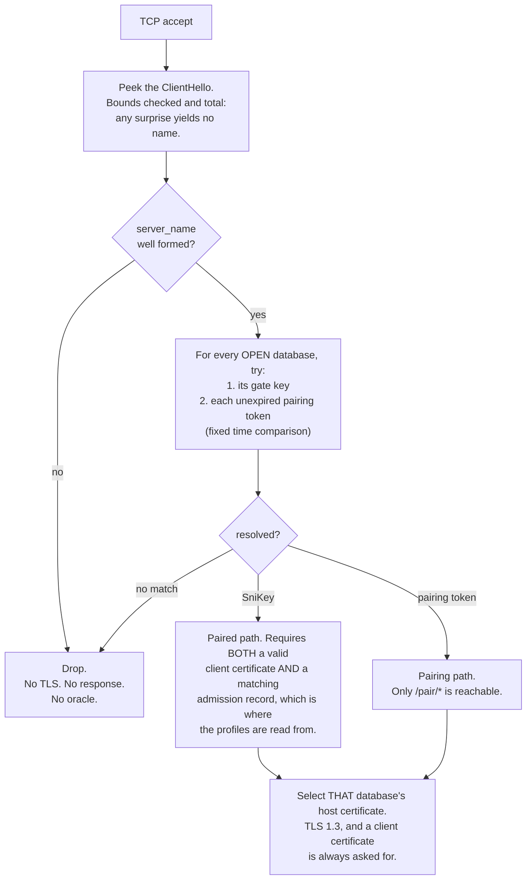
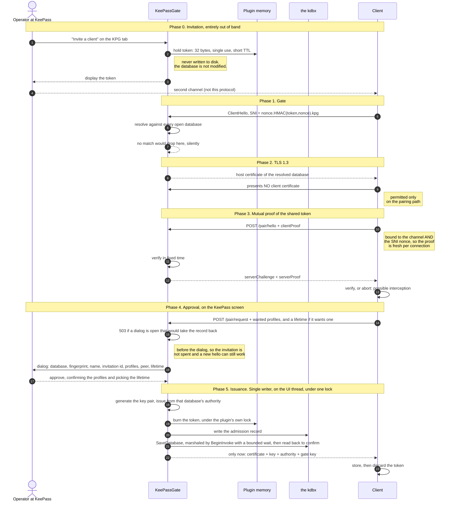
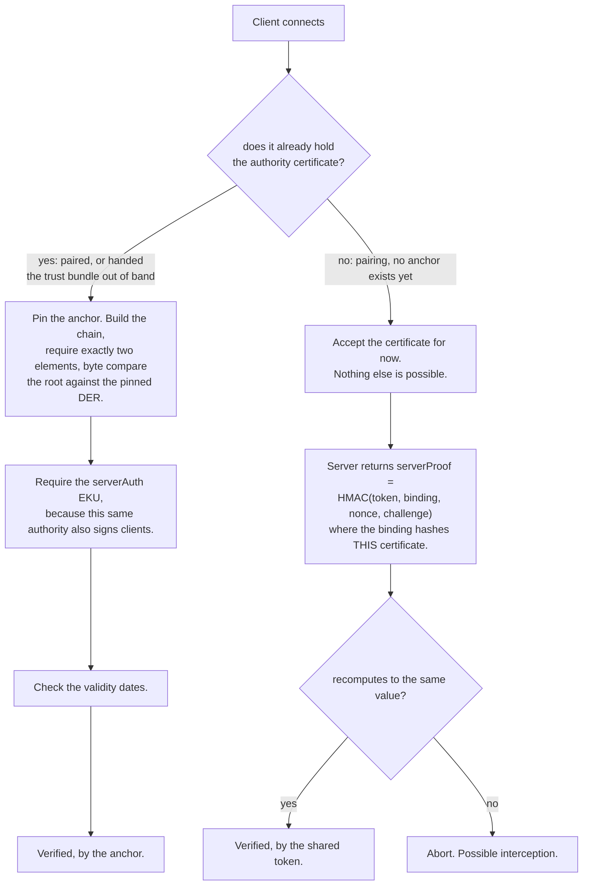
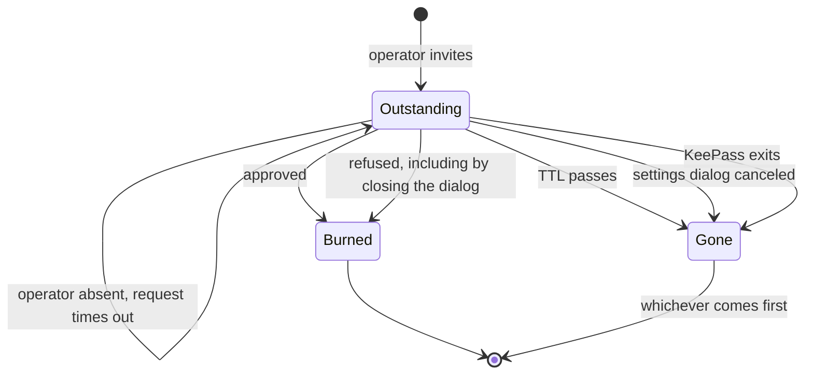
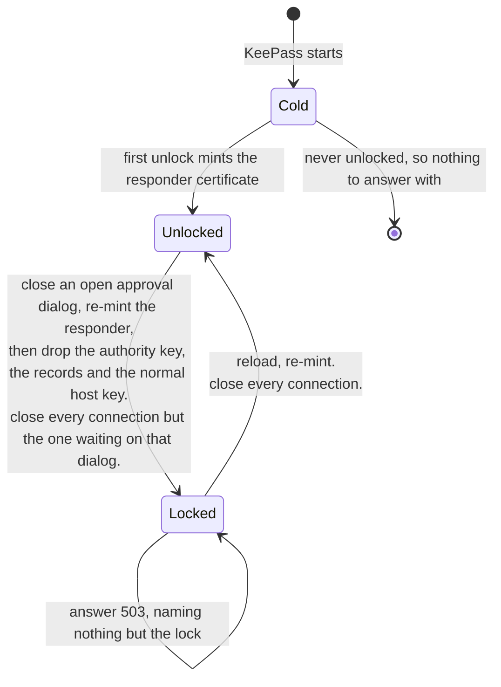

# Pairing

How a stranger becomes a client, and, in §312, how a client already admitted is given a new
certificate. [`CA.md`](CA.md) covers the authority this flow issues from,
[`DESIGN.md`](DESIGN.md) covers the transport it runs over, and
[`docs/pairing.md`](docs/pairing.md) is the same flow described to the person answering the dialog,
with the screens.

Every database carries its own certificate authority, so pairing is an act of **issuance** rather
than a key exchange. The flow exists to answer one question safely: may this stranger ask, and is
the thing it is asking actually us?

---

## 1. Four secrets, four blast radii §301

The reason pairing needs a credential of its own. Collapsing any two of these ties a routine act to
an expensive recovery.

| Secret | Who holds it | If it leaks |
| --- | --- | --- |
| Authority private key | nobody outside the host, protected by the kdbx encryption | mint any certificate for that database. Recovery is recreating the authority, which revokes every client at once |
| The gate key | every paired client, indefinitely, shipped in the trust bundle | an outsider reaches the TLS layer. Recovery is a rotation that re-keys the whole fleet |
| Pairing token | one invitee, briefly, over a second channel. **Plugin memory only, never written to disk** | an outsider may *ask* to pair. The operator still has to approve. Recovery is revoking it, or waiting for the TTL |
| Client certificate | one paired client, until it expires | whatever the record admits it to. Recovery is revoking that client from the KPG tab, which takes effect on its next request |

A prompt-injected agent is an intended consumer of this API and holds the gate key. That is
precisely why it must not also be the thing that authorizes pairing.

---

## 2. The gate, before any TLS work §302

The SNI is `nonce . HMAC(key, nonce) . kpg`, rebuilt for every connection, so a passive observer
never sees the same name twice. The server reads it out of the ClientHello itself, because .NET
Framework offers no server-side SNI callback.



Expired tokens leave the resolution set first, so expiry is indistinguishable from never having
existed.

**Asked for on every connection, and asked for here rather than by a setting.**
`GateTlsServer.GetCertificateRequest` sends a certificate request whatever the connection turns out
to be, so a client with something to show offers it and one with nothing completes the handshake
anyway and is served as a stranger, which is what the pairing path needs. Nothing about the
handshake decides what a client may do: that is `ClientCredentials` on the anchor pin and the
record, and the route table.

**Measured on the stack this no longer uses**, and one of the reasons it no longer uses it.
SChannel's `ClientCertificateRequired = false` makes the server skip the certificate request
entirely under TLS 1.3, so a client holding a good certificate never offers one, while `= true`
requires nothing, because a certificate-less client completes the handshake regardless. The plain
reading of that flag is the opposite of what it does in both directions, and under TLS 1.2 it
behaves as its name suggests, so testing there and shipping on 1.3 was a silent authentication
bypass. [`DESIGN.md`](DESIGN.md) §133 is why the TLS became managed code, which is what took the
flag out of this picture altogether.

---

## 3. The flow end to end §303



**A pairing connection is measured against a budget of its own, and so is a renewal's, §312.** Every
other connection has a fixed span from accept to the end of its request, which is what stops a peer
holding a thread by feeding it a byte at a time, and no deadline at all after that: what is left
there is a write and a save that no number bounds, so a deadline could only ever close the socket
while a write that is still going to land is landing.

Phase 4 blows through it on purpose, and by more than one wait. The operator is given two minutes to
read the dialog; a second pairing waits that long again just to get in front of them, since only one
is put to the operator at a time; the prompt waits a little longer than the dialog does; and the
write and save that follow have timeouts of their own. So the moment the request is off the wire,
the connection's deadline is set again to `GateOptions.PairingBudget`, which outlasts all of them
together: where every other connection's deadline is dropped at that point, a pairing's, and a
renewal's, is raised. **That is the whole of the difference**: their remaining work is a list of
waits somebody wrote down, so a number for it means something, where an ordinary write's remaining
work is a save of unknown length.

**Not when the name resolves**, which is earlier and asks for less. The reason for the longer
budget is that the connection is about to wait on a person, and a connection that has named an
invitation and sent nothing waits on nobody: granted there, one invitation would buy thirty-two
silent connections six minutes of the gate each, which is the harm the locked case is guarded
against, reachable all along against a database that was open.

Closing the socket underneath phase 4 does not stop the pairing, which is what makes this worth
saying. Everything after the dialog still happens: the certificate is issued, the invitation is
burned, and the record is written and saved. All that is lost is the answer, leaving a record on
disk for a certificate the client never received and cannot ask for again. That is the peer hanging
up, or its deadline running out. A lock is the other thing that closes connections, and it spares
this one: it closes the dialog as unanswered instead, nothing is issued or spent, and the client is
told `503 locked`, §308.

**One pairing is put to the operator at a time.** Two connections can reach phase 4 together, and
each asks the user interface thread to show a dialog. The second would open inside the first one's
modal loop, and a modal dialog disables every other window on its thread: the first request goes
gray in front of the operator, cannot be answered, and times out. The second one waits instead, for
as long as it was going to give the operator anyway, and answers `503 busy` if it never gets the
screen. Nothing is spent by that, so the invitee can simply ask again. The reference client does
so by itself when it is given a budget for waiting, starting again from the hello rather than
repeating the approval request alone.

**Nor is a dialog put up inside a save.** Showing it is a call marshaled to KeePass's thread, and
KeePass's save pumps that thread while it runs, so a dialog posted during one opened inside it and
held the save, the writer and KeePass's interaction block for as long as the operator took, which
also kept a workstation lock from locking KeePass. So the dialog is shown only once nothing is
saving. **A save this plugin is making for another client is waited for**: the request waits for it
within the same wait it has for the screen, and answers `503 busy` only if that wait runs out first.
**KeePass's own work is not**: its own saves, an import, XML Replace, a message box of its own, its
progress window, Database Maintenance and the dialogs that would take the record back are answered
`503 busy` at once, before the dialog and again just before it would be shown.

**The dialog does not take the focus, and no key approves it.** A client chooses when it comes up,
and the operator may be typing into KeePass at that moment, so a dialog that took the focus would
take the next keystroke too: a Tab, a word and an Enter meant for an entry were measured approving.
It comes up on top without being activated, and KeePass's taskbar entry flashes until the operator
clicks it. Once it has the focus, Enter and Escape refuse wherever the focus is, unless an open list
takes them first, and Approve has no mnemonic, is never the default button and comes after Refuse
in the tab order, so a click on it, or Space while it has the focus, is the only way to approve. The
renewal dialog, §312, is built the same way.

**The dialog says what approving a profile brings back.** Pairing writes the approved names onto
the database's list of profiles in the same write as the record, and that list decides which names
are in force (`DESIGN.md` §139). A name the database does not name now and no client holds is
marked "(new)", because approving adds it, and the dialog says that any rule already naming it
applies at once: a name removed once, whose every holder has since been revoked or has expired,
looks the same from a connection, which does not walk the tree to count rules. A name the operator
removed that other clients still hold is marked
"(removed)", and the dialog names those clients: approving puts the name back, every one of them
regains it through whichever certificate still holds it, and every rule still naming it applies
again. A client that renewed while the name was off the list regains it only through its older
certificate, until it gives that up, since the one it renewed to was recorded without the name.
Each client is named once, by its client key, `CA.md` §223, however many of its certificates hold
the name, and two clients that paired under one name are named apart, each with the start of its
client key as the clients page shows it.

**Every answer is written to the audit**, `DESIGN.md` §120, naming the invitation the request
arrived on: approved, with the admission key of the certificate it admitted, which is the new
client's client key as well, once the record is saved and before the bundle is handed over;
refused; or unanswered, those two naming no client. An approval that admitted nobody, because the
record did not land or the invitation was gone by the time the operator answered, gets no line,
and no line carries a profile.

**The client proposes how long its certificate lasts, and the operator picks.** A request may ask
for anything from a day to a year, and the dialog offers 1, 7, 30, 90 and 365 days under the
profiles, with the one asked for chosen already and marked "(asked)". One that is none of those is
offered as a choice of its own, in its place by length, rather than rounded to the nearest, because
the nearest is a certificate nobody asked for. A request asking for nothing is offered a year, which
is what every client was given before any could ask, so asking can shorten a certificate and never
lengthen one. The list drops down rather than standing open, and a closed list takes neither Enter
nor Escape, so both still refuse as they do everywhere else on the dialog, nor any letter, digit or
arrow, so no stray key changes the lifetime unless the list is opened. The profile list takes no
letter or digit either, so its checks change only by a click or by Space. `CA.md` §207 holds the
bounds.

Both proofs are bound to the RFC 5929 `tls-server-end-point` channel binding, which both sides
derive independently and which hashes the certificate actually in use. **It needs no interface from
the transport on either side**, because it is defined as a hash of the server's certificate: the
server has the one it chose, and the client has the one it was just sent. An earlier draft reached
for `TransportContext.GetChannelBinding`, which was necessary while `SslStream` terminated the TLS
and stopped being necessary when the transport became managed code.

---

## 4. How the client verifies the server §304

Hostname verification is gone, deliberately: the SNI is rebuilt every connection, so it can never
appear in the host certificate's SAN. A correct deployment therefore always reports both
`RemoteCertificateNameMismatch` and `RemoteCertificateChainErrors`, the second because the authority
is deliberately absent from every machine trust store. The client ignores `SslPolicyErrors` entirely
and reaches its own verdict.



Pairing ends by handing over the authority certificate, which is what promotes a client from the
right branch to the left one, permanently.

**Dropping the name is safe only because the authority is single purpose.** Hostname verification
exists to stop a certificate valid for one host being accepted for another under a *shared*
authority. This one issues for exactly one database, so any `serverAuth` certificate under it is
that database's host by construction. The EKU check closes the remaining gap, since the same
authority also signs client certificates.

**The client speaks first, and that is deliberate.** It sends its own proof before the server sends
one, so an impostor learns nothing and does no work until the caller has shown it holds the token. A
man in the middle does harvest a `clientProof`, but one computed over *its* certificate, which is
worthless against the real server whose binding is a different value.

---

## 5. What each phase is actually for §305

| Phase | Without it |
| --- | --- |
| 1. Gate | anyone who reaches the port reaches the pairing dialog, and dialog spam becomes a denial of service against the operator's own screen |
| 3. Client proof | a captured SNI can be replayed to raise dialogs. The proof cannot be forged without the token, so a replay dies here rather than in front of the operator |
| 3. Server proof | an unpaired client has no trust anchor and accepts whatever certificate arrives. An on-path attacker runs a fake pairing, issues its own certificate, and owns the client. The real KeePass never sees the connection, so nobody ever gets to refuse |
| 4. Approval | the token alone would be authentication, and a compromised second channel would be a compromised database |
| 5. Record, then issue | a certificate the database has no record of is a credential nobody can revoke and nobody can see. The record is checked on *every* connection, so losing it makes the certificate inert rather than invisible |

---

## 6. The token's whole life §306



The whole lifetime is in memory, under the plugin's own lock, so a burn cannot be reverted and a
race cannot double spend. A timeout does not burn the token, so an absent operator does not cost the
invitee their invitation. A refusal does.

**Closing the dialog is a refusal, not a timeout**, whether by the close box, by Alt with F4, from
the window menu or from the taskbar. An operator who dismisses the question has answered it, and the
answer a dismissal means is no: the invitation is spent and the program has to be invited again. Only
the countdown running out is a timeout, and that is the one case where the dialog closes itself
rather than being closed.

**The settings dialog an invitation was made on takes it back unless that dialog is accepted.**
The code is good the moment it is shown, so a program can pair before OK, but Cancel, or closing the
dialog any other way, withdraws it if nobody has used it yet. That is the dialog's OK and Cancel
meaning what they say for the one thing on the tab that the database does not hold. A code already
spent stays spent, since the record it led to is the database's and a revocation takes that back.

---

## 7. What an adversarial review changed §307

Four independent reviewers attacked an earlier version of this flow, each finding then put to a
separate reviewer told to refute it. One survived, and it needed no attacker at all.

That draft promised the admission record was *persisted before issuance* and that the token burn was
*atomic* with it. Neither is buildable in a KeePass plugin.

**The operator opens Tools then Database Maintenance to look at something.** That dialog copies the
database's own `CustomData` when it opens. While it sits there a client pairs: the admission record
is written and the token removed. The dialog closes, the stale copy is written back over the
database's, the record is gone and the single-use token is alive again. The client already holds a
working certificate. Nothing on screen says anything happened.

That is a defect in the store rather than in this flow, restated against a dictionary that now
holds a signing key.

- **The admission record became load bearing**, checked on every connection, with profiles read from
  it rather than from the certificate's SAN. A lost record now makes the certificate inert and the
  client pairs again. That is the only response that also survives the operator answering "Discard
  changes" on exit, which no amount of locking prevents.
- **Pairing tokens left the database entirely** and now live only in plugin memory. A token that is
  never in `CustomData` cannot be restored by a stale snapshot, which removes that half of the
  defect at the root rather than compensating for it. It also stops invitation creation from
  modifying the database, and lets the burn happen under a real lock, which `StringDictionaryEx`
  could never provide.
- **Issuance became a single writer on the UI thread**, saving synchronously and reading back to
  confirm, with the certificate handed over only after all of it succeeds.
- **The word "atomically" was dropped.** A sorted dictionary plus a file save cannot provide it. The
  property actually wanted is that a certificate without a matching record is refused.

The gate against a stale dialog tracks specific `GroupForm` instances through
`GlobalWindowManager.WindowAdded`. It must **not** gate on `WindowCount`. That number counts every
window KeePass registers, and nearly none of them copies anything: keyed on it, an about box left
open becomes a reason not to pair, and it still cannot answer the question actually being asked,
which is whether a dialog is open on *this* group. The plugin's own approval dialogs do not add
themselves to that manager, and one is the window certain to be open at exactly this moment, so a
count would also leave the guard at the mercy of one line added elsewhere in this plugin. Their
staying out is a decision of its own, §308: a dialog registered there holds every lock off, and one
a client can raise would let it keep KeePass unlocked with nobody at the desk.

**And it refuses when it is not watching, which is a separate thing from seeing nothing open.** The
first version answered "nothing is open" whenever its table was empty, which is also what it answers
when the watch never started or has been stopped. That is the fail-open direction on the one guard
this whole flow is built around: the dialog really is on screen, nothing noticed it, and the record
is written into a dictionary that is about to be overwritten. An empty table now only means anything
while the watch is running.

**Two cryptographic findings were raised but their refutation never ran**, so they are neither
confirmed nor cleared. The substantive one is that `tls-server-end-point` is a per-certificate
constant rather than a per-session value, so the proofs carried no freshness. Binding them to the
SNI nonce and adding a server challenge costs nothing and is folded into phase 3 above, and that is
what was built: the nonce the client chose makes the server's proof fresh to the client, and the
challenge the server chose makes the request fresh to the server.

---

## 8. When the database is locked §308

Locking closes the database, and with it the authority, the admission records and the gate key.
A **second host certificate**, minted at unlock and again at the lock it answers, held only in
plugin memory, is what lets a locked KeePass answer `503 locked` instead of failing at the
transport. Minted twice because its life has to cover the lock rather than the session before it,
and the lock is the last moment the authority that signs it is still there: `CA.md` §208 has the
dates and what they are worth.

| Held in memory | Unlocked | Locked |
| --- | --- | --- |
| Authority private key | yes | **dropped** |
| Admission records | yes | **dropped** |
| Host key, normal | yes | **dropped** |
| Host key, locked responder | yes | **kept** |
| The gate key | yes | **kept** |

**The `SniKey` has to stay resident too, or none of this is ever reached.** The gate resolves the
SNI before any TLS work, using a key that lives in the database. Drop it at lock and every
connection is refused at the gate with the responder certificate sitting unused. Of the three
secrets it is the right one to keep: it authenticates nothing, and every paired client already holds
it.



Pairing while locked is refused the same way: issuing needs the authority private key and the
admission write, and neither exists in this state.

**Both transitions close every connection, but for the one below, and unlock is the interesting
one.** Closing at lock is obvious: a socket thread must not be reading a database the UI thread is
closing, and that race needs a real gate because the lock fires on the UI thread. Closing at unlock
is about privilege. A connection that completed its handshake against the responder certificate was
authenticated against nothing, because validating a client certificate needs the authority, which
was not loaded. Letting it survive into the unlocked state would promote a connection to an
authority it never proved anything to.

**A lock closes an open pairing or renewal dialog as unanswered**, and its client is told `503
locked`. Neither dialog holds a lock off, since a dialog that did would let a client that raises one
after another keep KeePass unlocked, so every way KeePass locks can fall under one: its own
inactivity timer, Ctrl and L, a session lock or switch, a suspend, a minimize, a change of remote
control. All of them end in the same closing of the database, and that closes the dialog before
anything else happens, so it does not stand over a locked database offering an Approve that can do
nothing. The connections of pairings and renewals are spared when every other one is closed, and
answer for themselves: the dialog's, and any still waiting for the screen, which is never shown,
with `503 locked`, and one the lock caught before it asked, with `503 busy`, as a database that
cannot be written answers. Their deadline still bounds them. Nothing is written and nothing is
spent: an invitation is still good after the unlock, and a renewing client's old certificate still
works. **A lock lets go of every approval held for a retry**, §303, and a close of the database
does too, so an approval still waiting for a busy KeePass when the lock comes is answered `503
locked` at once and never written into the database the unlock opens again.

**An unlock that lifts no lock closes nothing**, which is a refinement the end to end tier forced
rather than a weakening. KeePass announces a database being opened and a database being unlocked
with the same event, so a KeePass starting with a database on its command line raised an unlock
while a client was already connecting, and killed a handshake that had never seen a responder. The
privilege argument only applies where there was a responder to be promoted from, so the close
follows a lock actually being lifted rather than the event that announces both.

**A database closed for real closes every connection too**, for the reason a lock does: a socket
thread must not be reading a database the UI thread is emptying. It closed none while the database
had never been locked, so a connection resolved before File > Close, or before KeePass closes every
database on exit, ran on to its deadline against a database with nothing left in it.

**The responder is minted when the database opens, not when a connection arrives.** Minting it
lazily looks equivalent and is not: a database nobody happened to connect to between an unlock and
the next lock would have nothing to answer with, which is the exact failure the responder exists to
remove.

**And every open database is read again just before a close or a lock**, because that is the last
moment it can be read and a lock answers out of what was read last. Without it, whatever changed
with no connection to notice was invisible to the lock: a Save As moved the file out from under what
the lock matches on, an authority created on the KPG tab had nothing to answer with, and one deleted
there went on being answered for.

---

## 9. What is on the wire §311

Built in step 8, and small enough to state completely. Two routes, reachable only on a connection
that arrived on an invitation and presented no certificate the database admits. Any other is refused
the way an undeclared path is: `404 no such route` to a client the database admits, and
`401 unpaired` to anybody else. This used to be a plain `404` for everybody, on the argument that a
paired client had no business learning that these exist; they are declared in a document that ships
inside the plugin, so their existence was never the secret, and what is kept instead is that a
caller which may not use a route is refused as it is refused everywhere.

Bodies are one flat JSON object of strings and arrays of strings, read strictly: nesting, numbers,
booleans, `null`, a repeated name or anything after the closing brace is not a body, it is a
refusal. Binary travels as base64.

```text
POST /pair/hello
  { "proof": "<HMAC-SHA256(token, "kpg-client-proof" | binding | nonce)>" }
->  200 { "challenge": "<32 bytes>",
          "proof": "<HMAC-SHA256(token, "kpg-server-proof" | binding | nonce | challenge)>",
          "expires": "<when the challenge stops being usable>" }

POST /pair/request
  { "name": "agent-fictitious",
    "profiles": ["ops"],
    "lifetime": "P30D",
    "proof": "<HMAC-SHA256(token, "kpg-request-proof" | binding | nonce | challenge | asked)>" }
    asked = name "\n" profiles joined by "," "\n" lifetime, or nothing after the second line break
->  200 { "identity": "<PKCS#12: the certificate and its key>",
          "authority": "<DER: what to pin from now on>",
          "gateKey": "<32 bytes: what to name every later connection from>",
          "subject": "CN=agent-fictitious",
          "profiles": ["ops"],
          "expires": "...", "database": "..." }
```

Every part is length prefixed before it is signed, so no two different sets of parts produce the
same bytes, and each proof carries its own label, so none of them can be replayed as another.

**`lifetime` is optional, and signed for whether it is there or not.** It is an ISO 8601 duration
of whole days from one to 365, in one spelling: `P`, the number with no leading zero, and `D`.
Anything else is `400 malformed`, refused by the document's own pattern before the challenge is
taken, so nothing is spent. The proof covers the text as it arrived, and an empty line when there
is none, so a lifetime added on the way, taken off it or changed is a request that no longer proves
itself, and the operator is never shown a lifetime nobody asked for.

**The exchange spans two connections**, because this transport answers one request per connection
and closes. The challenge is what carries it across: it is held on the invitation in memory,
together with the binding and the nonce it was issued against, and it is spent the moment it is
taken. So a request has to follow a hello that really happened, on a connection served with the same
certificate, and a second hello takes the first one's challenge away rather than running beside it.

**So a request spends its challenge, whatever it is answered.** A request that names something
that could be issued, on an invitation that is still there, takes the challenge its hello left, and
every answer after that leaves nothing for a second request to follow: trying again means a new
hello, which the invitation allows for as long as it is not spent. Where the table below says that
nothing is spent, it means the invitation. A hello whose proof fails spends nothing at all, and
nor does an answer given before a request is read.

What a refusal says, and deliberately no more:

| | |
| --- | --- |
| `401 unpaired` | the connection did not arrive on an invitation. Every route answers a caller the database does not admit this way, and nothing is spent |
| `404 no such route` | the caller is a client the database already admits, which has nothing to pair. Answered as an undeclared path is, and nothing is spent |
| `401 proof` | the proof did not verify. No dialog was raised and nothing was spent |
| `409 no exchange` | there was no hello, or it was answered by a different certificate |
| `409 no invitation` | it was spent or it ran out between the gate and here |
| `400 name` / `400 profile` / `400 malformed` | it could never have been issued as asked |
| `403 refused` | the operator said no, and the invitation is spent |
| `504 unanswered` | nobody was at the screen. **Nothing is spent** |
| `503 busy` | a dialog is open that would take the record back, KeePass is part way through a save, an import, a synchronize, an export or a message box of its own, or shows its progress window for one such as XML Replace, saving the database would stop to ask the operator something, such as what to do about a file on disk that is not the one KeePass read, another pairing or a renewal is already in front of the operator, a save this plugin is making for another client outlasts the wait for the screen, or there is no screen to ask; or the operator approved and KeePass was still busy a moment later, and then the body carries `heldUntil`, the moment the approval stops being held. **Nothing is spent**, and the client is never told which |
| `500 not recorded` | the operator approved and the record did not reach the disk. **The invitation is spent** |
| `500 internal error` | the operator approved and no certificate could be issued: the authority's key would not sign, or the authority has outlived its hundred years. **The invitation is not spent**, and the client starts again from a hello |
| `503 undecided` | the database holds more than one authority and the operator has not kept one. Answered before the request is read, as `503 locked` is, so **nothing is spent** |

The `503 busy` row is the one to be careful with. A caller learns that it should try later and nothing
about what is open on somebody's desk. **An approval KeePass is too busy to write is held rather
than lost**, which is the operator's ruling of 2026-10-14. The check made once the operator has
answered is asked again for as long as the `Retry-After` the caller would be told, so a save that
ends in a moment is written on the same connection. One that lasts longer is answered
`{"error":"busy","heldUntil":"<UTC to the second>"}`: the approval is kept in the plugin's memory,
beside the invitations, until the end of the pairing budget the request arrived in, and the same
request asked again before then, from a fresh hello as every pairing retry starts, is written
without the dialog. The same request is the same invitation, name, profiles and lifetime as
written; anything different is put to the operator again, since the gate makes the key pair itself
and nothing else is on the wire. Answering at once used to let a client retrying on busy put the
dialog the operator had just answered in front of them again.

**What it was approved against is compared at the write, under the writer's lock**: the authority
served, and for each approved profile whether the list holds it exactly as it did when the operator
answered, since the write would otherwise put a name back that was taken off in between. The
approval is used up there, and the invitation spent there, last, so nothing that can still answer
busy comes after the burn. **A lock, a close and KeePass exiting let go of every approval held**,
and one still settling when KeePass locks is answered `503 locked` rather than written into the
database an unlock opens again.

**Every `503` is raised before the invitation is spent, and that is what makes it honest.** The
dialog check and the wait for the screen both happen before the burn, so a caller that starts again
from a hello is retrying something that can still work. Once the invitation is burned there is no retryable
answer left: a write that fails after that point is a `500` however transient its cause was, because
the same code will be turned away at the name on its next connection and dropped without any answer
at all. Whether it was worth retrying goes to the operator's log, which is where somebody can act on
it.

**The two `500`s are not the same kind of thing, and only the status they share is.** A record
that did not land is this plugin failing partway through something it had started, and the
invitation is gone with it. `internal error` is a certificate that could not be issued once the
operator had approved: the authority's key would not sign, or the authority has outlived its hundred
years, which nothing refuses ahead of because nothing warns ahead of it either, `CA.md` §219.
Nothing was issued, so the approval is lost and the invitation is not.

**This replaces two refusals made before the dialog**, `500 expired authority` and
`500 expired host`, which answered a ten-year authority and a five-year host certificate running
out before anybody was disturbed. Issued together for a century, neither is a state a database
reaches while anybody is minding it, and a check for it would be code that never runs.

## 10. Renewing a certificate §312

A client that is already admitted asks for a new certificate with `POST /gate/renew`, and the
operator approves or refuses it on screen as they would a pairing. It is pairing's request with the
client already known: no invitation and no proofs, because the certificate on the connection is the
proof, and the router has checked that it chains, is current and has a record before anything here
runs.

```text
POST /gate/renew
  { "lifetime": "P30D" }          or {} to ask for nothing
->  200 { the bundle the pairing request answers with, for the new certificate }
```

**What the operator is shown is read from the record, not from the request.** Who is asking is the
name the record was issued under, with when it was admitted and when the certificate it holds now
expires, where the request came from, and the profiles its record holds that the database still
names, all checked. The operator may uncheck any of them and can add none: the new certificate is
never wider than the record. Unchecking narrows the new certificate alone, since the old record is
left valid with everything it held until the client gives it up, and the dialog says so. A name the
database no longer holds is not offered, and a line under the list says it is not carried over,
since a renewed record is written from the names on the list. The list is read again once the
operator has answered, so a name taken off it while they decided is not carried over either, and the
renewal never puts a name back on the list. The lifetime is a proposal, as on a pairing: preselected
among the presets when one is asked for, and a year when none is.

**Refusing can answer more than this request**, which is the operator's ruling. Refuse is a split
button. Pressing it refuses once, which keeps nothing, and so do Enter, Escape, the close box and
every other way of dismissing the dialog: a standing answer is given from the button's menu and from
nothing else. The menu, opened by its arrow or by Alt and Down, offers refusing once, in this
session, until a date, or forever, and until a date asks for a day from tomorrow to the day the
certificate it holds now ends, so on that day itself the choice is grayed out and says why. The
answer stands until the chosen day begins where the operator is, its first midnight on a day the
clocks fall back, and that moment is the `notBefore` a client is sent, in UTC. While a standing
answer stands, every renewal of that certificate is answered without the dialog:

- **In this session** is held in the plugin's memory, per certificate, as invitations are held, and
  goes when KeePass exits. Nothing of it is written to the database, since an answer about one
  session kept in the file would outlast it in every copy. It is answered `409 this session`, and a
  renewal asked after KeePass has started again raises the dialog.
- **Until a date** and **forever** are stored under `KPG.RenewalRefused.` and the certificate's key,
  `CA.md` §204. They are answered `409 too early` with `notBefore`, the moment from which the
  operator is asked again, and `409 forever`, for which pairing again is the way out. **If one
  cannot be written now**, KeePass busy or Database Maintenance open, it takes effect at once all
  the same, held in the plugin's memory as an answer about this session is, and the plugin's next
  write to that database that lands writes it with whatever that write was for, which is the
  operator's ruling of 2026-10-14. One that no write has taken when KeePass exits goes with it, and
  the operator is told so on the way out rather than only in the log.

**The operator can take any of the three back**, which is the operator's ruling on review 3: on the
clients page a client with a standing answer has its name in red, the row's tooltip and its
description to a screen reader name the answer, and the row's menu, opened by the right button,
Shift and F10 or the menu key, states it on a grayed first line and offers **Allow renewal** beside
**Revoke**. Allow renewal waits for the settings dialog's OK, as a revocation does: the stored
answer is taken away in the dialog's buffer and the session's in what the dialog holds of the
plugin's memory, so the red goes at once and the gate keeps refusing until OK, and Cancel leaves
the answer standing. The plugin holds one set of the session's answers, read by the handler and by
every clients page, so the page shows and lifts exactly what the gate answers from. Once lifted,
the next renewal raises the dialog again. An answer given on that dialog while the settings dialog
was still open, possible once an until-date has passed, is the later word and survives the OK.
Otherwise a standing answer ends as described: the session's with KeePass, the stored ones with
the certificate they are about, and every one with the authority recreated or deleted.

The database's answer is read before the session's. The dialog is raised only while neither
refuses, and a renewal waiting behind another of the same certificate is answered at once rather
than kept for a second dialog, so the two meet only when a merge brings a stored answer in from
another copy of the file. Then the stored one is what the client is told, since forever says that
only pairing again helps. A stored until a date says less there: once its day begins the session's
answer is told in its place, `409 this session`, so its `notBefore` is the moment the session's
refusal takes over rather than one from which the operator is asked again.

**Every answer is written to the audit**, `DESIGN.md` §120, against the certificate that asked and
the client key on its record, which the renewal leaves as it was: approved, with the key of the one
issued in its place once its record is saved; refused, with which of the four answers it got;
refused without the dialog, by an answer given before; or unanswered.

**The order is pairing's, kept exactly.** Refused with `503 busy` before anybody is disturbed while
a dialog would take the record back, asked again once the operator has answered, then issued,
written and saved, and only then handed over. Refused `503 busy` the second time, when KeePass is
still busy a moment after the answer, the approval is held, as a pairing's is, keyed by the
admission key and the lifetime as written, and the answer carries `heldUntil`: nothing is issued
yet, the audit has its line when the write lands, and the renewal asked again before then is
written without the dialog, **unless an answer refusing it stands by then**: a merge can bring one
in, and so can the dialog of a renewal of the same certificate that asked for another lifetime.
That answer is what the retry is told, as it would be told before any dialog, and the approval is
let go. What pairing asks again about its invitation a renewal asks about its
record: one revoked while the operator was deciding, or left behind by an authority recreated or
deleted in that time, is answered `401 unpaired` and nothing is issued. **And the write asks it
once more, under the writer's lock**, comparing the record with the one the operator approved, so a
revocation landing after the handler last read it, the client's own on another connection among
them, is found under the lock it was written under rather than overtaken. A renewal
waits its turn for the screen with every pairing, since one raised inside a pairing's dialog would
gray it out, and its connection is measured against `GateOptions.PairingBudget` from the moment its
request is off the wire, since what is left after it is the same list of waits.

**One renewal per certificate is in flight at a time.** A second renewal of a certificate whose first
is still being answered is told `503 busy` at once, before anything about it is read, and the first
stays in flight until its answer has been kept, the standing half included. So the dialog is never
raised twice for one certificate, and the next renewal after the first is answered meets whatever
the operator decided.

**The old record is left valid.** Nothing is revoked by a renewal: the client gives the old
certificate up itself with `DELETE /gate/certificate` once the new identity is stored, presenting
the old one, which is what the reference client does. So an answer lost on the way costs the
database nothing, since the old certificate still works and the client can ask again, and a record
a lost answer orphans expires and is pruned, or the operator revokes it from the clients page,
which lists both until then. It costs the operator the dialog a second time, which is why a client
waits on its socket for as long as `GateOptions.PairingBudget` before giving up on the answer, as
the reference client does for a renewal as for a pairing. What each refusal says is in the route's
own responses, [`openapi.yaml`](src/KeePassGate/Spec/openapi.yaml) §510.

**The new record is the same client.** It carries the client key of the record that asked,
`CA.md` §223, the digest of the certificate the client paired with, so the two records name one
client while both stand and every count of clients counts it once. Nothing is issued in two steps
and nothing is revoked by name: the operator's ruling of 2026-10-16 first had a renewal revoke every
other certificate under the same name once the client had shown it held the new one, and withdrew
that the same day, since a name is the client's own choice and two programs may share one.

## 11. What this deliberately does not defend §310

- **Local code execution as the user.** It reads the host key, a client's private key, the token as typed,
  and the clipboard the tab's copy button puts it on. Conceded everywhere in this design.
- **A compromised second channel.** Whoever holds the token may ask. That is what the operator's
  approval is for, and it is the only thing standing there.
- **A KeePass that has never been unlocked since starting.** No responder certificate has been
  minted yet, so the failure really is a bare connection error. Every later lock is answered
  with `503 locked`.
- **Two copies of one database open at once.** They share an authority and a `SniKey` and are
  genuinely indistinguishable, so the plugin refuses to serve and logs how many answered.
- **A spent exchange.** The name a client connects under travels in the clear and can be replayed,
  so whoever sees it can connect under it too and send a request of its own, which takes the
  challenge the client's hello left: the client's own request is then answered `409 no exchange`
  and begins again with a hello. That is all it can do. Without the token its proof fails, so no
  dialog is raised and the invitation is untouched.

Two consequences of holding invitations in memory, neither a defect but both easy to trip over.
**An invitation does not replicate**, so a client must pair against the host where it was issued,
even where two hosts serve the same database. And because the gate gives no oracle, **an invitation
lost to a restart looks exactly like an attack**: the connection is simply dropped. The client
library has to name that possibility, because nothing on the wire will.
