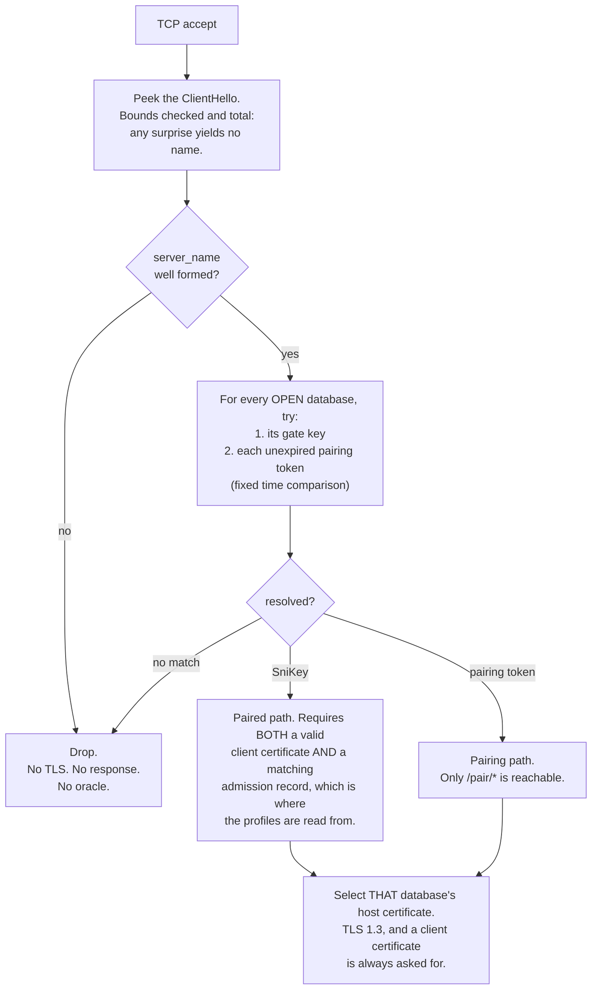
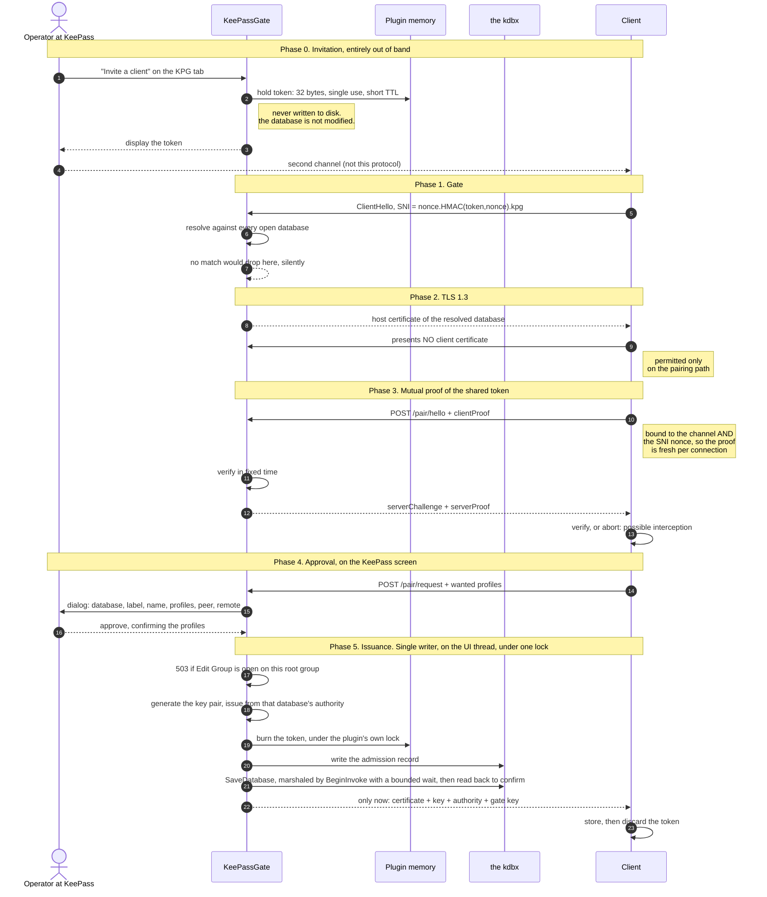
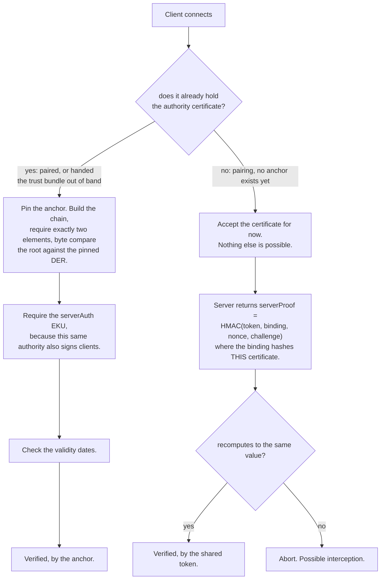
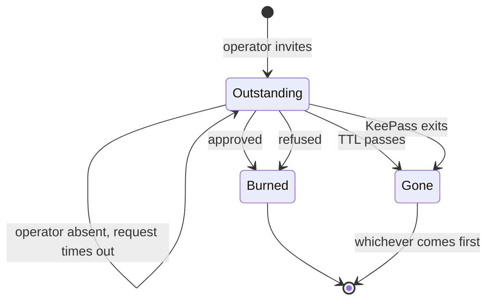
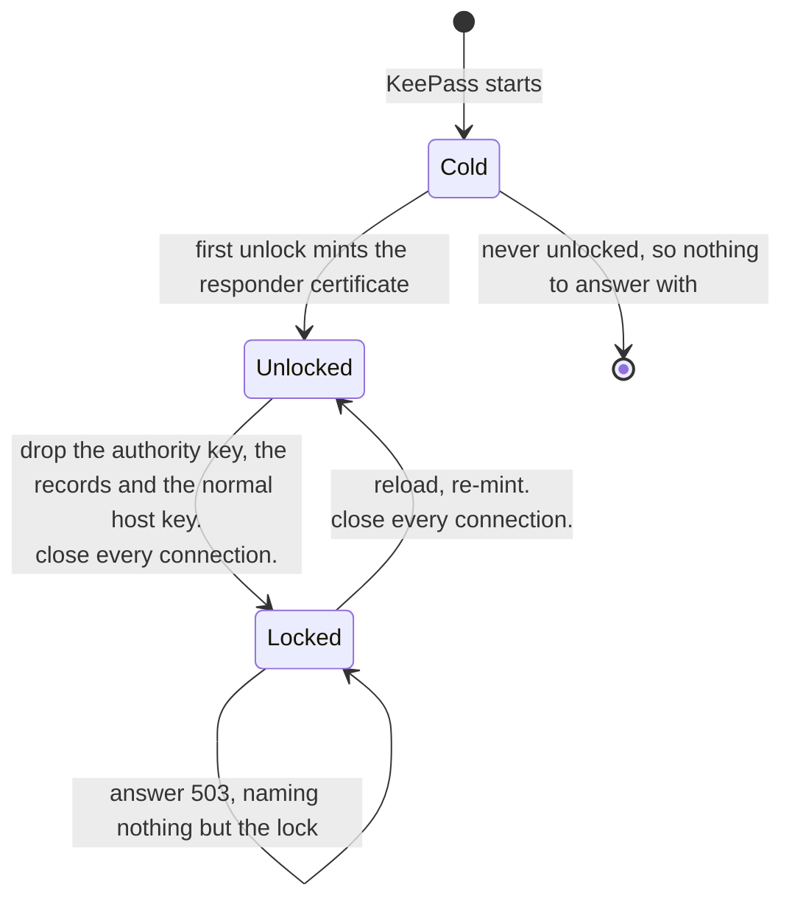

# Pairing

How a stranger becomes a client. [`CA.md`](CA.md) covers the authority this flow issues from,
[`DESIGN.md`](DESIGN.md) covers the transport it runs over.

Every database carries its own certificate authority, so pairing is an act of **issuance** rather
than a key exchange. The flow exists to answer one question safely: may this stranger ask, and is
the thing it is asking actually us?

---

## 1. Four secrets, four blast radii §301

The reason pairing needs a credential of its own. Collapsing any two of these ties a routine act to
an expensive recovery.

| Secret | Who holds it | If it leaks |
| --- | --- | --- |
| Authority private key | nobody outside the host, protected by the kdbx encryption | mint any certificate for that database. Recovery is recreating the authority, which revokes every client at once |
| The gate key | every paired client, indefinitely, shipped in the trust bundle | an outsider reaches the TLS layer. Recovery is a rotation that re-keys the whole fleet |
| Pairing token | one invitee, briefly, over a second channel. **Plugin memory only, never written to disk** | an outsider may *ask* to pair. The operator still has to approve. Recovery is revoking it, or waiting for the TTL |

A prompt-injected agent is an intended consumer of this API and holds the gate key. That is
precisely why it must not also be the thing that authorizes pairing.

---

## 2. The gate, before any TLS work §302

The SNI is `nonce . HMAC(key, nonce) . kpg`, rebuilt for every connection, so a passive observer
never sees the same name twice. The server reads it out of the ClientHello itself, because .NET
Framework offers no server-side SNI callback.

Expired tokens leave the resolution set first, so expiry is indistinguishable from never having
existed.

**Asked for on every connection, and asked for here rather than by a setting.**
`GateTlsServer.GetCertificateRequest` sends a certificate request whatever the connection turns out
to be, so a client with something to show offers it and one with nothing completes the handshake
anyway and is served as a stranger, which is what the pairing path needs. Nothing about the
handshake decides what a client may do: that is `ClientCredentials` on the anchor pin and the
record, and the route table.

**Measured on the stack this no longer uses**, and one of the reasons it no longer uses it.
SChannel's `ClientCertificateRequired = false` makes the server skip the certificate request
entirely under TLS 1.3, so a client holding a good certificate never offers one, while `= true`
requires nothing, because a certificate-less client completes the handshake regardless. The plain
reading of that flag is the opposite of what it does in both directions, and under TLS 1.2 it
behaves as its name suggests, so testing there and shipping on 1.3 was a silent authentication
bypass. [`DESIGN.md`](DESIGN.md) §133 is why the TLS became managed code, which is what took the
flag out of this picture altogether.

---

## 3. The flow end to end §303

**A pairing connection is measured against a budget of its own.** Every other connection has thirty
seconds from accept to answer, which is what stops a peer holding a thread by feeding it a byte at a
time. Phase 4 blows through that on purpose: the operator is given two minutes to read the dialog,
the prompt waits a little longer than the dialog does, and the write and save that follow have
timeouts of their own. So the moment the name resolves to an invitation, the connection's deadline
is set again to `GateOptions.PairingBudget`.

Closing the socket underneath phase 4 does not stop the pairing, which is what makes this worth
saying. Everything after the dialog still happens: the certificate is issued, the invitation is
burned, and the record is written and saved. All that is lost is the answer, leaving a record on
disk for a certificate the client never received and cannot ask for again.

**One pairing is put to the operator at a time.** Two connections can reach phase 4 together, and
each asks the user interface thread to show a dialog. The second would open inside the first one's
modal loop, and a modal dialog disables every other window on its thread: the first request goes
gray in front of the operator, cannot be answered, and times out. The second one waits instead, for
as long as it was going to give the operator anyway, and answers `503 busy` if it never gets the
screen. Nothing is spent by that, so the invitee can simply ask again.

Both proofs are bound to the RFC 5929 `tls-server-end-point` channel binding, which both sides
derive independently and which hashes the certificate actually in use.

---

## 4. How the client verifies the server §304

Hostname verification is gone, deliberately: the SNI is rebuilt every connection, so it can never
appear in the host certificate's SAN. A correct deployment therefore always reports both
`RemoteCertificateNameMismatch` and `RemoteCertificateChainErrors`, the second because the authority
is deliberately absent from every machine trust store. The client ignores `SslPolicyErrors` entirely
and reaches its own verdict.

Pairing ends by handing over the authority certificate, which is what promotes a client from the
right branch to the left one, permanently.

**Dropping the name is safe only because the authority is single purpose.** Hostname verification
exists to stop a certificate valid for one host being accepted for another under a *shared*
authority. This one issues for exactly one database, so any `serverAuth` certificate under it is
that database's host by construction. The EKU check closes the remaining gap, since the same
authority also signs client certificates.

**The client speaks first, and that is deliberate.** It sends its own proof before the server sends
one, so an impostor learns nothing and does no work until the caller has shown it holds the token. A
man in the middle does harvest a `clientProof`, but one computed over *its* certificate, which is
worthless against the real server whose binding is a different value.

---

## 5. What each phase is actually for §305

| Phase | Without it |
| --- | --- |
| 1. Gate | anyone who reaches the port reaches the pairing dialog, and dialog spam becomes a denial of service against the operator's own screen |
| 3. Client proof | a captured SNI can be replayed to raise dialogs. The proof cannot be forged without the token, so a replay dies here rather than in front of the operator |
| 3. Server proof | an unpaired client has no trust anchor and accepts whatever certificate arrives. An on-path attacker runs a fake pairing, issues its own certificate, and owns the client. The real KeePass never sees the connection, so nobody ever gets to refuse |
| 4. Approval | the token alone would be authentication, and a compromised second channel would be a compromised database |
| 5. Record, then issue | a certificate the database has no record of is a credential nobody can revoke and nobody can see. The record is checked on *every* connection, so losing it makes the certificate inert rather than invisible |

---

## 6. The token's whole life §306

The whole lifetime is in memory, under the plugin's own lock, so a burn cannot be reverted and a
race cannot double spend. A timeout does not burn the token, so an absent operator does not cost the
invitee their invitation. A refusal does.

---

## 7. What an adversarial review changed §307

Four independent reviewers attacked an earlier version of this flow, each finding then put to a
separate reviewer told to refute it. One survived, and it needed no attacker at all.

That draft promised the admission record was *persisted before issuance* and that the token burn was
*atomic* with it. Neither is buildable in a KeePass plugin.

**The operator opens Tools then Database Maintenance to look at something.** That dialog copies the
database's own `CustomData` when it opens. While it sits there a client pairs: the admission record
is written and the token removed. The dialog closes, the stale copy is written back over the
database's, the record is gone and the single-use token is alive again. The client already holds a
working certificate. Nothing on screen says anything happened.

That is a defect in the store rather than in this flow, restated against a dictionary that now
holds a signing key.

- **The admission record became load bearing**, checked on every connection, with profiles read from
  it rather than from the certificate's SAN. A lost record now makes the certificate inert and the
  client pairs again. That is the only response that also survives the operator answering "Discard
  changes" on exit, which no amount of locking prevents.
- **Pairing tokens left the database entirely** and now live only in plugin memory. A token that is
  never in `CustomData` cannot be restored by a stale snapshot, which removes that half of the
  defect at the root rather than compensating for it. It also stops invitation creation from
  modifying the database, and lets the burn happen under a real lock, which `StringDictionaryEx`
  could never provide.
- **Issuance became a single writer on the UI thread**, saving synchronously and reading back to
  confirm, with the certificate handed over only after all of it succeeds.
- **The word "atomically" was dropped.** A sorted dictionary plus a file save cannot provide it. The
  property actually wanted is that a certificate without a matching record is refused.

The gate against a stale dialog tracks specific `GroupForm` instances through
`GlobalWindowManager.WindowAdded`. It must **not** gate on `WindowCount`. That number counts every
window KeePass registers, and nearly none of them copies anything: keyed on it, an about box left
open becomes a reason not to pair, and it still cannot answer the question actually being asked,
which is whether a dialog is open on *this* group. The plugin's own approval dialog does not add
itself to that manager, and it is the one window certain to be open at exactly this moment, so a
count would also leave the guard at the mercy of one line added elsewhere in this plugin.

**And it refuses when it is not watching, which is a separate thing from seeing nothing open.** The
first version answered "nothing is open" whenever its table was empty, which is also what it answers
when the watch never started or has been stopped. That is the fail-open direction on the one guard
this whole flow is built around: the dialog really is on screen, nothing noticed it, and the record
is written into a dictionary that is about to be overwritten. An empty table now only means anything
while the watch is running.

**Two cryptographic findings were raised but their refutation never ran**, so they are neither
confirmed nor cleared. The substantive one is that `tls-server-end-point` is a per-certificate
constant rather than a per-session value, so the proofs carried no freshness. Binding them to the
SNI nonce and adding a server challenge costs nothing and is folded into phase 3 above.

---

## 8. When the database is locked §308

Locking closes the database, and with it the authority, the admission records and the gate key.
A **second host certificate**, minted at unlock and held only in plugin memory, is what lets a
locked KeePass answer `503 locked` instead of failing at the transport.

| Held in memory | Unlocked | Locked |
| --- | --- | --- |
| Authority private key | yes | **dropped** |
| Admission records | yes | **dropped** |
| Host key, normal | yes | **dropped** |
| Host key, locked responder | yes | **kept** |
| The gate key | yes | **kept** |

**The `SniKey` has to stay resident too, or none of this is ever reached.** The gate resolves the
SNI before any TLS work, using a key that lives in the database. Drop it at lock and every
connection is refused at the gate with the responder certificate sitting unused. Of the three
secrets it is the right one to keep: it authenticates nothing, and every paired client already holds
it.

Pairing while locked is refused the same way: issuing needs the authority private key and the
admission write, and neither exists in this state.

**Both transitions close every connection, and unlock is the interesting one.** Closing at lock is
obvious: a socket thread must not be reading a database the UI thread is closing, and that race
needs a real gate because the lock fires on the UI thread. Closing at unlock is about privilege. A
connection that completed its handshake against the responder certificate was authenticated
against nothing, because validating a client certificate needs the authority, which was not loaded.
Letting it survive into the unlocked state would promote a connection to an authority it never
proved anything to.

---

## 9. What this deliberately does not defend §310

- **Local code execution as the user.** It reads the host key, the client key and the token as
  typed. Conceded everywhere in this design.
- **A compromised second channel.** Whoever holds the token may ask. That is what the operator's
  approval is for, and it is the only thing standing there.
- **A KeePass that has never been unlocked since starting.** No responder certificate has been
  minted yet, so the failure really is a bare connection error. Every later lock is answered
  with `503 locked`.
- **Two copies of one database open at once.** They share an authority and a `SniKey` and are
  genuinely indistinguishable, so the plugin refuses to serve and logs how many answered.

Two consequences of holding invitations in memory, neither a defect but both easy to trip over.
**An invitation does not replicate**, so a client must pair against the host where it was issued,
even where two hosts serve the same database. And because the gate gives no oracle, **an invitation
lost to a restart looks exactly like an attack**: the connection is simply dropped. The client
library has to name that possibility, because nothing on the wire will.
