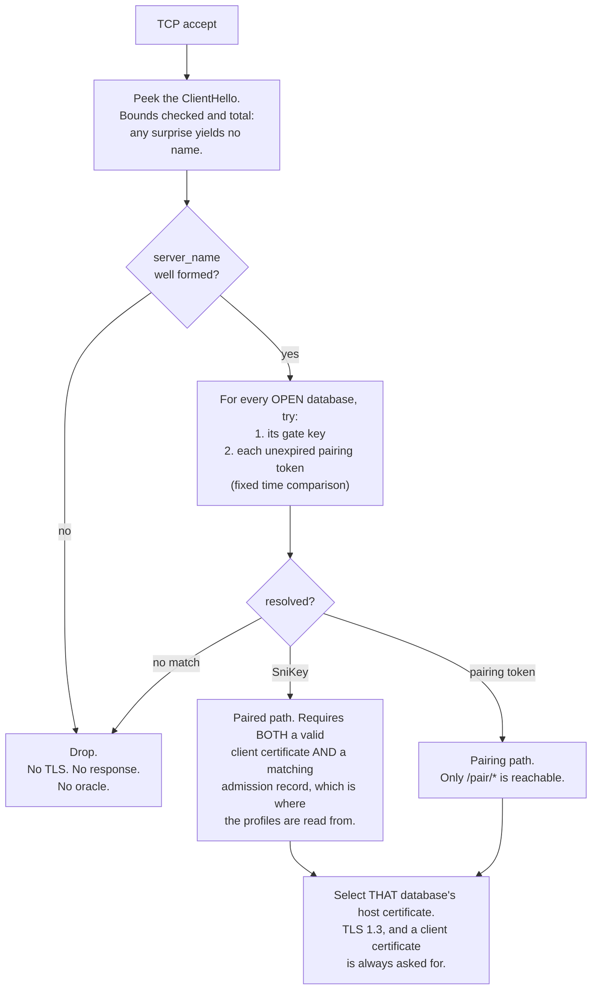
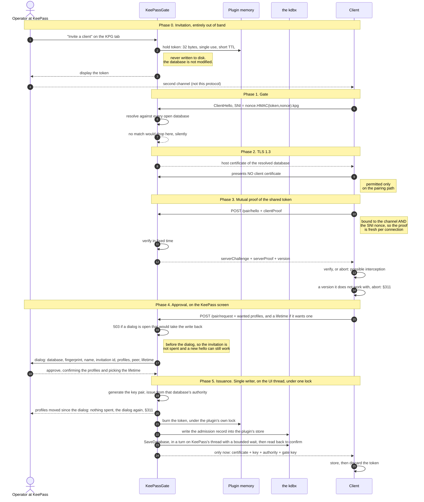
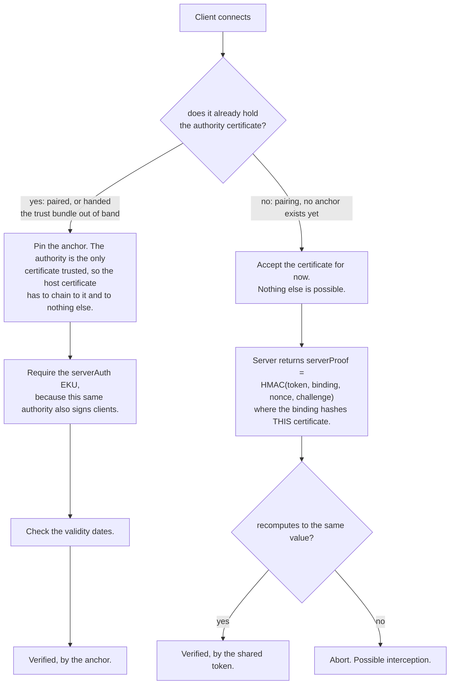
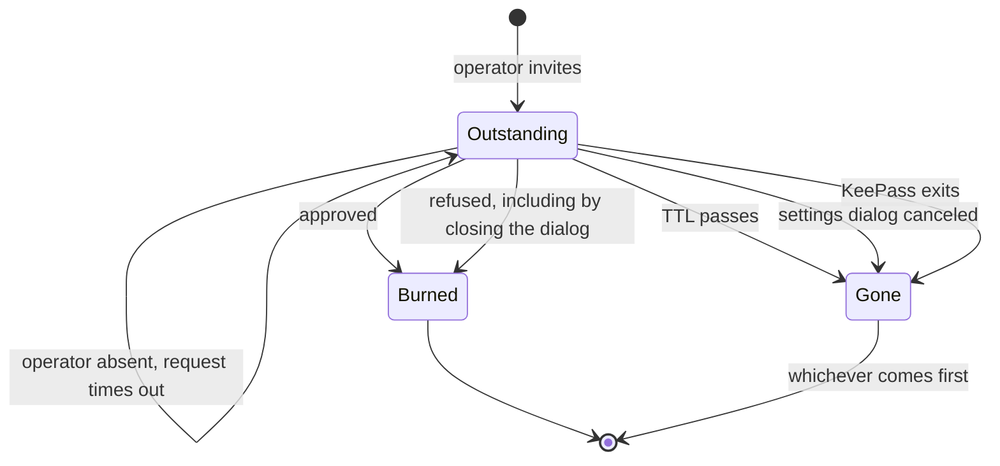
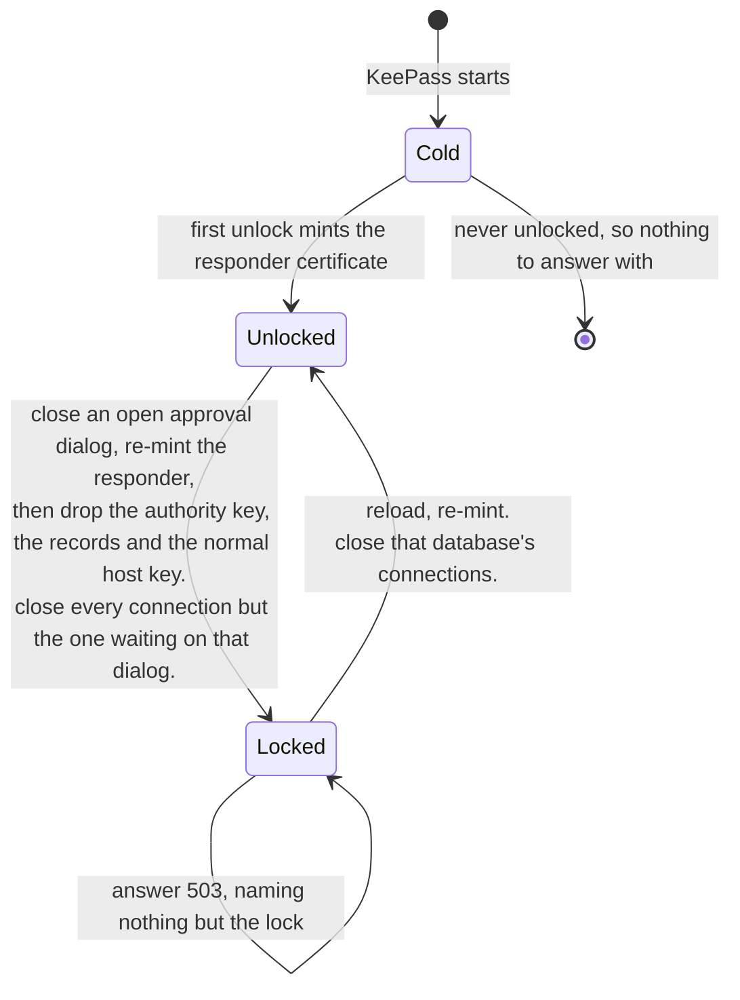

# Pairing

How a stranger becomes a client, and, in §312, how a client already admitted is given a new
certificate. [`CA.md`](CA.md) covers the authority this flow issues from,
[`DESIGN.md`](DESIGN.md) covers the transport it runs over, and
[`docs/pairing.md`](docs/pairing.md) is the same flow described to the person answering the dialog,
with the screens.

Every database carries its own certificate authority, so pairing is an act of **issuance** rather
than a key exchange. The flow exists to answer one question safely: may this stranger ask, and is
the thing it is asking actually us?

---

## 1. Four secrets, four blast radii §301

The reason pairing needs a credential of its own. Collapsing any two of these ties a routine act to
an expensive recovery.

| Secret | Who holds it | If it leaks |
| --- | --- | --- |
| Authority private key | nobody outside the host, protected by the kdbx encryption | mint any certificate for that database. Recovery is recreating the authority, which revokes every client at once |
| The gate key | every paired client, indefinitely, shipped in the trust bundle | an outsider reaches the TLS layer. Recovery is a rotation that re-keys the whole fleet |
| Pairing token | one invitee, briefly, over a second channel. **Plugin memory only, never written to disk** | an outsider may *ask* to pair. The operator still has to approve. Recovery is revoking it, or waiting for the TTL |
| Client certificate | one paired client, until it expires | whatever the record admits it to. Recovery is revoking that client from the KPG tab, which takes effect on its next request |

A prompt-injected agent is an intended consumer of this API and holds the gate key. That is
precisely why it must not also be the thing that authorizes pairing.

---

## 2. The gate, before any TLS work §302

The SNI is `nonce . HMAC(key, nonce) . kpg`, rebuilt for every connection, so a passive observer
never sees the same name twice. The server reads it out of the ClientHello itself, because .NET
Framework offers no server-side SNI callback.



Expired tokens leave the resolution set first, so expiry is indistinguishable from never having
existed.

**Asked for on every connection, and asked for here rather than by a setting.**
`GateTlsServer.GetCertificateRequest` sends a certificate request whatever the connection turns out
to be, so a client with something to show offers it and one with nothing completes the handshake
anyway and is served as a stranger, which is what the pairing path needs. Nothing about the
handshake decides what a client may do: that is `ClientCredentials` on the anchor pin and the
record, and the route table.

**Measured on the stack this no longer uses**, and one of the reasons it no longer uses it.
SChannel's `ClientCertificateRequired = false` makes the server skip the certificate request
entirely under TLS 1.3, so a client holding a good certificate never offers one, while `= true`
requires nothing, because a certificate-less client completes the handshake regardless. The plain
reading of that flag is the opposite of what it does in both directions, and under TLS 1.2 it
behaves as its name suggests, so testing there and shipping on 1.3 was a silent authentication
bypass. [`DESIGN.md`](DESIGN.md) §133 is why the TLS became managed code, which is what took the
flag out of this picture altogether.

---

## 3. The flow end to end §303



**A pairing connection is measured against a budget of its own, and so is a renewal's, §312.** Every
other connection is given two spans to deliver its request in, which is what stops a peer holding a
thread by feeding it a byte at a time: from accept until its name resolves, as long as one read may
take or the ordinary budget if that is shorter, since all it owes there is a ClientHello; then the
whole ordinary budget, `GateOptions.Budget`, counted from the name resolving to the end of its
request. After that it has no deadline at all: what is left there is a write and a save that no
number bounds, so a deadline could only ever close the socket while a write that is still going to
land is landing. The ordinary budget is given again, counted afresh, once its answer is being
written, since how fast that is read is the peer's doing.

Phase 4 blows through it on purpose, and by more than one wait. The operator is given two minutes to
read the dialog; a second pairing waits that long again just to get in front of them, since only one
is put to the operator at a time; the prompt waits a little longer than the dialog does; and a busy
KeePass is given a moment to settle once the operator has approved. So the moment the request is off
the wire, the connection's deadline is set again to `GateOptions.PairingBudget`, which outlasts all
of them together: where every other connection's deadline is dropped at that point, a pairing's, and
a renewal's, is raised. **That is the whole of the difference**: what they wait for ahead of their
write is a list of waits somebody wrote down, so a number for it means something.

**And it is dropped where the record is handed to the writer**, as every other connection's is at
the end of its request, because from there a pairing's remaining work is what an ordinary write's
is: a save of unknown length. The invitation is spent inside that write, before the save, so a
deadline still running through it could only close the socket over a record that lands anyway. The
answer is then given the ordinary budget to be written in, as any other answer is. This reverses
keeping the deadline until the answer, which rested on the write's own timeouts bounding it: they
bound the waits for the writer's lock and turn, and not the save. A pairing whose write finds its
approval stale saves nothing and puts the dialog up again, and takes the deadline up again for it,
to the end of the same budget, §311.

**A dialog that comes up late has less than two minutes.** Its countdown starts from what is left
of the budget once the waits after the dialog are set aside, when that is shorter, so everything
ahead of the save, the writer's lock and turn included, still ends inside the budget; with less
than thirty seconds left the dialog is not shown at all, and the request is answered `503 busy`
with nothing spent. That reverses giving every dialog its whole two minutes however late it came
up, which took the worst case past the budget: `DESIGN.md` §119 has the arithmetic. **A dialog the
request puts to the operator again is given what is left the same way**, §311, and nothing ahead
of a dialog is waited for past the moment the dialog could still be shown for thirty seconds, so
that the further dialogs of a request end inside its budget too.

**Not when the name resolves**, which is earlier and asks for less. The reason for the longer
budget is that the connection is about to wait on a person, and a connection that has named an
invitation and sent nothing waits on nobody: granted there, one invitation would buy thirty-two
silent connections six minutes of the gate each, which is the harm the locked case is guarded
against, reachable all along against a database that was open.

Closing the socket underneath phase 4 does not stop the pairing, which is what makes this worth
saying. Everything after the dialog still happens: the certificate is issued, the invitation is
burned, and the record is written and saved. All that is lost is the answer, leaving a record on
disk for a certificate the client never received and cannot ask for again. That is the peer hanging
up, or its deadline running out before the write. A lock is the other thing that closes
connections, and it spares this connection: it closes the dialog as unanswered instead, nothing is
issued or spent, and the client is told `503 locked`, §308. A close or an unlock closes only its
own database's connections, so a close or an unlock of another database leaves this connection
alone. A close of its own database
closes the dialog as unanswered too, and spares this connection as a lock does, so nothing is issued
or spent there either and the client is told `503 locked`. KeePass's exit takes the dialog away the
same way and spares nothing: stopping the gate closes this connection with the rest, before the
answer exists, §308.

**One pairing is put to the operator at a time.** Two connections can reach phase 4 together, and
each asks the user interface thread to show a dialog. The second would open inside the first one's
modal loop, and a modal dialog disables every other window on its thread: the first request goes
gray in front of the operator, cannot be answered, and times out. The second one waits instead, for
as long as it was going to give the operator anyway, and answers `503 busy` if it never gets the
screen. Nothing is spent by that, so the invitee can simply ask again. The reference client does
so by itself when it is given a budget for waiting, starting again from the hello rather than
repeating the approval request alone. **A request keeps the screen from its first dialog until it
is answered**, so that where its write finds the approval stale and it puts the dialog to the
operator again, §311, no other request's dialog comes up between the two: a request waiting
behind it waits through that write and the dialogs after it, within the same wait.

**Nor is a dialog put up inside a save.** Showing it is a turn on KeePass's thread, and KeePass's
save pumps that thread while it runs, so a dialog posted during one, as it once was, opened inside
it and held the save, the writer and KeePass's interaction block for as long as the operator took,
which also kept a workstation lock from locking KeePass. A turn waits for KeePass to be idle, which
a save never is, `DESIGN.md` §119, and the dialog is shown only once nothing is saving. **A save
this plugin is making for another client is waited for**: the request waits for it within the
same wait it has for the screen, and answers `503 busy` only if that wait runs out first.
**KeePass's own work is not**: its own saves, an import, XML Replace, a message box of its own or of
Windows', its progress window, Database Maintenance and the dialogs that would take the record back
are answered `503 busy` at once, before the dialog and again just before it would be shown.

**The dialog does not take the focus, and no key approves it.** A client chooses when it comes up,
and the operator may be typing into KeePass at that moment, so a dialog that took the focus would
take the next keystroke too: a Tab, a word and an Enter meant for an entry were measured approving.
It comes up on top without being activated, and KeePass's taskbar entry flashes until the operator
clicks it. Once it has the focus, Enter and Escape refuse wherever the focus is, unless an open list
takes them first, and Approve has no mnemonic, is never the default button and comes after Refuse
in the tab order, so a click on it, or Space while it has the focus, is the only way to approve. The
renewal dialog, §312, is built the same way.

**The dialog shows what approving a profile brings back.** It is built from the dialog's reading
of the plugin's store: the names on the list and, for each name asked for off it, the clients that
regain it and the removals of it. **The reading is made on KeePass's thread, afresh, with the
store key**, as the writer's turn reads, `KdbxStore.Read`, in the turn that puts the dialog up and
at the moment it comes up, so that a removal that only a deletion record tells of is tied to its
name as the write ties it, `StoreInForce.RemovalsOnceKnown`, from the first dialog. Only names and
identifiers leave the turn, and letting the reading go overwrites the bytes of the key, `CA.md`
§208. Pairing adds each approved name the database does not hold in the same write as the
admission, as a record of the plugin's store that names the removals of the name that the dialog
last showed, `STORE.md` §616: a removal of it that the write finds beyond those, as a synchronize
brings it between Approve and the write or while the approval is held, makes the approval stale,
§311, so that no approval puts a name back over a removal the operator was not shown. The names
the database holds decide which names are in force (`DESIGN.md` §139).

**The dialog does not change by itself; Refresh shows a change.** On each tick of its countdown,
every second, the dialog reads the store again in the same way and compares it with what it shows,
unless KeePass is part way through work of its own, the question a write asks first,
`IWriterState.Interrupting`, or this plugin's own save is running: a merge pumps between one group
and the next, and a tree read there is part way between two databases, and KeePass raises no event
a dialog could rely on for a change of its tree, an import none at all. A reading that shows what
the dialog shows changes nothing on the screen and is what an approval then rests on, so that a
further removal of a name already shown as restored, read by a tick, makes no approval stale. A
reading that shows otherwise, a state or the clients regaining a name, touches no row:
**Refresh** is enabled, **Approve is disabled**, and the words beside Refresh read "The database
changed.", the tooltip of Refresh "Refresh shows the change. (F5)", "Refresh (F5)" while Refresh
is disabled, which the pointer resting on a disabled Refresh shows as well, since a disabled
control is told of no pointer and the line above the table shows the tooltip in its place, under
the place of the latest move the line was told of rather than where the system's pointer stands
by the time the tooltip comes up. The
words beside Refresh read left to right in a right to left window, as the plugin's tooltips do,
since read right to left an English sentence takes its full stop at its start. **Refresh is a
square button with KeePass's own picture for Synchronize and no text**, as tall as Refuse and
Approve at every scaling, the picture in its middle, at the end of the line above the table, level
with the table's edge, the right edge and in a right to left window the left, so that it takes no
line of its own, and the line is as tall as Refresh; UI automation reads it as "Refresh". F5
presses it wherever the focus is, which does nothing while nothing waits, and it comes before the
table in the tab order. The picture is read from KeePass's own resources, `KeePassPictures`,
scaled as KeePass scales its own pictures and copied for the dialog, which lets go of the copy;
where KeePass has no such picture, Refresh has none, and no text stands in for it. Refresh shows
the database as it stands, highlights each row whose state it changed as a row of a dialog shown
again is highlighted, with the same tooltip and text read out, §311, and brings the first row it
changed into view. **A row the Refresh makes Approve do more for is unchecked**,
`PairingRequest.Unchecks`: added or restored where it was not, as a row of a dialog shown again
opens unchecked; every other row keeps its check. Approve is enabled again once
`PairingApprovalForm.ApproveHeldBack` has passed, as on
a dialog shown again, and **for that moment no key but Enter and Escape does anything**: no letter
presses a button by its mnemonic, with Alt or typed on a focused button, no Tab or arrow moves the
focus, no arrow or page key scrolls the table, and no Space presses a button or toggles a row,
since the dialog answers a mnemonic, Tab and the arrows before the key reaches the control it is
typed on. Enter and Escape refuse, as they do wherever the focus is, which is safe: a refusal
grants nothing, and either key refuses whatever the dialog shows, so that a press of either means
on the dialog now what it meant on the dialog before; a list opened by a click in that moment
takes neither until the moment has passed. **A control the dialog disables while it holds the
focus hands the focus to the view the table's rows scroll in**, with the same moment held back:
disabling a focused control moves the focus to the next control, so that after Refresh a second
Space refused and spent the invitation, and after a change disabled Approve a second Space toggled
a row. A box given the focus there instead showed no sign of it after a click, and a Space checked
the row a Refresh had just unchecked; on the view, Space checks nothing, the keys that scroll the
table scroll it, and Tab goes on to the first box. A reading that fails disables Approve and
Refresh, the words beside Refresh read "The database cannot be read for now.", and the next tick
reads again;
the plugin's log records a reading that fails, with what failed, once as the readings begin to
fail and once as they read again, held by
`PairingHandlerTests.A_reading_that_fails_under_the_dialog_is_logged_once_for_each_change_and_answers_a_reading_that_failed`.
**A reading that throws what no list names is a defect**: under a dialog it goes on to the handler
of the tick, which counts it, and the dialog reads nothing more and stands unreadable until it
ends, the words beside Refresh reading "The database cannot be read.", so that the defect is
counted once and
Approve stays disabled,
`PairingApprovalFormTests.A_reading_that_throws_under_the_dialog_leaves_the_database_unreadable_and_reads_no_more`;
before a dialog it goes on to the connection thread's own catch,
`PairingHandlerTests.A_first_reading_that_throws_what_no_list_names_goes_on_as_a_defect_and_puts_nothing_up`.
A first reading that fails puts no dialog up, and the request is answered `503 busy`,
`PairingHandlerTests.A_first_reading_that_fails_puts_nothing_up_and_is_answered_busy_as_a_reading_that_failed`.
A reading of a store that no longer serves the authority the pairing arrived under takes the
dialog off the screen, below, and a lock or a close of the database takes the dialog away, §308. The
window is not made again, takes no focus from another window and keeps its countdown. **The words
beside Refresh keep their place whatever they state**, a single line between the line's name and
Refresh, cut with an ellipsis and whole in their tooltip where a scaling leaves the line too little
room, and hidden while they state nothing; a dialog shown again states "Shown again: the table
changed." there until a change waiting replaces it. Enter refuses as it does on every approval
dialog, and the check at the write stays the backstop for a change that lands between the last
reading and the write.

**The profiles asked for are a table, with the check boxes and what Approve does for each name in
columns of their own**, never joined to the name, since a name and its state read as a single
word are a spelling to notice: **Grant**, the box alone; **Profile**, the name alone;
**Approve also**; and **Regained by**. A name on the list has an empty cell under
**Approve also**. A name off the list
reads "restores the profile" where the dialog's reading holds a removal of it, made here or in
another copy and brought in by a synchronize, by its record, by an item of a summary entry, or by a
deletion record, which the store key ties to the name whether or not the file knows the name
otherwise, `STORE.md` §623 step 2; or where admitted clients still hold it. Its row names the
clients that regain it under **Regained by**, each on a line of its own however many there are, and
through whichever certificate still holds it each of them regains the name. A client that renewed
while the name was off the list regains it only through its older certificate, until it gives that
up, since the certificate it renewed to was recorded without the name. Each client is named once,
by its client key, `CA.md` §223, however many of its certificates hold the name, and two clients
that paired under one name are named apart, each with the start of its client key as the clients
page shows it. A name off the list that is none of those reads "adds the profile", and any rule
already naming it applies at once, which a connection cannot count, since it does not walk the tree.

**No sentence of the dialog names a profile or a client, and none puts a pronoun for a noun**:
the table shows which rows a sentence is about. Above the table, "Profiles the client asks for:",
whatever the states, which names the table to UI automation without its colon, or for a request
that names no profile "The client asks for no profile.", its tooltip "Approved, the client reaches
nothing.", short enough that the words beside Refresh stand whole at the size the dialog is
designed at; and above that,
"Approve issues a certificate and saves this database. The
KPG tab revokes the certificate." **Nothing under the table explains a state**: each cell under
**Approve also** that holds text carries a sentence on what Approve does as its tooltip,
`PairingApprovalForm.NewTip`, "Approve adds the profile to this database. Rules already naming the
profile apply at once.", and `PairingApprovalForm.RemovedTip`, "Approve restores the profile for
every rule and client still naming the profile.", since a line for each state under the table
would stand apart from the rows it explains. The headings and the text of each state are each held
in a single constant, `PairingApprovalForm.StateHeading`, `HeldByHeading`, `NewState` and
`RemovedState`, which the tests read rather than repeat. Each row's box is a check box that UI
automation reads by the row's text read out: the name, then that sentence where the name has a
state, then the clients regaining it, every client however many, since the approval of the box
rests on each of them, then the change where its state changed; each cell is a text of its own.
**Every part of the dialog that UI automation reads has a name of its own**, since a part with
none is read by the name of the part before it: a row is read by its profile, the headings by
"Headings", the line above the table by "Status", Refresh by "Refresh" and the words beside
Refresh by what they state, the lifetime by "Lifetime", the footer, which holds the countdown and
the answers alone, by "Answer" and its buttons by "Buttons", the content by "Pairing request" and
the facts by "Details"; an empty cell and empty words beside Refresh are hidden. Whether a part is
off the screen is UI automation's own answer: a row scrolled out of the view is read as off the
screen, and its box and cells, which lie inside the row, as on it, whatever the box or the cell
answers of itself.

**The table is a row of headings that stays where it is above rows that scroll by pixels**,
`ProfileTable`, each row a box and a cell of text for each column, since neither stock table holds
a row taller than a line to its last line: every row of a list view is a single line tall, and a
grid scrolls by whole rows. Every cell keeps to the top of its row, the box level with the first line.
**A thin line parts each row from the next**, in the system's color for a control's light edge and
in the theme's text color under a high contrast setting, so that a row of several lines reads as a
single row and two highlighted rows as two; none under the last row. **A tall row scrolls as the
rest of the rows do**: its box, name and state leave the view with its first line, and its client
lines go on scrolling with no profile in sight, the line under the row telling where the next row
begins. **A scroll reaches the screen whole**: the view the rows scroll in is painted, with every
row in it, into a single buffer that reaches the screen once the paint is over, and every scroll
paints the whole view, a scroll by the wheel, the keys or the scroll bar before the next message is
handled and a box brought into view by the focus together with its focus. The system moves what a
scroll keeps by copying it, and each row painted what the scroll uncovered afterwards on its own:
in between, the screen showed the strip the scroll uncovered holding the lines it held before the
scroll, a line standing twice or a row missing, for a picture of the screen at a time; a view
painted into a single buffer shows of a copy only what a later paint covers, so the whole view is
painted. **The rows end on the edge of a line**: the view scrolls as far as the first edge of a line at or past the place
where the last row's end meets the view's bottom, a row's top or the top of a client line of a row
past its first, so that once the view is scrolled to the end, as a row brought into view there by
Tab or by a Refresh leaves it, its top cuts no line and no box, and less than a row of the view
stays empty below the last row.
The boxes' column is as wide as the box with its margins or its heading, the state's as wide as its
longest text, and the other two share what is left once a vertical scroll bar is taken out, so the
table scrolls down and never sideways; a row reaches the scroll bar, or the table's edge where no
scroll bar is shown, so that a highlight does too. A line its column cuts ends in an ellipsis, and
the cell's tooltip shows the cell whole. **The dialog is sized as it comes up, from what it shows
then, and grows with its table while it stands**; a dialog shown again is a new dialog, sized
afresh. The view is as tall as the rows, between two rows of a single line and ten. **Rows taller
than ten rows of a single line end on a line cut in half**: the view holds as many whole lines as
the room of ten such rows holds from the top of the rows, and half the line after them, whatever
that line is, a row of a single line, a client line, or the first or last line of a taller row,
which carries the row's room above or below its text, so that the line the view's bottom meets is
neither a sliver nor nearly whole. That holds for the view at the top of its rows; scrolled, its
bottom cuts whatever line it meets wherever rows go on below it. That cut, where the eye reaches
the end of the table, is what shows that the table scrolls, and no line under the table states it
in words. At the normal font
a row of a single line is 18 pixels and a client line 14, so that the cut leaves 9 pixels of a row
and 7 of a client line in sight, and a view of single rows is 189 pixels; at twice the font, 29 and
25, and 14 and 12. Scrolled to the end, the last row is whole and nothing is cut, since nothing
follows. **Where a Refresh makes the rows taller than the view, the view grows**, to the rows'
height or to its most, whichever is less, and the dialog grows downward by as much: its top edge
stays where it stood, and the lifetime, the countdown and the answers move down by the growth.
Where the grown dialog would reach below the working area of its screen, it moves up by what is
missing, never above the working area's top. A view kept taller than its most cut, whose rows
still scroll, grows on to the next height that cuts a line in half, at most a row past ten, so that
a grown view ends on a cut line too. **The view never shrinks**: rows a Refresh makes shorter leave
the view's height, with empty room under the last row, and nothing on the dialog moves back up. A
press aimed at Approve where it stood before a growth lands on what stands there now, the empty
room beside the lifetime or a client line of the table, and approves nothing: Approve takes no
press for a moment after the Refresh, and stands lower afterwards. The heights are worked out where
the rows change, never in answer to a size or a layout. The wheel scrolls by
lines, the small turns of a precision touchpad added up, the arrows by a line, Page Up and Page
Down by the view less a line, and Home and End to either end, while a box or the view the rows
scroll in has the focus; the view is a stop of its own before the boxes, Tab moves from box to box,
and a box out of sight that the focus moves to brings its row's top to the top of the view. **With
a box focused, the view stays where a key puts it**: the box keeps the focus, as the focused item
of any list that scrolls does, and nothing brings it back into view until the focus moves to it or
a Refresh brings its row into view. A layout of the dialog brought the focused box back into view,
and the dialog was laid out every second as the words of its countdown changed, so that the view
went back to where a key found it within a second and a row taller than the view was never read to
its last line by the keys with a box focused. **The countdown keeps the size of its widest words
while the dialog stands**, so that its words changing lay nothing out: a layout of the dialog also
has WinForms set the view's scroll bar again round a focused box, which drew the view again every
second with nothing changed. **The focus is drawn wherever it is in sight, whatever
turned the focus cues on**: round a box on its row, clear of the box, a pixel inside the row and
the view and in the row's own colors, so that the dots never stand on the blue of a checked box,
the line between two rows or the table's frame, and round the view on a frame of the table's own;
a box out of sight has none of it drawn. A check changes only by a click on its box or by Space on
the box focused and in sight: Space on a box out of sight brings its row into view and changes no
check, and the press after it changes the check in sight, so that no check changes unseen. A
letter typed on a box or on the view does nothing, where it would otherwise reach the dialog's
mnemonics as it does on a button, and a double click is the single click it begins with.
The states are held
by `AskedProfilesTests`,
`PairingHandlerTests.A_first_dialog_marks_a_name_removed_here_that_nobody_holds_as_removed`,
`PairingHandlerTests.A_first_dialog_marks_a_name_another_copy_removed_as_removed_and_its_approval_is_written`,
`PairingHandlerTests.A_first_dialog_marks_each_name_by_what_the_reading_holds_of_it`,
`PairingHandlerTests.A_first_dialog_shows_a_name_removed_and_added_back_without_a_mark`,
`PairingHandlerTests.A_first_dialog_over_a_removal_only_a_deletion_record_tells_of_marks_the_name_removed_and_its_approval_is_written`,
`PairingHandlerTests.The_dialog_is_read_as_it_comes_up_and_not_before_the_wait_for_the_screen`
and `PairingApprovalFormTests.Each_profile_is_a_row_of_its_name_its_state_and_the_clients_still_holding_it`,
and through the real target and the real dialog by
`PairingInRealDatabaseTests.A_first_dialog_shows_each_profile_with_its_state_and_the_clients_still_holding_it`
and, over a database synchronized by KeePass,
`PairingInRealDatabaseTests.A_removal_synchronized_in_before_the_dialog_is_built_is_a_removal_the_approval_puts_the_name_back_over`
and `PairingInRealDatabaseTests.A_name_the_file_does_not_know_whose_removal_a_deletion_record_alone_tells_of_is_removed_on_the_first_dialog`;
the table by the rest of `PairingApprovalFormTests`. Refresh is held by the tests of
`PairingApprovalFormTests` from
`A_change_landing_under_the_open_dialog_enables_Refresh_and_disables_Approve_without_touching_a_row`
on, by `PairingRequestTests`, which holds what a Refresh changes and unchecks, by
`PairingApprovalPromptTests.A_pairing_s_dialog_is_read_in_the_turn_that_puts_it_up_and_shows_what_was_read`,
and through the real target, the real form and KeePass's own Synchronize by
`PairingInRealDatabaseTests.A_removal_KeePass_synchronizes_in_under_the_open_dialog_waits_for_Refresh_and_Refresh_shows_it`.

**A dialog is built only over a reading that serves the authority the pairing arrived under**, a
dialog shown again, §311, as well as a first dialog. Its connection was answered the store's word
if the store held the gate back when it arrived, `STORE.md` §656, and what the connection was
judged on can change before the dialog's reading is taken, or between a write that found an
approval stale and the reading of the dialog shown again, as a synchronize brings a second
authority or a retirement of the authority served, or the database is locked or closed. A reading
that does not serve holds no list, so a dialog built from it would state every name untruly: a
name on the list as added, or as restored where a client holds it. So the request
is answered as its write would be answered over the same store, through the same two members,
`StoreReadings.WordOf` and `StoreReadings.Serves`, and in every round by the same lines of
`PairingHandler`: the store's word under `503` where the store holds the gate back,
`503 undecided` where several authorities stand, the authority it arrived under among them,
`409 no invitation` where that authority is no longer the authority served, and `503 locked` for a
database locked or closed. Nothing is spent but the hello's challenge, and the plugin's log names
the invitation, the database and the cause. **The reading is taken as the dialog comes up**, in
the turn that puts it up, so that no wait for the screen comes between the reading and the
dialog; no dialog comes up over a reading that does not serve, and nothing is shown or asked. **A
store that stops serving while the dialog stands ends the dialog**: no later tick can be counted on
to serve again, so the tick that reads it takes the dialog off the screen, and the request is
answered as before a dialog, the store's word under `503`, `409 no invitation` or `503 locked`,
with nothing spent and no line in the audit, since the store's word ended the dialog and not the
countdown, `PairingApproval.NoLongerServed`. **The plugin's log calls such a dialog taken off the
screen, never unanswered**, which is the word of the audit line a countdown or a lock writes, so
that the log and the audit cannot be read as two accounts of the same ending. An approval given
before that tick is answered by its write with
the store's word. A reading that fails is another matter: the next tick may read, so the dialog
stands, as above. Held by
`PairingHandlerTests.A_store_that_stopped_serving_before_the_dialog_is_answered_as_its_write_would_be`,
for a dialog shown again by
`PairingHandlerTests.A_later_dialog_over_a_reading_that_is_not_served_is_answered_as_its_write_would_be`,
for a dialog standing by
`PairingHandlerTests.A_store_that_stops_serving_under_the_open_dialog_ends_the_dialog_with_the_store_s_word`,
and, through the real target,
`PairingInRealDatabaseTests.A_store_that_stopped_serving_before_the_dialog_is_answered_as_its_write_would_be`
and, for the real form standing over the real target, a second authority, the authority retired
and the database closed among them,
`PairingInRealDatabaseTests.A_store_that_stops_serving_under_the_open_dialog_ends_the_dialog_with_the_store_s_word_and_no_unanswered_line`.

**Every answer is written to the audit**, `DESIGN.md` §120, naming the invitation the request
arrived on: approved, with the admission key of the certificate it admitted, which is the new
client's client key as well, once the record is saved and before the bundle is handed over;
refused; or unanswered, those two naming no client. An approval that admitted nobody, because the
record did not land, the invitation was gone by the time the operator answered, or the approval
was stale at its write, §311, gets no line, and no line carries a profile. A stale approval is
named in the plugin's log, with the profile and the cause. Unanswered is a dialog that came up and
closed itself, or that a lock or a close took away: a dialog KeePass's thread never put up was seen
by nobody, is answered `503 busy`, and gets no line, and a dialog a store no longer served ended
gets none either.

**The client proposes how long its certificate lasts, and the operator picks.** A request may ask
for anything from a day to a year, and the dialog offers 1, 7, 30, 90 and 365 days under the
profiles, with the one asked for chosen already and marked "(asked)". One that is none of those is
offered as a choice of its own, in its place by length, rather than rounded to the nearest, because
the nearest is a certificate nobody asked for. A request asking for nothing is offered a year, which
is what every client was given before any could ask, so asking can shorten a certificate and never
lengthen one. The list drops down rather than standing open, and a closed list takes neither Enter
nor Escape, so both still refuse as they do everywhere else on the dialog, nor any letter, digit or
arrow, so no stray key changes the lifetime unless the list is opened. The table of profiles takes
no letter or digit either, so its checks change only by a click on a box or by Space. `CA.md` §207
holds the bounds.

Both proofs are bound to the RFC 5929 `tls-server-end-point` channel binding, which both sides
derive independently and which hashes the certificate actually in use. **It needs no interface from
the transport on either side**, because it is defined as a hash of the server's certificate: the
server has the one it chose, and the client has the one it was just sent. An earlier draft reached
for `TransportContext.GetChannelBinding`, which was necessary while `SslStream` terminated the TLS
and stopped being necessary when the transport became managed code.

---

## 4. How the client verifies the server §304

Hostname verification is gone, deliberately: the SNI is rebuilt every connection, so it can never
appear in the host certificate's SAN, and the authority is deliberately absent from every machine
trust store. So the client trusts nothing but the authority. The reference client turns host name
checking off and loads the authority it was handed at pairing as the only anchor, so a host
certificate that does not chain to it fails the handshake, and OpenSSL's own check for a TLS server
holds the certificate to `serverAuth` and to its dates. While pairing it has no anchor yet, verifies
nothing in the handshake, and lets the server's proof decide. A client built on `SslStream` meets
the same facts as `RemoteCertificateNameMismatch` and `RemoteCertificateChainErrors` on every
correct connection, so it has to ignore `SslPolicyErrors` and reach its own verdict, `CA.md` §214.



Pairing ends by handing over the authority certificate, which is what promotes a client from the
right branch to the left one, permanently.

**Dropping the name is safe only because the authority is single purpose.** Hostname verification
exists to stop a certificate valid for one host being accepted for another under a *shared*
authority. This one issues for exactly one database, so any `serverAuth` certificate under it is
that database's host by construction. The EKU check closes the remaining gap, since the same
authority also signs client certificates.

**The client speaks first, and that is deliberate.** It sends its own proof before the server sends
one, so an impostor learns nothing and does no work until the caller has shown it holds the token. A
man in the middle does harvest a `clientProof`, but one computed over *its* certificate, which is
worthless against the real server whose binding is a different value.

---

## 5. What each phase is actually for §305

| Phase | Without it |
| --- | --- |
| 1. Gate | anyone who reaches the port reaches the pairing dialog, and dialog spam becomes a denial of service against the operator's own screen |
| 3. Client proof | a captured SNI can be replayed to raise dialogs. The proof cannot be forged without the token, so a replay dies here rather than in front of the operator |
| 3. Server proof | an unpaired client has no trust anchor and accepts whatever certificate arrives. An on-path attacker runs a fake pairing, issues its own certificate, and owns the client. The real KeePass never sees the connection, so nobody ever gets to refuse |
| 4. Approval | the token alone would be authentication, and a compromised second channel would be a compromised database |
| 5. Record, then issue | a certificate the database has no record of is a credential nobody can revoke and nobody can see. The record is checked on *every* connection, so losing it makes the certificate inert rather than invisible |

---

## 6. The token's whole life §306



The whole lifetime is in memory, under the plugin's own lock, so a burn cannot be reverted and a
race cannot double spend. A timeout does not burn the token, so an absent operator does not cost the
invitee their invitation. A refusal does.

**Every lifetime in pairing is kept by elapsed time**: an invitation's ten minutes, a hello's
challenge, and an approval held for a busy KeePass, §311, each end once that long has passed on a
monotonic clock, which is the operator's ruling of 2026-11-08. So setting the system clock back or
forward while one is outstanding neither lengthens nor shortens it, where measured against the
system clock a step back kept a code and a held approval alive for the length of the step. What the
tab shows and the client is told, `expires` and `heldUntil`, is the wall-clock time read when each
was made, and so is the tab's countdown to an invitation's end, so after such a step those differ
from when the thing really ends by as much as the clock moved.

**Closing the dialog is a refusal, not a timeout**, whether by the close box, by Alt with F4, from
the window menu or from the taskbar. An operator who dismisses the question has answered it, and the
answer a dismissal means is no: the invitation is spent and the program has to be invited again. Only
the countdown running out is a timeout, and that is the one case where the dialog closes itself
rather than being closed.

**The settings dialog an invitation was made on takes it back unless that dialog is accepted.**
The code is good the moment it is shown, so a program can pair before OK, but Cancel, or closing the
dialog any other way, withdraws it if nobody has used it yet. That is the dialog's OK and Cancel
meaning what they promise for the one thing on the tab that takes effect before OK. A code already
spent stays spent, since the record it led to is the database's and a revocation takes that back.

---

## 7. What an adversarial review changed §307

Four independent reviewers attacked an earlier version of this flow, each finding then put to a
separate reviewer told to refute it. One survived, and it needed no attacker at all.

That draft promised the admission record was *persisted before issuance* and that the token burn was
*atomic* with it. Neither is buildable in a KeePass plugin.

**The operator opens Tools then Database Maintenance to look at something.** That dialog copies the
database's own `CustomData` when it opens. While it sits there a client pairs: the admission record
is written and the token removed. The dialog closes, the stale copy is written back over the
database's, the record is gone and the single-use token is alive again. The client already holds a
working certificate. Nothing on screen says anything happened.

That is a defect in the store rather than in this flow, restated against a dictionary that now
holds a signing key.

- **The admission record became load bearing**, checked on every connection, with profiles read from
  it rather than from the certificate's SAN. A lost record now makes the certificate inert and the
  client pairs again. That is the only response that also survives the operator answering "Discard
  changes" on exit, which no amount of locking prevents.
- **Pairing tokens left the database entirely** and now live only in plugin memory. A token that is
  never in `CustomData` cannot be restored by a stale snapshot, which removes that half of the
  defect at the root rather than compensating for it. It also stops invitation creation from
  modifying the database, and lets the burn happen under a real lock, which `StringDictionaryEx`
  could never provide.
- **Issuance became a single writer on the UI thread**, saving synchronously and reading back to
  confirm, with the certificate handed over only after all of it succeeds.
- **The word "atomically" was dropped.** A sorted dictionary plus a file save cannot provide it. The
  property actually wanted is that a certificate without a matching record is refused.

**The record is an entry of the plugin's store now, and that dialog holds no copy of it**,
`STORE.md` §615 and §626, which reverses the record as a key of the dictionary the dialog copies.
Database Maintenance still copies the database's own custom data, where the standing answers to a
renewal are kept, so a pairing, whose write can take such an answer away, is still refused while
it is open. The profile names are records of the store, as the admission is. What can take the
admission itself back is KeePass's entry dialog, which puts its copy of an entry back at its OK:
the write is answered `503 busy`, with the approval held, while that dialog holds an entry the
write deletes or sets back, the store's summary entry among them. Nothing of the order changed.
The admission and the summary entry written with it are saved, found in the database as they were
written, and the file hashed back, before the certificate is handed over, and a write that does
not land is taken back out whole, the entries it added and the entries it deleted alike, an
addition of a name among each, `STORE.md` §627. A write whose plan adds no admission is refused
before the approval is used up or the invitation spent, so no certificate is handed over on a
save of nothing. A lost admission still makes its certificate inert. Held by
`PairingInRealDatabaseTests`, whose save failures leave every entry and every deletion record of
the store as before, among them
`A_pairing_that_does_not_land_puts_an_admission_that_came_back_back_as_well`,
`A_pairing_whose_save_fails_puts_back_the_addition_its_write_deleted` and
`A_write_whose_plan_leaves_the_admission_out_is_not_believed_and_spends_nothing`.

The gate against a stale dialog tracks specific `GroupForm` instances through
`GlobalWindowManager.WindowAdded`. It must **not** gate on `WindowCount`. That number counts every
window KeePass registers, and nearly none of them copies anything: keyed on it, an about box left
open becomes a reason not to pair, and it still cannot answer the question actually being asked,
which is whether a dialog is open on *this* group. The plugin's own approval dialogs do not add
themselves to that manager, and one is the window certain to be open at exactly this moment, so a
count would also leave the guard at the mercy of one line added elsewhere in this plugin. Their
staying out is a decision of its own, §308: a dialog registered there holds every lock off, and one
a client can raise would let it keep KeePass unlocked with nobody at the desk.

**And it refuses when it is not watching, which is a separate thing from seeing nothing open.** The
first version answered "nothing is open" whenever its table was empty, which is also what it answers
when the watch never started or has been stopped. That is the fail-open direction on the one guard
this whole flow is built around: the dialog really is on screen, nothing noticed it, and the record
is written into a dictionary that is about to be overwritten. An empty table now only means anything
while the watch is running.

**Two cryptographic findings were raised but their refutation never ran**, so they are neither
confirmed nor cleared. The substantive one is that `tls-server-end-point` is a per-certificate
constant rather than a per-session value, so the proofs carried no freshness. Binding them to the
SNI nonce and adding a server challenge costs nothing and is folded into phase 3 above, and that is
what was built: the nonce the client chose makes the server's proof fresh to the client, and the
challenge the server chose makes the request fresh to the server.

---

## 8. When the database is locked §308

Locking closes the database, and with it the authority, the admission records and the normal host
key. A **second host certificate**, minted at unlock and again at the lock it answers, held only in
plugin memory, is what lets a locked KeePass answer `503 locked` instead of failing at the
transport. Minted twice because its life has to cover the lock rather than the session before it,
and the lock is the last moment the authority that signs it is still there: `CA.md` §208 has the
dates and what they are worth.

| Held in memory | Unlocked | Locked |
| --- | --- | --- |
| Authority private key | yes | **dropped** |
| Admission records | yes | **dropped** |
| Host key, normal | yes | **dropped** |
| Host key, locked responder | yes | **kept** |
| The gate key | yes | **kept** |

**The `SniKey` has to stay resident too, or none of this is ever reached.** The gate resolves the
SNI before any TLS work, using a key that lives in the database. Drop it at lock and every
connection is refused at the gate with the responder certificate sitting unused. Of the three
secrets it is the right one to keep: it authenticates nothing, and every paired client already holds
it.



Pairing while locked is refused the same way: issuing needs the authority private key and the
admission write, and neither exists in this state. Nor can a client certificate be validated with
no authority held, so every caller of a locked database is a stranger by construction rather than
by a check somebody has to remember.

**A lock closes every connection but the ones below, and an unlock only that database's**, the
operator's ruling of 2026-11-01. Closing at lock is obvious: a socket thread must not be reading a
database the UI thread is closing, that race needs a real gate because the lock fires on the UI
thread, and KeePass locks every database at once. An unlock lifts the lock on one database, the
database in front, and closes the connections its responder was answering, so that a client part way
through a handshake with the responder connects again rather than being told `503 locked` by a
database that no longer is.

**An unlock used to close every connection**, the other databases' too, so unlocking a second
database reset every request to the first, which had been unlocked all along, and closed the
connection of a pairing waiting on the first database's dialog, which the operator then approved
into a closed socket. It was argued as privilege: a connection that completed its handshake
against the responder was authenticated against nothing, and surviving into the unlocked state
would promote it to an authority it never proved anything to. Nothing promotes such a
connection, since a connection keeps the target it resolved, and a responder's is answered `503
locked` before a request is read.

**A lock closes an open pairing or renewal dialog as unanswered**, and its client is told `503
locked`. Neither dialog holds a lock off, since a dialog that did would let a client that raises one
after another keep KeePass unlocked, so every way KeePass locks can fall under one: its own
inactivity timer, Ctrl and L, a session lock or switch, a suspend, a minimize, a change of remote
control. All of them end in the same closing of the database, and that closes the dialog before
anything else happens, so it does not stand over a locked database offering an Approve that can do
nothing. The connections of pairings and renewals are spared when every other one is closed, and
answer for themselves: the dialog's, and any still waiting for the screen, which is never shown,
with `503 locked`, and one the lock caught before it asked, with `503 busy`, as a database that
cannot be written answers. Their deadline still bounds them. Nothing is written and nothing is
spent: an invitation is still good after the unlock, and a renewing client's old certificate still
works. **A lock lets go of every approval held for a retry**, §303, and a close of a database lets
go of that database's, so an approval still waiting for a busy KeePass when the lock comes is
answered `503 locked` at once and never written into the database the unlock opens again. **So is
an answer the lock or the close overtook**: an approval the operator gave as KeePass locked or the
database closed, which had not reached the plugin's memory when the lock or the close let go of what
was there. The plugin notes where it stood before the operator was asked, and an approval arriving
after a lock, or after a close of its own database, is let go as it arrives and answered
`503 locked`.

**Nor does either dialog hold KeePass's periodic triggers off**, which registering it would do as
well, so a trigger that synchronizes or saves runs inside the dialog's modal loop, and KeePass ends
that work by enabling its main window, which the dialog had disabled. The plugin disables the window
again for as long as the dialog stands, so the operator cannot work in KeePass behind a request
still waiting for an answer. It does the same under the authority chooser and the window under
Tools, which are not registered either.

**A database closed for real closes its own pairing or renewal dialog as unanswered**, as a lock
does, which is the operator's ruling of 2026-11-08, and the answer names the close rather than a
lock. That replaced leaving the dialog standing over the closed database, which nothing took down,
on the argument that its answer would find the database gone: an Approve there could do nothing,
and only the plugin letting go of the approval as it arrived kept it out of the database opened
again under the same authority. A close of another database leaves the dialog where it is, and a
close that names no database, which lets every approval go, closes it too. The request is written
down as unanswered, since the operator was shown it, and its client is told `503 locked`: the
close spares the connections waiting on its operator, as a lock does, the operator's ruling of
2026-11-08 on the same day. It ended them with the database's other connections, so the dialog it
closed answered into a closed socket and the client saw only its connection end. A request still
waiting for the screen is spared too, is never shown, and is told `503 locked` the same way.

**The line is written as the dialog is taken away**, by the lock or the close, on KeePass's thread,
and not once the answer has reached the connection. **It used to be written there**, and KeePass's
exit is what that lost: KeePass closes every database and then unloads the plugin inside the one
press, before the dialog's loop can hand its answer back, and the unload waits for the audit lines
handed over by then and for nothing after. The connection's line raced the end of the process and
was missing from the file after most exits. A renewal's line is written there without waiting for
the client's pace, and the connection takes its turn for it, as for an approved renewal.

**An exit answers nothing.** The same press stops the gate, and stopping it closes every connection
it holds, the connection spared for the dialog's answer included, before that answer exists. A
client waiting on a dialog when KeePass exits sees its connection end with no answer, which the
reference client raises as `TransportError`. Nothing was spent and nothing written, as for a lock,
and the request is in the audit as unanswered. Answering first would need the stop to wait for a
thread that can only go on once the stop has returned, on the same thread.

**An unlock that lifts no lock closes nothing**, which is a refinement the end to end tier forced
rather than a weakening. KeePass announces a database being opened and a database being unlocked
with the same event, so a KeePass starting with a database on its command line raised an unlock
while a client was already connecting, and killed a handshake that had never seen a responder. The
close is for the responder's connections, so it follows a lock actually being lifted rather than
the event that announces both.

**A database closed for real closes its connections too**, for the reason a lock does: a socket
thread must not be reading a database the UI thread is emptying. It closed none while the database
had never been locked, so a connection resolved before File > Close, or before KeePass closes every
database on exit, ran on to its deadline against a database with nothing left in it. **Only its
own**, as an unlock: it closed every connection and let every approval go, so closing a second
database cost the first a request in flight, and a pairing waiting on its dialog its connection.
A connection is that database's when its name resolved to an authority of the database, and a
connection whose name resolves as the database closes is ended as soon as the name has resolved.
**But for a pairing's or a renewal's waiting on the operator**, which the close spares as a lock
spares it, since the close has taken its question away and what is left to it is answering
`503 locked`. Its name resolved before its request was read, so the guard for a name resolving as
the database closes never ends it, and its deadline still bounds it. An unlock spares none.

**The responder is minted when the database opens, not when a connection arrives.** Minting it
lazily looks equivalent and is not: a database nobody happened to connect to between an unlock and
the next lock would have nothing to answer with, which is the exact failure the responder exists to
remove.

**And every open database is read again just before a close or a lock**, because that is the last
moment it can be read and a lock answers out of what was read last. Without it, whatever changed
with no connection to notice was invisible to the lock: a Save As moved the file out from under what
the lock matches on, an authority created on the KPG tab had nothing to answer with, and one deleted
there went on being answered for.

---

## 9. What is on the wire §311

Small enough to state completely. Two routes, reachable only on a connection that arrived on an
invitation and presented no certificate the database admits. Any other is refused the way an
undeclared path is: `404 no such route` to a client the database admits, and `401 unpaired` to
anybody else. This used to be a plain `404` for everybody, on the argument that a paired client had
no business learning that these exist; they are declared in a document that ships inside the
plugin, so their existence was never the secret, and what is kept instead is that a caller which
may not use a route is refused as it is refused everywhere.

Bodies are one flat JSON object of strings and arrays of strings, read strictly: nesting, numbers,
booleans, `null`, a repeated name or anything after the closing brace is not a body, it is a
refusal. Binary travels as base64.

```text
POST /pair/hello
  { "proof": "<HMAC-SHA256(token, "kpg-client-proof" | binding | nonce)>" }
->  200 { "challenge": "<32 bytes>",
          "proof": "<HMAC-SHA256(token, "kpg-server-proof" | binding | nonce | challenge)>",
          "expires": "<when the challenge stops being usable>",
          "version": "<the plugin's release, as the status route reports it>" }

POST /pair/request
  { "name": "agent-fictitious",
    "profiles": ["ops"],
    "lifetime": "P30D",
    "proof": "<HMAC-SHA256(token, "kpg-request-proof" | binding | nonce | challenge | asked)>" }
    asked = name "\n" profiles joined by "," "\n" lifetime, or nothing after the second line break
->  200 { "identity": "<PKCS#12: the certificate and its key>",
          "authority": "<DER: what to pin from now on>",
          "gateKey": "<32 bytes: what to name every later connection from>",
          "subject": "CN=agent-fictitious",
          "profiles": ["ops"],
          "expires": "...", "database": "..." }
```

Every part is length prefixed before it is signed, so no two different sets of parts produce the
same bytes, and each proof carries its own label, so none of them can be replayed as another.

**The hello carries the gate's version so that a client can refuse before anybody is asked.** A
client works with a gate of its own major version whose major and minor it does not lead,
[`API.md`](API.md) §411, and refuses any other. A paired client learns the version from the status
route before its first request, and a pairing connection reaches no route but these two, so the
version travels beside the server's proof: the client reads it once that proof verifies and stops
there, before the request that puts it in front of the operator. The proof does not cover it and
does not need to, since it binds the channel and the version arrives on the same channel.

**`lifetime` is optional, and signed for whether it is there or not.** It is an ISO 8601 duration
of whole days from one to 365, in one spelling: `P`, the number with no leading zero, and `D`.
Anything else is `400 malformed`, refused by the document's own pattern before the challenge is
taken, so nothing is spent. The proof covers the text as it arrived, and an empty line when there
is none, so a lifetime added on the way, taken off it or changed is a request that no longer proves
itself, and the operator is never shown a lifetime nobody asked for.

**The exchange spans two connections**, because this transport answers one request per connection
and closes. The challenge is what carries it across: it is held on the invitation in memory,
together with the binding and the nonce it was issued against, and it is spent the moment it is
taken. So a request has to follow a hello that really happened, on a connection served with the same
certificate, and a second hello takes the first one's challenge away rather than running beside it.

**So a request spends its challenge, whatever it is answered.** A request that names something
that could be issued, on an invitation that is still there, takes the challenge its hello left, and
every answer after that leaves nothing for a second request to follow: trying again means a new
hello, which the invitation allows for as long as it is not spent. Where the table below says that
nothing is spent, it means the invitation. A hello whose proof fails spends nothing at all, and
nor does an answer given before a request is read.

What a refusal says, and deliberately no more:

| | |
| --- | --- |
| `401 unpaired` | the connection did not arrive on an invitation. Every route answers a caller the database does not admit this way, and nothing is spent |
| `404 no such route` | the caller is a client the database already admits, which has nothing to pair. Answered as an undeclared path is, and nothing is spent |
| `401 proof` | the proof did not verify. No dialog was raised and nothing was spent |
| `409 no exchange` | there was no hello, or it was answered by a different certificate |
| `409 no invitation` | it was spent or it ran out between the gate and here, or the authority it was made under was recreated or deleted before the dialog's reading, or while the dialog stood, which closes it, §303, or before the write: then any approval is used up, and the invitation is left unspent and pairs with nothing, its authority being gone |
| `400 name` / `400 profile` / `400 malformed` | it could never have been issued as asked |
| `403 refused` | the operator said no, and the invitation is spent |
| `504 unanswered` | the dialog came up and nobody answered it. **Nothing is spent** |
| `503 busy` | a dialog is open that would take the write back, KeePass is part way through a save, an import, a synchronize, an export or a message box of its own, or shows its progress window for work such as XML Replace, saving the database would stop to ask the operator something, such as what to do about a file on disk that is not the file KeePass read, another pairing or a renewal is already in front of the operator, so little of the pairing's time is left once the request reaches the screen, for its first dialog or for a dialog it puts to the operator again once its write found the approval stale, that the dialog would stand for under thirty seconds, a save this plugin is making for another client outlasts the wait for the screen, KeePass's thread never put the dialog up, the reading the dialog was to come up over failed, or there is no screen to ask; or the operator approved and KeePass was still busy a moment later, and then the body carries `heldUntil`, the moment the approval stops being held. **Nothing is spent**, and the client is never told which. An approval its write finds stale is answered no `503`: the same request puts the dialog to the operator again, or writes the approval again where no row reads otherwise |
| `500 not recorded` | the operator approved and the record did not reach the disk. **The invitation is spent** |
| `500 internal error` | the operator approved and no certificate could be issued: the authority's key would not sign, or the authority has outlived its hundred years. **The invitation is not spent**, and the client starts again from a hello |
| `503 undecided` | the database holds more than one authority and the operator has not yet kept any of them. Answered before the request is read, as `503 locked` is; where a second authority arrived after the request was read, before the dialog or while the dialog stood, which closes it, §303; or, where it arrived after the dialog's last reading, when the write comes to it, and then the approval is used up. It is answered only while the authority the invitation was made under is among the authorities standing: an invitation whose authority is gone is answered `409 no invitation`, above. **Nothing is spent** either way |
| `503 lost`, `503 split`, `503 outdated`, `503 stopped` | the plugin's store holds the gate back, `STORE.md` §656. Answered before the request is read; where the store came to hold the gate back after the request was read, before the dialog or while the dialog stood, which closes it, §303; or, where it did so after the dialog's last reading, when the write comes to it, and then the approval is used up and the next request is put to the operator again. **Nothing is spent** |

The `503 busy` row is the one to be careful with. A caller learns that it should try later and nothing
about what is open on somebody's desk. **An approval KeePass is too busy to write is held rather
than lost**, which is the operator's ruling of 2026-10-14. The check made once the operator has
answered is asked again for as long as the `Retry-After` the caller would be told, so a save that
ends in a moment is written on the same connection. One that lasts longer is answered
`{"error":"busy","heldUntil":"<UTC to the second>"}`: the approval is kept in the plugin's memory,
beside the invitations, until the end of the pairing budget the request arrived in, and the same
request asked again before then, from a fresh hello as every pairing retry starts, is written
without the dialog. The same request is the same invitation, name, profiles and lifetime as
written; anything different is put to the operator again, since the gate makes the key pair itself
and nothing else is on the wire. Answering at once used to let a client retrying on busy put the
dialog the operator had just answered in front of them again.

**What it was approved against is compared at the write, under the writer's lock**: the authority
served, and for each approved profile whether the list holds it exactly as it did when the operator
answered, since the write would otherwise put a name back that was taken off in between. **And
for each approved profile off the list, the removals of it**: the write puts such a name back
over the removals of it that the dialog held, and a removal the write finds beyond those, by its
record, by an item of a summary entry or by its deletion record, counted with the store key, is a
removal the operator was not shown, however long ago it was made, as an Add on the Profiles page
that a removal overtook writes nothing, `STORE.md` §627. **What the dialog held is what it last
showed**: the dialog reads the store with the store key as it comes up and on each tick, §303, so
the comparison at the write is the backstop for a removal a synchronize brought in between the last
reading and the write, a reading a tick skipped inside work of KeePass's own among them, or while
the approval was held. **A reading that shows the table the dialog shows is taken
without a word**: nothing on the screen changes, Approve stays enabled, and that reading is what
the approval then rests on, so that a further removal of a name the dialog already shows as
restored, read by a tick while the dialog stands, makes no approval stale. A further removal read
by no tick makes the approval stale at the write and brings no dialog back, since no row reads
otherwise, below. That holds for an approval written in the request it was given in as for an
approval held; a renewal adds no name, and an approved name on the list is held to its place there
alone. **Every cause is found in a single pass**: a write that finds a name moved on the list and a
removal beyond the dialog's together names both. The plugin's log names each profile and each
cause: a place on the list other than the dialog showed, or a removal the dialog did not show.

**An approval its write finds stale writes nothing and spends nothing, and the request is not
answered there**. The approval is used up, the invitation
stays good, and the same request puts the dialog to the operator again, from a reading taken
afresh, and is answered only once an approval is written, the operator refuses, or its time is
up. A second request would be a different request, whose body can differ, so nothing shown for it
could rest on what the dialog before showed or what the operator chose there; and a client told to
ask again that does not would leave the operator believing in a pairing that never landed. **The
dialog shown again comes up only where a row differs from the dialog before**, a state changed,
so that its notice is true wherever it stands. Where every row reads as before, as a change that
went back between the write and the next reading leaves it, or a further removal of a name the
dialog before showed as restored, no dialog comes up: the approval given there is given again over
that reading, asked of nobody, and written, and the plugin's log names it so. **The dialog shown
again** states beside Refresh, on the line above the table, "Shown again: the state of the
profiles changed.", until a change waiting replaces the notice, the same whatever the write
found, since the rows show the state and the plugin's log names each profile and each cause. It
opens with the lifetime picked on the dialog before, and with a row checked only where the
operator left it checked there and its state is the state it had there: **a row whose state
changed opens unchecked**, on the list before and restored now, added before and restored now,
and so on, so that a single Approve grants no name in a state the operator did not approve it in.
**Such a row is highlighted as well**, since unchecked alone would mean both
that the operator unchecked it and that its state changed: the whole row, its box among it, over
its whole height, in a light yellow, `PairingApprovalForm.ChangedBackground`, whatever its box then
holds, since the change it states is not undone by a check; the tooltip anywhere on the row a
sentence stating to what the state changed since the profile was first shown, true of a Refresh
as well, under the whole text of a cell its column cuts; and the same sentence at the end of the
row's text read out, which UI automation reads as the row's box. **The sentence tells what the
state cell reads now**: "The row changed after the profile was first shown: Approve now also adds
the profile.", "... Approve now also restores the profile." or "... this database names the
profile now.". Each sentence is a single constant, `PairingApprovalForm.ChangeTip` chooses among
them, and none names a profile or a client. **The meaning rests on no color alone**: under a high contrast
setting no fixed color is drawn, and the row keeps the theme's background with its text in the
theme's hyperlink color, `SystemColors.HotTrack`, which a contrast theme keeps legible there and
apart from its ordinary text, beside the tooltip and the text read out. A row the operator
unchecked whose state is unchanged opens unchecked with no highlight, and a first dialog highlights
nothing. Held by
`PairingApprovalFormTests.On_a_dialog_shown_again_the_row_whose_state_changed_is_highlighted_and_no_other_row_is`,
`PairingApprovalFormTests.A_first_dialog_highlights_no_row`,
`PairingApprovalFormTests.The_row_whose_state_changed_states_so_in_its_tooltip_and_in_its_accessible_text`,
`PairingApprovalFormTests.The_highlight_stays_whatever_the_box_and_Approve_grants_the_names_checked`,
`PairingApprovalFormTests.The_highlight_is_a_light_yellow_legible_with_the_row_s_text_and_a_contrast_theme_s_own_pair_under_high_contrast`
and, through UI automation,
`ApprovalTableAutomationTests.A_row_whose_state_changed_is_read_with_the_change_and_no_other_row_is`.
**Approve on it takes no press for a second** from when it comes
up, twice the 500 milliseconds Windows takes by default for a double click, since it comes up where
the dialog before stood just after Approve there was pressed, and a press still on its way would
otherwise answer it unread; Refuse stays enabled, Enter refuses as on every approval dialog, and no
focus is taken. It shows "restores the profile", with its tooltip and any client that regains it
in its row, for each name off the list whose removal its own reading holds: that reading counts
with the store key as the write does, so it holds every removal the dialog before held or a write
of the request found for as long as the store holds it, and its approval is not stale over the
same removals again, and no later write finds a removal the store no longer holds. A first
dialog carries no such line, opens with every row checked, and takes a press on Approve at once.
**What a request carries from
one dialog to the next is its own**, in the plugin's memory for as long as the request runs and
never written to the database or taken from anything a client sends, and it goes with the request:
nothing of it reaches another request, a request on a new code for the same name among them, whose
own write finds what it finds.

**Each dialog shown again stays inside the budget the request arrived in**: it is given what is
left of the pairing budget once the waits after the dialog are set aside, and never more than the
operator's two minutes, as a dialog that comes up late is, §303, and nothing ahead of it is waited
for past the moment it could still be shown for thirty seconds. With less than that left it is not
shown, and the request is answered `503 busy` with nothing written or spent, as a request too late
for the screen is. So the dialogs of a request end within its budget, however often its writes
find the approval stale. **The connection's deadline is taken up again for it**, to the end of the
pairing budget counted from the request: the write that found the approval stale dropped it, as
every write does, and the dialog after it waits on a person as the first did, so the gate bounds
it as it bounds the first, and the next write drops it once more. **The request keeps the screen
between its dialogs**, through the write that finds its approval stale, so that no other request's
dialog comes up between the operator's Approve and the dialog shown again: a request waiting behind
it waits through that write and the dialogs after it, within its own wait for the screen, and is
answered `503 busy` if that wait runs out, as behind any dialog. **A dialog KeePass's thread never
puts up**, for the dialog shown again as for a first dialog and a renewal's, is answered `503 busy`
as a request that never got the screen is, and the audit records nothing of it, since nobody saw
it; only a dialog that came up and closed itself unanswered is `504 unanswered`.

**Before a dialog shown again, what the request rests on is asked once more.** A lock of KeePass,
or a close of the database, since the request arrived is answered `503 locked`, with nothing
written or spent, as a lock is answered wherever it meets a pairing: between two dialogs, while
the write after a dialog shown again waits for its turn, and while a dialog shown again stands,
which the lock or the close takes away as it takes a first dialog away, §308. An invitation spent
or run out since is answered `409 no invitation`, and no dialog is raised, since an Approve on it
could do nothing. A database whose store no longer serves the authority the pairing was asked under
is answered as the write would answer it, with no dialog raised, as before a first dialog, §303:
the store's word, `503 undecided`, `409 no invitation` or `503 locked`. Everything else ahead of
a dialog shown again is asked as it is ahead of a first dialog. A refusal
on the dialog shown again is a refusal, `403 refused` with the invitation spent, and a dialog shown
again that nobody answers is `504 unanswered` with nothing spent, as on a first dialog. **Whether
the client is still there is not asked**: the transport gives the handler no way to tell without
reading from the connection, so the dialog is shown, and an approval given after the client went
away is written as the approval of a pairing whose client hangs up while its dialog stands is,
§303. **The audit records what the request ends as**, §303: an approval its write found stale
admitted nobody and has no line of its own, wherever the request then ends, as an approval whose
record did not land has none; the plugin's log names it with each cause, and names the ending.

**A held approval is the only approval a later request can find stale.** KeePass too busy to write
is answered `503 busy` with `heldUntil`, and the client sends the same request again, since a
connection cannot wait out a dialog of KeePass's that may stand for minutes. Where that request's
write finds the held approval stale, that request puts the dialog to the operator with the notice
beside Refresh, as the dialog after the dialog the approval was given on: opening with its
profiles and lifetime and its rows checked as above, from its own reading of the store, and goes
on as above. That is the single case in which a second request carries the notice, and it is
bound to the held approval's own key, the request exactly as written.

Held by
`PairingHandlerTests.A_profile_taken_off_the_list_under_the_write_voids_the_approval_and_spends_nothing`,
`PairingHandlerTests.A_profile_put_on_the_list_under_the_write_voids_the_approval_and_the_dialog_comes_back`,
`PairingHandlerTests.The_dialog_after_an_approval_a_removal_it_did_not_show_made_stale_marks_the_name_removed`,
`PairingHandlerTests.A_further_removal_of_a_name_a_client_regains_under_the_write_brings_no_dialog_back`,
`PairingHandlerTests.A_list_change_and_a_removal_found_by_the_same_write_put_the_dialog_up_again_once`,
`PairingHandlerTests.A_name_taken_off_the_list_leaving_only_a_deletion_record_puts_the_dialog_up_again_once`,
`PairingHandlerTests.A_further_removal_while_the_dialog_shown_again_stands_brings_no_third_dialog`,
`PairingHandlerTests.A_change_that_went_back_before_the_dialog_shown_again_is_written_without_the_dialog`,
`PairingHandlerTests.The_dialog_shown_again_opens_with_what_the_operator_approved_before`,
`PairingHandlerTests.The_notice_reads_the_same_whatever_the_write_found_and_the_log_names_each_cause`,
`PairingHandlerTests.A_name_found_removed_and_unchecked_on_the_dialog_shown_again_stays_off_the_list`,
`PairingHandlerTests.Refusing_the_dialog_shown_again_is_answered_as_a_refusal_and_spends_the_invitation`,
`PairingHandlerTests.Nobody_answering_the_dialog_shown_again_spends_nothing`,
`PairingHandlerTests.Nothing_of_a_request_s_dialogs_reaches_the_next_request`,
`PairingHandlerTests.A_held_approval_found_stale_at_its_retry_opens_the_dialog_as_the_operator_approved_it`,
`ApprovalBookTests.A_held_approval_is_stale_for_every_cause_its_write_finds_in_a_single_pass`,
`ApprovalBookTests.A_removal_only_a_deletion_record_tells_of_is_held_by_the_dialog_s_reading_and_lets_the_approval_through`
and, through the real target and the real dialog,
`PairingInRealDatabaseTests.A_name_a_synchronize_takes_off_the_list_while_the_dialog_stands_is_marked_removed_at_the_next_dialog`,
`PairingInRealDatabaseTests.A_name_taken_off_the_list_while_the_dialog_stands_brings_the_dialog_back_with_the_name_removed`,
`PairingInRealDatabaseTests.The_real_form_shown_again_opens_with_what_the_operator_approved_before`,
`PairingInRealDatabaseTests.A_refusal_of_the_dialog_shown_again_spends_the_invitation_and_the_next_request_starts_from_its_own_reading`;
its fit beside the longest of every other line by
`PairingApprovalFormTests.The_notice_of_a_dialog_shown_again_fits_beside_the_longest_of_every_other_line`.
The rows and the held-back Approve are held by
`PairingHandlerTests.A_row_whose_mark_changed_opens_unchecked_on_the_dialog_shown_again`,
`PairingHandlerTests.The_retry_of_a_held_approval_shows_the_removal_its_dialog_held_and_writes_over_it`,
`PairingApprovalFormTests.Approve_on_a_dialog_shown_again_takes_no_press_for_a_moment_through_the_real_loop`,
`PairingApprovalFormTests.Enter_on_a_dialog_shown_again_refuses_while_Approve_is_held_back`,
`PairingApprovalFormTests.A_first_dialog_holds_Approve_back_for_no_moment_and_carries_no_notice`
and, with the visual styles KeePass turns on, by `ThemedApprovalTests` and, through a real KeePass,
`LivePairingTests.The_dialog_opened_with_every_profile_asked_for_checked`;
what is asked before a dialog shown again by
`PairingHandlerTests.A_lock_or_a_close_between_two_dialogs_is_answered_locked`,
`PairingHandlerTests.A_lock_or_a_close_while_a_later_write_waits_is_answered_locked`,
`PairingHandlerTests.A_lock_or_a_close_that_takes_a_later_dialog_away_is_answered_locked`,
`PairingHandlerTests.A_later_dialog_is_not_raised_once_the_invitation_is_gone`
and
`PairingHandlerTests.A_later_dialog_over_a_reading_that_is_not_served_is_answered_as_its_write_would_be`;
a dialog never shown by
`PairingHandlerTests.A_dialog_never_shown_is_answered_busy_and_written_down_as_nothing`,
`PairingApprovalPromptTests.A_dialog_KeePass_s_thread_never_shows_is_answered_as_never_shown_rather_than_unanswered`,
`PairingApprovalPromptTests.A_dialog_answered_in_its_last_seconds_is_not_logged_as_shown_late`
`PairingApprovalPromptTests.A_dialog_that_came_up_after_its_wait_is_logged_as_shown_late`
and
`PairingApprovalPromptTests.A_reading_that_puts_no_dialog_up_is_not_logged_as_shown_late_however_late_the_turn_came`.
The budget and the screen are held by
`PairingGateTests.A_dialog_shown_again_is_bounded_by_the_pairing_budget_as_the_first_dialog_is`,
over a real socket,
`PairingHandlerTests.The_dialog_shown_again_is_given_what_is_left_of_the_pairing_budget`,
`PairingHandlerTests.A_dialog_shown_again_with_too_little_of_the_budget_left_is_not_shown`,
`PairingHandlerTests.The_screen_stays_with_the_request_until_the_request_is_answered`,
`PairingApprovalPromptTests.A_dialog_left_little_of_its_time_waits_for_its_turn_no_longer_than_it_could_still_be_shown`
and
`PairingApprovalPromptTests.A_dialog_left_little_of_its_time_gives_up_on_the_screen_by_then`.
The comparison is held by
`PairingHandlerTests.A_held_approval_of_a_name_off_the_list_is_stale_once_a_removal_the_dialog_did_not_hold_arrives`,
`PairingHandlerTests.An_approval_of_a_name_off_the_list_is_stale_once_a_removal_arrives_while_the_dialog_stands`,
`PairingHandlerTests.A_name_on_the_list_whose_addition_names_earlier_removals_is_written_at_the_first_approval`,
`PairingHandlerTests.An_approval_of_a_name_on_the_list_is_written_whatever_removal_arrives_while_it_stays_on_the_list`
and, over real databases synchronized by KeePass,
`PairingInRealDatabaseTests.A_further_removal_synchronized_in_while_the_dialog_stands_is_written_without_the_dialog_again`
and
`PairingInRealDatabaseTests.A_removal_synchronized_in_while_an_approval_is_held_makes_it_stale_at_the_retry`.
The authority is held first, by the plan of the write: an admission is planned only while the
authority that issued its certificate stands alone in the store, `STORE.md` §627, and a write
whose plan is refused for it is answered `409 no invitation`, with the approval used up and the
invitation unspent, since no retry under that authority can be written. That answer is for an
authority that is gone, recreated or deleted since the operator answered. An authority that
still stands, beside a second authority that a synchronize brought meanwhile, is answered `503
undecided` before anything is planned, as a connection to such a database is: the approval is
used up, the invitation stays good, and the operator keeps an authority first. **`undecided` is
for an authority that still stands.** Where several authorities stand and the authority the
invitation was made under is not among them, retired while the others came, the write is
answered `409 no invitation` as for any authority that is gone, by the same refusal of the
plan, with no window asked and nothing spent. A client of that authority cannot connect any
more: no target answers for an authority that does not stand, so its handshake is refused,
while several authorities stand and once the operator has kept an authority
(`OpenDatabaseTargetsTests.A_connection_naming_the_gate_of_an_authority_that_no_longer_stands_finds_no_target`).
The condition that the handler hands the write compares no authority: the plan has held it by
then. Held by
`PairingInRealDatabaseTests.An_authority_retired_beside_several_others_while_the_dialog_stands_is_answered_no_invitation_with_nothing_spent`,
`PairingInRealDatabaseTests.A_second_authority_arriving_while_the_dialog_stands_is_answered_undecided_with_nothing_spent`,
`PairingHandlerTests.An_authority_recreated_under_the_write_admits_nobody` and, over a real
database, by
`PairingInRealDatabaseTests.A_pairing_whose_authority_is_recreated_before_its_write_is_told_its_invitation_is_gone`.
The approval is used up at the write, and the invitation spent there, last, so nothing that can
still answer busy comes after the burn. **A lock and KeePass exiting let go of every approval
held, and a close of a database lets go of that database's**, and an approval still settling
when KeePass locks is answered `503 locked` rather than written into the database an unlock
opens again. So is an approval the operator gave across the lock or the close, which arrives
after it, §308. A close let go of every database's until the operator's ruling of 2026-11-01,
which told a pairing approved for a database still open that its database was locked.

**Two exchanges on one invitation can find the same approval held**, since a client may start again
from a hello while its first request is still waiting, and the write that lands first uses it up.
The other is answered `409 no invitation` once the invitation is gone, and `503 busy` while it is
not, which puts the request to the operator again, and the log tells either apart from an approval
whose time ran out.

**Every `503` is raised before the invitation is spent, and that is what makes it honest.** The
dialog check and the wait for the screen both happen before the burn, so a caller that starts again
from a hello is retrying something that can still work. Once the invitation is burned there is no retryable
answer left: a write that fails after that point is a `500` however transient its cause was, because
the same code will be turned away at the name on its next connection and dropped without any answer
at all. Whether it was worth retrying goes to the operator's log, which is where somebody can act on
it.

**The two `500`s are not the same kind of thing, and only the status they share is.** A record
that did not land is this plugin failing partway through something it had started, and the
invitation is gone with it. `internal error` is a certificate that could not be issued once the
operator had approved: the authority's key would not sign, or the authority has outlived its hundred
years, which nothing refuses ahead of because nothing warns ahead of it either, `CA.md` §219.
Nothing was issued, so the approval is lost and the invitation is not.

**This replaces two refusals made before the dialog**, `500 expired authority` and
`500 expired host`, which answered a ten-year authority and a five-year host certificate running
out before anybody was disturbed. Issued together for a century, neither is a state a database
reaches while anybody is minding it, and a check for it would be code that never runs.

## 10. Renewing a certificate §312

A client that is already admitted asks for a new certificate with `POST /gate/renew`, and the
operator approves or refuses it on screen as they would a pairing. It is pairing's request with the
client already known: no invitation and no proofs, because the certificate on the connection is the
proof, and the router has checked that it chains, is current and has a record before anything here
runs.

```text
POST /gate/renew
  { "lifetime": "P30D" }          or {} to ask for nothing
->  200 { the bundle the pairing request answers with, for the new certificate }
```

**What the operator is shown is read from the record, not from the request.** Who is asking is the
name the record was issued under, with when it was admitted and when the certificate it holds now
expires, where the request came from, and the profiles its record holds that the database still
names, read with the record in a single hold, all checked. The operator may uncheck any of them
and can add none: the new certificate is never wider than the record. Unchecking narrows the new
certificate alone, since the old record is left valid with everything it held until the client
gives it up, and the dialog states as much. A name the database no longer holds is not offered, and
a line under the list states that it is not carried over, since a renewed record is written from
the names on the list. The list is read again once the operator has answered, so a name taken off
it while they decided is not carried over either, and the renewal never puts a name back on the
list. The lifetime is a proposal, as on a pairing: preselected among the presets when a lifetime is
asked for, and a year when no lifetime is.

**Refusing can answer more than this request**, which is the operator's ruling. Refuse is a split
button. Pressing it refuses once, which keeps nothing, and so do Enter, Escape, the close box and
every other way of dismissing the dialog: a standing answer is given from the button's menu and from
nothing else. The menu, opened by its arrow or by Alt and Down, offers refusing once, in this
session, until a date, or forever, and until a date asks for a day from tomorrow to the day the
certificate it holds now ends, both days where the operator is, so on that day itself the choice is
grayed out and states why. The answer stands until the chosen day begins where the operator is, its
first midnight on a day the clocks fall back, and that moment is the `notBefore` a client is sent,
in UTC. While a standing answer stands, every renewal of that certificate is answered without the
dialog:

- **In this session** is held in the plugin's memory, per certificate, as invitations are held, and
  goes when KeePass exits. Nothing of it is written to the database, since an answer about one
  session kept in the file would outlast it in every copy. It is answered `409 this session`, and a
  renewal asked after KeePass has started again raises the dialog.
- **Until a date** and **forever** are stored under `KPG.RenewalRefused.` and the certificate's key,
  `CA.md` §204. They are answered `409 too early` with `notBefore`, the moment from which the
  operator is asked again, and `409 forever`, for which pairing again is the way out. **If either
  cannot be written now**, KeePass busy or Database Maintenance open, it takes effect at once all
  the same, held in the plugin's memory as an answer about this session is, and the next save of
  that database that lands writes it, whoever asks for it, which is the operator's ruling of
  2026-10-14 as the operator extended it on 2026-11-04 from the plugin's own writes to every save.
  An answer that no save has taken when KeePass exits goes with it, and the operator is told so on
  the way out rather than only in the log, except at a Windows logoff or shutdown, where a message
  would hold the session's end up with nobody there to answer it and the log is all there is, which
  is the operator's ruling of 2026-11-08. KeePass's main window is hidden before that message goes
  up, because an exit closes the databases without redrawing it, and the window would otherwise go
  on listing the closed database's groups and entries for as long as the message waits. It is
  written only while the key still holds what it held when the answer was given, and while the
  answer still refuses, so an answer written there since, on a later dialog or by a synchronize, is
  the later word. It is written wherever a record in force still names its certificate, whether or
  not that certificate is admitted at that moment, as in a store that has stopped or beside
  several authorities, and it is let go unwritten only where no such record names the
  certificate, which is where a written answer goes as well. Held by
  `RenewalInRealDatabaseTests.An_owed_answer_is_written_while_a_record_in_force_names_its_certificate`.

**The operator can take any of the three back**, which is the operator's ruling on review 3: on the
clients page the row of a certificate with a standing answer has its name in red, the row's
tooltip and its description to a screen reader name the answer, and the row's menu, opened by the
right button, Shift and F10 or the menu key, names the row's certificate on a grayed first line,
states the answer on a grayed line under it and offers **Allow renewal**, beside **Revoke** on a
client's first row. Allow renewal waits for the settings dialog's OK, as a revocation does: the
stored answer is taken away in the dialog's buffer and the session's in what the dialog holds of
the plugin's memory, so the red goes at once and the gate keeps refusing until OK, and Cancel leaves
the answer standing. The plugin holds one set of the session's answers, read by the handler and by
every clients page, so the page shows and lifts exactly what the gate answers from. Once lifted,
the next renewal raises the dialog again. An answer given on that dialog while the settings dialog
was still open, possible once an until-date has passed, is the later word and survives the OK.
Otherwise a standing answer ends as described: the session's with KeePass, the stored answers once
no admission names the certificate they are about, its client revoked or the certificate given
up, and every answer with the authority recreated or deleted. A stored answer no longer ends with
its certificate's expiry, since the admission of an expired certificate stays, `CA.md` §204.

The database's answer is read before the session's. The dialog is raised only while neither
refuses, and a renewal waiting behind another of the same certificate is answered at once rather
than kept for a second dialog, so the two meet only when a merge brings a stored answer in from
another copy of the file. Then the stored one is what the client is told, since forever tells it
that nothing short of the operator allowing renewal again, or pairing again, helps. A stored until
a date says less there: once its day begins the session's answer is told in its place,
`409 this session`, so its `notBefore` is the moment the session's refusal takes over rather than
one from which the operator is asked again.

**Every answer is written to the audit**, `DESIGN.md` §120, against the certificate that asked and
the client key on its record, which the renewal leaves as it was: approved, with the key of the one
issued in its place once its record is saved; refused, with which of the four answers it got;
refused without the dialog, by an answer given before; or unanswered.

**The order is pairing's, kept exactly.** Refused with `503 busy` before anybody is disturbed while
a dialog would take the record back, asked again once the operator has answered, then issued,
written and saved, and only then handed over. Refused `503 busy` the second time, when KeePass is
still busy a moment after the answer, the approval is held, as a pairing's is, keyed by the
admission key and the lifetime as written, and the answer carries `heldUntil`: nothing is issued
yet, the audit has its line when the write lands, and the renewal asked again before then is
written without the dialog, **unless an answer refusing it stands by then**: a merge can bring
one in, and so can the dialog of a renewal of the same certificate that asked for another
lifetime. That answer is what the retry is told, as it would be told before any dialog, and the
approval is let go. A stored answer that will not read is no answer: the approval stays held, and
the retry is told `503 busy` with `heldUntil` again. What pairing asks again about
its invitation a renewal asks about its record: one revoked while the operator was deciding, or left
behind by an authority recreated or deleted in that time, is answered `401 unpaired` and nothing is
issued. **And the write asks it once more, under the writer's lock**, in the store as the write's
own turn reads it: the record still admits its certificate, and it is still the entry the operator
approved against, so a revocation landing after the handler last read it, or the certificate given
up by the client on another connection, is found under the lock it was written under rather than
overtaken. The record is compared by its entry, where it was compared by a digest of its stored
text: a record of the store is written once, so the same entry is the same content, `STORE.md`
§627. An authority recreated or deleted after the handler last read it is found there as well,
by the plan of the write, and answered `401 unpaired` with the approval used up and nothing
written, held by
`RenewalHandlerTests.An_authority_recreated_under_the_write_is_answered_unpaired_and_lets_the_approval_go`
and
`RenewalInRealDatabaseTests.A_renewal_whose_authority_is_recreated_before_its_write_is_answered_unpaired_with_nothing_written`.
**A store that holds the gate back is answered its word, and never `401 unpaired`.** The handler
asks the target's word before the dialog and again once the operator has answered, each time
before it reads the record and from the same reading, inside a single hold, so a word and a
record are never of two moments; and the write asks it once more: `lost`, `split`, `outdated` or
`stopped` where the store holds the gate back, `STORE.md` §656, and `undecided` where a second
authority has come to stand beside the authority the certificate was issued under. Each is
answered under `503`, with the approval used up after the dialog and nothing issued or written.
`401 unpaired` is left for a store that is whole and holds no admission in force for the
certificate under an authority it serves, and for a certificate whose authority is not among
several that stand, since `undecided` is for an authority that still stands. Held by
`RenewalInRealDatabaseTests.After_the_dialog_the_word_and_the_record_are_read_from_a_single_reading`,
`RenewalInRealDatabaseTests.A_renewal_whose_authority_is_retired_beside_several_others_while_the_dialog_stands_is_answered_unpaired`,
`RenewalInRealDatabaseTests.A_renewal_arriving_over_a_store_that_holds_the_gate_back_is_answered_its_word_before_the_dialog`,
`RenewalInRealDatabaseTests.A_renewal_whose_store_comes_to_hold_the_gate_back_while_the_dialog_stands_is_answered_its_word`
and
`RenewalInRealDatabaseTests.A_renewal_whose_database_comes_to_hold_a_second_authority_before_its_write_is_answered_undecided`.
A renewal waits its turn for the screen with every pairing, since one raised inside a
pairing's dialog would gray it out, and its connection is measured against
`GateOptions.PairingBudget` from the moment its request is off the wire until its record is handed
to the writer, since what is left between the two is the same list of waits.

**One renewal per certificate is in flight at a time.** A second renewal of a certificate whose first
is still being answered is told `503 busy` at once, before anything about it is read, and the first
stays in flight until its answer has been kept, the standing half included. So the dialog is never
raised twice for one certificate, and the next renewal after the first is answered meets whatever
the operator decided.

**The old record is left valid.** Nothing is revoked by a renewal: the client gives the old
certificate up itself with `DELETE /gate/certificate` once the new identity is stored, presenting
the old one, which is what the reference client does. Giving it up writes a record that names
that single certificate and the renewals made from it, so the certificate the renewal issued
keeps working, `STORE.md` §648; a revocation, which names the client's key, would refuse both. So
an answer lost on the way costs the database nothing, since the old certificate still works and
the client can ask again, and a record a lost answer orphans stays listed under its client on the
clients page, as expired once its certificate has ended. Nothing prunes it, which reverses its
going at the plugin's next write once it had expired, `CA.md` §204. Revoking its client takes it
with every other certificate that client holds; **Take certificate away** in its row's menu on
the clients page takes it away alone, `STORE.md` §648. A lost answer costs the operator the
dialog a second time, which is why a client waits on its socket at least as long as
`GateOptions.PairingBudget` before giving up on the answer, as the reference client does for a
renewal as for a pairing. The gate holds
the connection past that budget through a save that outlasts it, so a client that expects a slow
save, of a large database or a database on slow storage, waits longer still. What each refusal
means is in the route's own responses, [`openapi.yaml`](src/KeePassGate/Spec/openapi.yaml) §510.

**The new record is the same client.** It carries the client key of the record that asked,
`CA.md` §223, the digest of the certificate the client paired with, so the two records name one
client while both stand and every count of clients counts it once. It also names the certificate
it was renewed from, which is the certificate on the connection, `STORE.md` §648. Nothing is
issued in two steps and nothing is revoked by name: the operator's ruling of 2026-10-16 first
had a renewal revoke every other certificate under the same name once the client had shown it
held the new certificate, and withdrew that the same day, since a name is the client's own
choice and two programs may share a name.

## 11. What this deliberately does not defend §310

- **Local code execution as the user.** It reads the host key, a client's private key, the token as typed,
  and the clipboard the tab's copy button puts it on. Conceded everywhere in this design.
- **A compromised second channel.** Whoever holds the token may ask. That is what the operator's
  approval is for, and it is the only thing standing there.
- **A lock with no responder to answer it.** A KeePass that has never been unlocked since starting
  has minted no responder certificate yet, so the failure really is a bare connection error. Every
  later lock is answered with `503 locked`, unless there is no responder then either: a database
  holding several authorities, none of them kept, mints none, since minting a responder would be
  choosing between them, and a lock at which a fresh responder could not be minted, while the
  responder held had expired, has none to answer with. A lock that outlasts the responder's ninety
  days answers with a certificate the client refuses, `CA.md` §208.
- **Two copies of one database open at once.** They share an authority and a `SniKey` and are
  genuinely indistinguishable, so the plugin refuses to serve and logs how many answered.
- **A spent exchange.** The name a client connects under travels in the clear and can be replayed,
  so whoever sees it can connect under it too and send a request of its own, which takes the
  challenge the client's hello left: the client's own request is then answered `409 no exchange`
  and begins again with a hello. That is all it can do. Without the token its proof fails, so no
  dialog is raised and the invitation is untouched.

Two consequences of holding invitations in memory, neither a defect but both easy to trip over.
**An invitation does not replicate**, so a client must pair against the host where it was issued,
even where two hosts serve the same database. And because the gate gives no oracle, **an invitation
lost to a restart looks exactly like an attack**: the connection is simply dropped. The client
library has to name that possibility, because nothing on the wire will.
