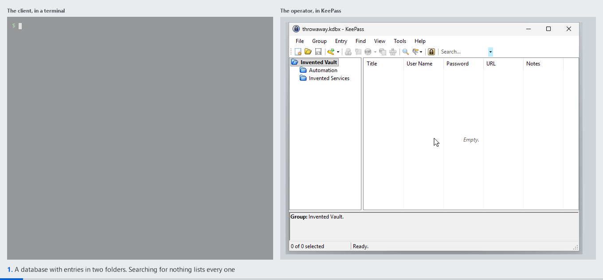

# KeePassGate

**Let a script, an automation or an AI agent use part of a KeePass database without handing over
the file or the master password.** Access is granted rule by rule, can be taken back at any time,
and every request is logged.

KeePassGate is a plugin for KeePass 2.61.1 and later. It serves a small HTTP API on the local
machine over mutual TLS, and each program sees only what it has been approved for.



*Recorded from a real KeePass by the project's test fixture. A database becomes its own
certificate authority, a program pairs with it and is approved, rules open one folder and close
another, the program reads a password and, once a rule allows it, sets a new one, and once
revoked, the program is refused everything. The gray boxes hide values that change on every run,
such as today's date and the invitation's identifier, so the recording comes out the same each
time it is made.*

## Why it exists

An agent that needs one API key should not need a whole password manager. Handing over the `.kdbx`
and the password gives it everything, for good, with no record of what it read. KeePassGate leaves
the database where it is and lets the agent in through a door the operator controls:

- **Nothing is shared by default.** A program can only connect with an invitation from the
  operator, and only after it is approved in a dialog. Even then, it reaches only what the rules on
  groups and entries allow.
- **Built for callers that can be talked into things.** An AI agent can be tricked into asking for
  more than it should. Every request is checked against the rules before any code runs to answer
  it, and anything unclear is refused.
- **Revoking takes a click and an OK.** From its next request on, the program's certificate no
  longer works. Every pairing, renewal, revocation and access decision goes into an audit log kept
  outside the database.
- **Keys stay inside the database.** Each database is its own certificate authority, stored in the
  encrypted file itself, and the plugin never writes a private key to the Windows user profile.

## How it fits together

Everything runs inside KeePass. There is no service and no extra process: the plugin listens on
loopback, and programs connect over mutual TLS with a certificate issued by the database itself.
Once KeePass closes, nothing is served.


Every request passes four steps, and each of them can turn it away:

1. **Gate.** Accepts a certificate only if this database issued it and still holds an admission
   record for it. A program with an invitation can reach pairing and nothing else.
2. **Router.** Knows only the paths declared in the OpenAPI document built into the plugin.
3. **Access control.** Compares the profiles a program was admitted with against the nearest
   `CRUSDLAP` rule on the group or entry it asks about.
4. **Handlers.** Only now does any code run to answer the request.

Rules are written and pairings approved in KeePass itself, and each decision ends up in the audit
log. [`docs/architecture.md`](docs/architecture.md) explains each piece in more detail.

## Try it

The plugin is published as a zip on [the releases page](https://github.com/mfrnd/KeePassGate/releases)
and the client as [`pykeepassgate`](https://pypi.org/project/pykeepassgate/) on PyPI, and
[`docs/getting-started.md`](docs/getting-started.md) installs them into a KeePass already in use.
The quickest way to look around without touching that KeePass is a clone of this repository, which
takes Windows, the [.NET SDK](https://dotnet.microsoft.com/download) and, for the client,
[uv](https://docs.astral.sh/uv/).

```powershell
git clone https://github.com/mfrnd/KeePassGate
cd KeePassGate
.\run-debug.ps1     # downloads and verifies the pinned KeePass, builds the plugin, starts KeePass
```

This starts a portable KeePass inside the clone with its own configuration, so any KeePass
already installed stays untouched. In that KeePass:

1. Open or create a database.
2. In the menu bar, choose **File** › **Database Settings**, switch to the **KPG** tab, press
   **Create authority** and close the dialog with **OK**.
3. Open **File** › **Database Settings** again, go to the **KPG** tab's **Clients** page, press
   **Invite**, then **Copy the invitation**, and close the dialog with **OK**. **Cancel** would take
   the invitation back.
4. In another terminal, pair, and paste the invitation when asked for it:

   ```shell
   uv run pykeepassgate pair --name agent-invented --profile-name reader
   ```

5. Back in KeePass, approve the request in the dialog that appears.
6. Check the connection with `uv run pykeepassgate status`.

The plugin listens on port 51776, which `pair` assumes. If another port was chosen, KeePass shows
it under **Tools** › **KeePassGate (KPG)**, and `pair` takes it as `--port`.
[`docs/getting-started.md`](docs/getting-started.md) covers every step, including installing the
plugin into an existing KeePass, and [`docs/pairing.md`](docs/pairing.md) explains what each
screen does.

## Access control

A paired program still sees nothing until a rule lets it in. Rules are written on the **KPG** tab
of KeePass's **Edit Group** and **Edit Entry** dialogs, and each one gives a profile a mask of
eight letters, `CRUSDLAP`:

| Letter | The program may |
| --- | --- |
| `C` | create groups and entries |
| `R` | read an entry's fields |
| `U` | update entries and groups, renaming included |
| `S` | strip fields and attachments out of an entry |
| `D` | delete groups and entries |
| `L` | list what a group holds |
| `A` | include an entry's attachments in whatever the rule allows |
| `P` | include protected values, such as passwords, in whatever the rule allows |

A rule holds for everything below it until a nearer one says otherwise, and a program admitted for
several profiles gets what any of them allows. `.R...L..` lets a program list and read the entries
under a group, but not their passwords or attachments. A group can also refuse every profile it
does not name, which keeps it private from the rules above it.
[`docs/access-control.md`](docs/access-control.md) has the details.


*A rule on a group's **KPG** tab: the profile reader may read and list everything under the group,
attachments included, but no passwords, since `P` is not set.*

## The client

**PyKeePassGate**, in [`src/pykeepassgate/`](src/pykeepassgate/README.md), is the reference
client. It comes with a Python library covering every route, a command line built on it, a
stand-in gate for testing programs built on it, and field references resolved the way KeePass
resolves them.

```python
from pykeepassgate import GateClient

client = GateClient.open()

for entry in client.entries():
    print(entry.uuid, entry.title, entry.url)
```

It is not on PyPI yet, so install it from a checkout with `uv add ./KeePassGate`.
[`docs/pykeepassgate.md`](docs/pykeepassgate.md) covers everything from pairing to writing entries.

## Documentation

| | |
| --- | --- |
| [`docs/`](docs/README.md) | for operators: installing, pairing, writing rules, revoking clients, reading the audit log |
| [`docs/pykeepassgate.md`](docs/pykeepassgate.md) | for developers writing programs against the API |
| [`docs/architecture.md`](docs/architecture.md) | an overview of the components |
| [`DESIGN.md`](DESIGN.md) | what was built and why, plus a section that attacks the design |
| [`API.md`](API.md) | why the routes look the way they do, with each route specified in [`openapi.yaml`](src/KeePassGate/Spec/openapi.yaml) |
| [`CA.md`](CA.md) | the certificate authority: issuing, claims, validation and revocation |
| [`PAIRING.md`](PAIRING.md) | how a new program becomes a client, with flow diagrams |
| [`FINDINGS.md`](FINDINGS.md) | what was measured instead of assumed, including what turned out wrong |
| [`ANALYSIS.md`](ANALYSIS.md) | the original design argument, including conclusions that were later reversed |

## For contributors

**`build.ps1` is the gate.** CI runs the same script on every pull request, with one job per check
it defines.

```powershell
.\build.ps1                 # prose, the client, the build, and every test that does not need KeePass
.\build.ps1 -Task All       # all of that, plus the end to end tests that drive a real KeePass
.\build.ps1 -Task Deploy    # copy the plugin into plugins\KeePassGate in the provided KeePass
.\build.ps1 -Task Package   # build the plugin as Release and zip it with a SHA256SUMS into dist\
.\run-release.ps1           # deploy, then start that KeePass with the build that would ship
uv run pre-commit install   # once per clone: the fast checks, run at every commit
```

**The build uses a pinned KeePass**, not whichever one is installed. `keepass.version` names the
release, and `tools/KeePass.ps1` downloads it into `.keepass\`, verified against a pinned SHA-256
and the Authenticode signature of KeePass's author. [`TESTING.md`](TESTING.md) explains what each
test tier covers, [`CONVENTIONS.md`](CONVENTIONS.md) has the rules every branch follows, and
[`CLAUDE.md`](CLAUDE.md) lists the settled decisions and the measurements behind them; read it
before proposing a change. The recording above and the screenshots in [`docs/`](docs/README.md)
are build outputs as well: `.\build.ps1 -Task Screenshots` retakes all of them.

**Some measurements live on branches of their own** that were never merged into `master`:
`spikes/tls-and-certificates` covers TLS and X.509 on .NET Framework, `spikes/build-environment`
whether the gate can fail when nothing is wrong, `spikes/revocation-merge` how KeePass merges a
database, and `spikes/pykeepass-compatibility` how much of `pykeepass` the API could serve. Each
keeps its findings in a `RESULTS.md`.

## License

[MIT](LICENSE). KeePass is GPL-2.0-or-later and has no plugin exception, but the FSF only requires
a plugin to use a GPL-compatible license, and MIT is one. So a permissively licensed KeePassGate
holds up under both the strict and the loose reading of the linking question.
