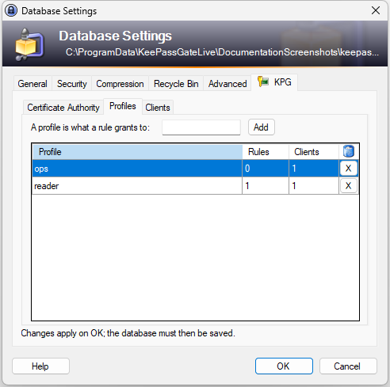
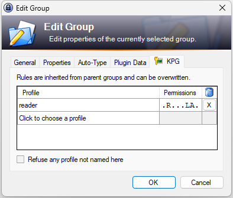
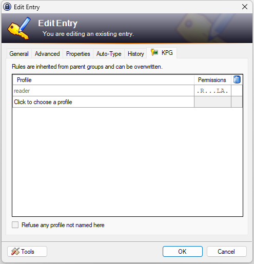

# Deciding what a profile reaches

A profile is a name the database keeps. On its own it grants nothing. The rules that give it
meaning live on its groups and entries, and are written on the **KPG** tab of the group and
entry dialogs.

Profiles are managed on the **Profiles** page of the database settings, and approving a pairing can
create one. See [Naming profiles](#naming-profiles).

## Naming profiles

Open **File**, **Database Settings**, pick the **KPG** tab, then the **Profiles** page.

| | |
| --- | --- |
| **Profile** | the name, which is what a rule and a certificate both carry |
| **Rules** | how many groups and entries have a rule for it, whatever the rule grants, which is how many rules removing it leaves inert |
| **Clients** | how many admitted clients hold it |
| **X** | removes it |

Type a name and press **Add**. A name is letters, digits, dash and underscore, up to 64 of
them. It grants nothing until a rule says so.

The other way one arrives is pairing: a program asks for profiles by name, and any this database does
not name now and no client holds is marked "(new)" on the approval dialog. Approving adds it, and
a rule still naming it from before it was removed applies at once.

A pairing writes that name straight to the database, where every other change on this tab waits for
**OK**, because the name has to be written by the same operation as the record it belongs to. A name
created that way while this page is holding an edit is kept: what **OK** writes is the difference
this page made, not the list it was showing, so a name added here goes in, a name removed here goes
out, and a name somebody else added stays. The one exception is a full list: a database names 32
profiles at most, and when a pairing's name fills it first, a name added here that no longer fits is
left out: the line under the list says so as soon as the page shows it gone, and the plugin's log
names it when **OK** is pressed, whatever was edited in between. The invite button is dead for as
long as the edit is waiting all the same, because a program approved for a profile that is part way
through being removed would be admitted to a name **OK** takes off the list, where it grants
nothing.

**Removing a profile takes it off this list and touches nothing else**, and from then on it grants
nothing. A program is given only the profiles its record holds that this list still names, so a
rule naming a removed profile stays on its group or entry, inert, and the access editor shows it
struck through. The page says how many rules still name it and how many clients still hold it.

That holds wherever the rule comes from: a group or entry dialog that was open while the profile was
removed and is then accepted, an old version of an entry restored from its history, or a copy of the
database merged in. None of them can bring a removed profile back into force through its rules, so
none of them has to be closed or checked first.

What can is the list itself. It is kept as one value, and merging two copies of the database keeps
one copy's list whole, for a synchronize whichever was changed last, and drops the other's. A
profile removed only on the dropped copy comes back into force, and a profile added only on the
dropped copy is lost, which the clients page then shows as removed on every client holding it.
After merging two copies that both changed their profiles, check this page.

**Adding a profile back is a full undo.** Every rule still naming it applies again, and every
client still holding it regains it, so the page asks first: it says how many rules come back into
force and names every client that regains the profile. A client whose certificate has expired is
not named, since it regains nothing: the gate refuses it before its record is read.

As everywhere else on this tab, nothing is changed until **OK** is pressed on the settings dialog,
and **saving the database** is what puts it on disk. Cancel discards it.

## Where the rules go

Open a group with **Group**, **Edit Group**, or an entry with **Entry**, **Edit Entry**, and pick
the **KPG** tab.

The line at the top says the same thing on both dialogs: rules are inherited from parent groups and
can be overwritten. On a group that reaches every entry in it and in the groups inside it; on an
entry it reaches that entry, with whatever the groups above grant shown among its own rules.

## Writing a rule

A rule is a profile and an eight character mask. **Neither is typed.** Click the empty line at the
bottom of the table and pick a profile from the list, then pick what it may do from the list the
**Permissions** column opens.

The profiles offered are the ones this database names, less any that already have a rule here. A
profile a group above grants is already on the table in gray, and the way to change that one is to
pick a rule on the row that is already there.

Nothing here can be typed because both halves are exact. A mask spelled by hand is a rule nobody
meant, and a profile spelled by hand is a rule for a name that may not exist, which grants nobody
anything and reads exactly like a rule that works.

The keyboard opens both lists with **F2** or **Alt+Down** on the cell. Inside a list, **Enter**
accepts and **Escape** leaves things as they were.

**Permissions is unavailable on the empty line**, because a rule is a profile first. It opens by
itself once a profile is chosen.

**Which profile a row is for is settled once the row exists.** To use a different one, remove the
rule with the **X** and choose again. Changing it in place would be two edits wearing one gesture:
the old profile silently loses its rule and the new one silently gains whatever the row held.

The eight characters are always in the same order, and a dot means "not this one":

| | | |
| --- | --- | --- |
| `C` | create | make a new group or entry here |
| `R` | read | read what an entry holds |
| `U` | update | change what an entry holds |
| `S` | strip | take fields and attachments off an entry, though not the five every entry has, which are emptied instead |
| `D` | delete | **removals are allowed here**: see below, because this one is asked twice |
| `L` | list | see that something exists, and whether an entry has expired, without reading it |
| `A` | attachments | **and the attachments too**, for whichever of the above this rule grants |
| `P` | protected | **and the protected values too**, for whichever of the above this rule grants |

So `.R...L..` is read and list, and nothing else. `.R...LA.` is the same over entries and over the
attachments inside them. `C.......` is create and nothing else, which is what an append-only program
wants. It still learns one thing about what is there: adding a field or an attachment under a name
the entry already holds is refused as taken, so such a program can find out, one guess at a time,
which names an entry holds. It never learns a value that way.

**`L` sits below `R` on purpose.** Knowing that an entry exists is not knowing what is in it.

**`S` and `D` are two sizes of removal.** `S` takes parts off a node: an entry's fields and its
attachments. `D` says removals are allowed here, and removing a group or an entry asks for it
**twice**, from the group the thing is leaving and from the thing itself.

That is what allows the grant most people want. Put `D` on one group and a program may
create and remove entries and subgroups inside it, including ones it makes later, while **the group
itself stays**, because nothing above it allows removals. Put a rule without `D` on a single entry
and that entry cannot be removed while its siblings still can.

So put `D` on the group whose contents may come and go, rather than at the top of the database. A
`D` at the top is what makes everything below it removable, and then holding one thing back means
writing a rule for it.

**Where a removed entry goes is out of the program's reach.** KeePass moves it to the recycle bin
when the database keeps one, and this API cannot see the bin at all: it is not listed, not
readable, and not addressable. So a program cannot read something by removing it first, and getting
a removed entry back is done in KeePass, where it is visible.

**`A` and `P` are switches, not verbs.** Neither means "may read attachments" or "may read
passwords". Each means "and those too", for whatever else the same rule grants, so a rule holding
switches and no verb grants nothing at all.

**`P` is the difference between recognizing an entry and signing in as it.** Without it, a rule that
grants `R` still answers with the title, the address, the names of every field and the values of the
ones nothing protects; where a protected value would be, the answer is `null`. `.R...L.P` is the same
rule with the passwords in it.

That is the grant to give a program that has to work out which entry it is looking at. `L` alone
does not tell it enough to tell two entries apart, and `R` used to tell it everything.

**It governs changing them too.** A rule with `U` and without `P` can correct an address and cannot
overwrite a password; one with `C` and without `P` can add a field and not a protected one. This is
worth more than it looks: a program that quietly replaces a password with one somebody else chose
has taken the account, and nothing in a log of "an entry was updated" says which happened.

**A write verb reaches further than the entry it is written on.** KeePass resolves what some
fields hold rather than using them as they stand: a URL it is told to open, a value being copied, an
auto-type sequence. A reference to another entry is resolved against the whole open database, which
knows nothing about these rules. So a program that may change one entry can put a reference to
another entry's password where the operator's own click resolves it. The gate refuses that in the
one place where nothing asks the operator first: a URL carrying a reference, or naming a command,
is refused outright, and the program is told so. What it cannot refuse is the rest, because a brace
is ordinary in a note. So give `U` and `C` as carefully as `R`, and treat a program holding a write
verb on one entry as a program whose values are going to be read and acted on.

**A write verb can also push an entry's older versions out of its history.** Every change the gate
makes to an entry first keeps the entry as it was, as an edit in KeePass does, and KeePass keeps
only as many of those versions as **Database Settings**, **Advanced**, allows, so a program that
changes an entry more times than that has pushed out every version from before it started, and the
audit names each of those writes.

**An attachment is opened by its name.** A program holding `C` with `A` chooses what an attachment
is called, and KeePass hands an attachment it cannot show itself to whatever Windows starts for its
name's ending, a program included, when the operator double-clicks it. The gate refuses a name
holding the characters that reorder how text is displayed, so a program cannot show the operator a
document's name on something that ends in `.exe`, but a name that says `.exe` plainly is still one it
may choose. Whatever a program may create, the operator's KeePass may open.

**What counts as protected is KeePass's own answer**, not this plugin's. KeePass keeps some fields
encrypted in memory, the password by default, and an operator can mark any field or unmark one. A
field nobody protected is not a secret here however secret it reads, so a program given `R` and not
`P` will still be told what is in the notes if nothing protects them.

**A removal can answer "busy" for a moment.** If the database has never had a recycle bin, the
first removal makes one, and while the Database Settings dialog is open it holds its own copy of that
choice: making the bin underneath it would be undone by its OK. So the removal is refused until that
dialog is closed, which is worth retrying rather than an error.

**And so can any change, while KeePass is busy with something of its own.** A change and the save
that keeps it happen together on KeePass's own thread, and the things KeePass takes a moment over,
saving, importing, synchronizing, exporting, any window it is waiting for an answer to, and
anything it shows its progress window for, such as **XML Replace**, all use
that thread while they run. A change made in the middle of one of them would be made against a
database that is being written, which ends with half of somebody's import on the disk or a change a
program was told had been saved not being there. So it is refused until KeePass has finished, and
every refusal of this kind tells the program to come back in two seconds.

**Neither switch applies to `S` or `D`.** Removing something shows nobody anything, and a rule
that may remove an entry already takes everything in it. So `...S....` removes an attachment on its
own, and asking for a switch first would forbid the smaller act while allowing the larger.

**With one exception, and it is about `C` rather than `S`.** A rule holding both `S` and `C` could
take a protected field away and put another back under the same name, which ends with a protected
field holding a value the program chose. That is writing a secret, which is what `P` governs, so a
program with `S` and `C` and no `P` is refused the strip of a protected field. A rule with `S` and
no `C` is unaffected: it has nowhere to put anything back.

## Inherited rules

Rules from the groups above are shown among the local ones, in gray, with nothing in the last
column:

Gray means this node does not carry that rule; a group above does. There is nothing to remove here,
which is why the last column is empty on those rows.

This is deliberate. A table listing only what this node grants would report nothing for an entry
that a group above already opens wide, and somebody reading that would be invited to grant more.

**A line through the mask means it no longer arrives.** That is what an inherited rule looks like
once **Refuse any profile not named here** is checked on this node: the rule is still up there and
still says what it says, and this node has stopped letting it through. The row stays on the table
because seeing what the check box refuses is the reason for checking it. To let one of them back in,
click its mask, choose what it may do here and press **Enter**, which puts a rule of this node's own
on the row. **Enter** keeps the check marks even when they are the ones the rule above already had;
clicking away from them does not, so looking at a refused rule never lets it through.

**A line through the mask also marks a profile this database no longer names**, on a rule of this
node's own or one from above. It grants nothing until the profile is added back on the **Profiles**
page, and its tooltip says so.

## Nearest wins

For any one profile, the nearest rule wins.

- A rule on the entry beats every group above it.
- A rule on a group beats the groups above that one.
- A profile that no rule names is answered by whatever the groups above say.

Different profiles do not interfere: they are worked out separately and combined, so a program
holding two profiles may reach what either of them reaches.

An empty mask is a rule too. `........` on a group grants that profile nothing from there down, which
is how a subtree is closed off for one profile while leaving the rest alone. A profile just
picked arrives with exactly that, so a new rule starts by granting nothing and is opened
deliberately.

## Refusing everything not named

The check box at the bottom, **Refuse any profile not named here**, is stronger than any rule and
worth understanding before using.

Without it, a profile with no rule here keeps whatever the groups above grant it. With it, this node
refuses every profile it does not name, and a grant from a group above stops reaching here or
anything under it.

It closes the way in from above, not the way in from below: a group or entry under this one that
names a profile itself still grants what its own rule says, because the nearest rule about a profile
is the one that answers.

Use it on a group holding things no program should reach.

## Press OK

**A rule is kept by the dialog's OK and discarded by its Cancel**, like everything else on those
dialogs. Then save the database as usual.

The **KPG** tab in the database settings dialog works the same way, for a different underlying
reason. KeePass's group and entry dialogs work on a copy and write it back when they are accepted, and
this page writes into that copy. The settings dialog keeps no such copy, so that tab keeps one of its
own. Either way OK and Cancel mean what they say.

## Where a rule is stored

In the group's or entry's own custom data, under a key beginning `KPG`. It travels with the
database, it is covered by the database's encryption, and no other plugin's data is touched.

**A copy of a node carries its rules.** **Duplicate Entry** and **Duplicate Group** give the copy
the original's custom data, rules included, and a duplicated group brings the rules of everything
inside it as well. The copy is a node of its own, with an identifier of its own, and it grants what
the original's rules grant wherever it is moved, so look at its **KPG** tab before moving it
somewhere a program should not reach.

## What a program actually gets

Two answers, and both have to allow it:

1. **The admission record**, which lists the profiles approved for that certificate. Only the ones
   this database still names count.
2. **The rules**, which say what those profiles reach.

The record is read from the open database on every request, so removing it takes effect at once.
A node a program may not reach and a node that does not exist answer the same way, so a refused
program cannot map the database by asking.

Nothing else is asked. An entry KeePass shows as expired, by its date or after **Expire Now**, is
still served, because expiry is KeePass's advice to whoever uses the entry rather than a control.
A program holding `R` is told when an entry expires, one holding `L` may ask a listing to leave the
expired ones out, and one holding `U` may move the date or take it off, as it would after rotating
the password. To take a retired credential out of a program's reach, take it out of the rules.

**What a program reads is what the entry stores.** A field reference such as `{REF:P@I:...}` or a
placeholder such as `{USERNAME}` reaches it as that text, not as the value KeePass would show or
type, because resolving one reads another entry, or the machine, without asking the rules. An entry
that borrows its password from another by reference gives a program the reference, and the program
needs the rules on the other entry to read what it points at.

**A program's new entry expires only when the program asks it to.** KeePass can give every new
entry an expiry, under **Tools**, **Options**, **Security**. An entry a program creates gets that
expiry when the program asks for it, and none when it does not, so a rotation policy set there
reaches what a program makes only where the program asked for it.
