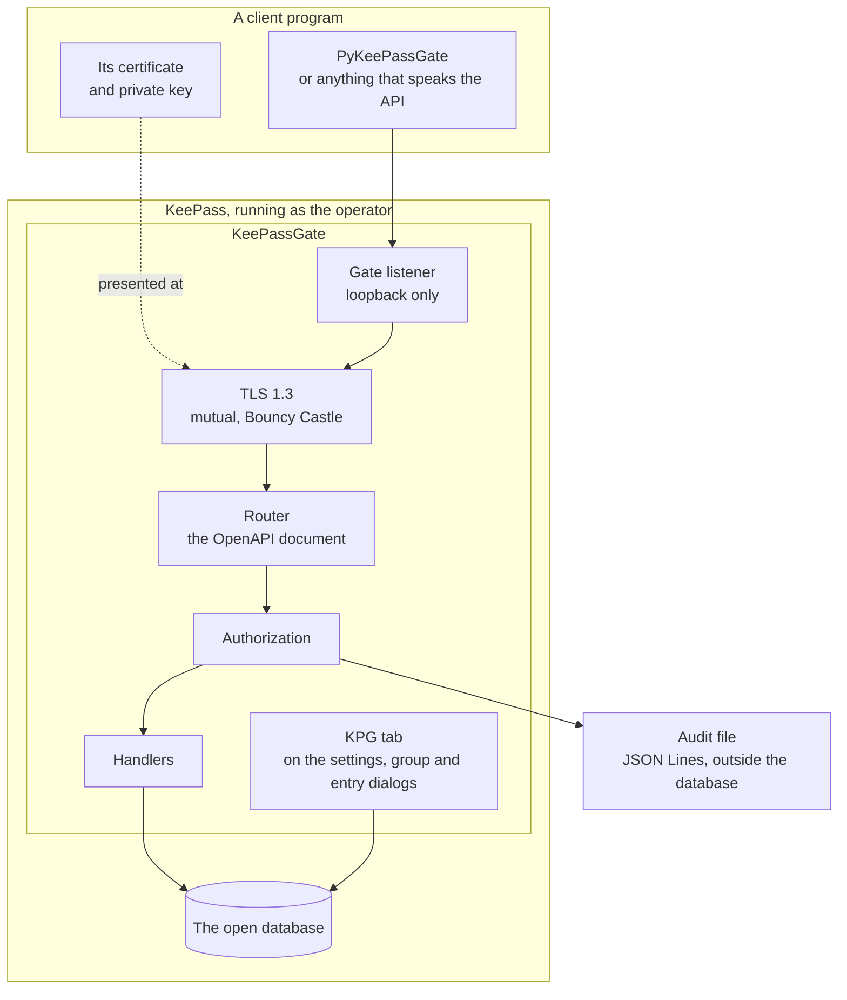
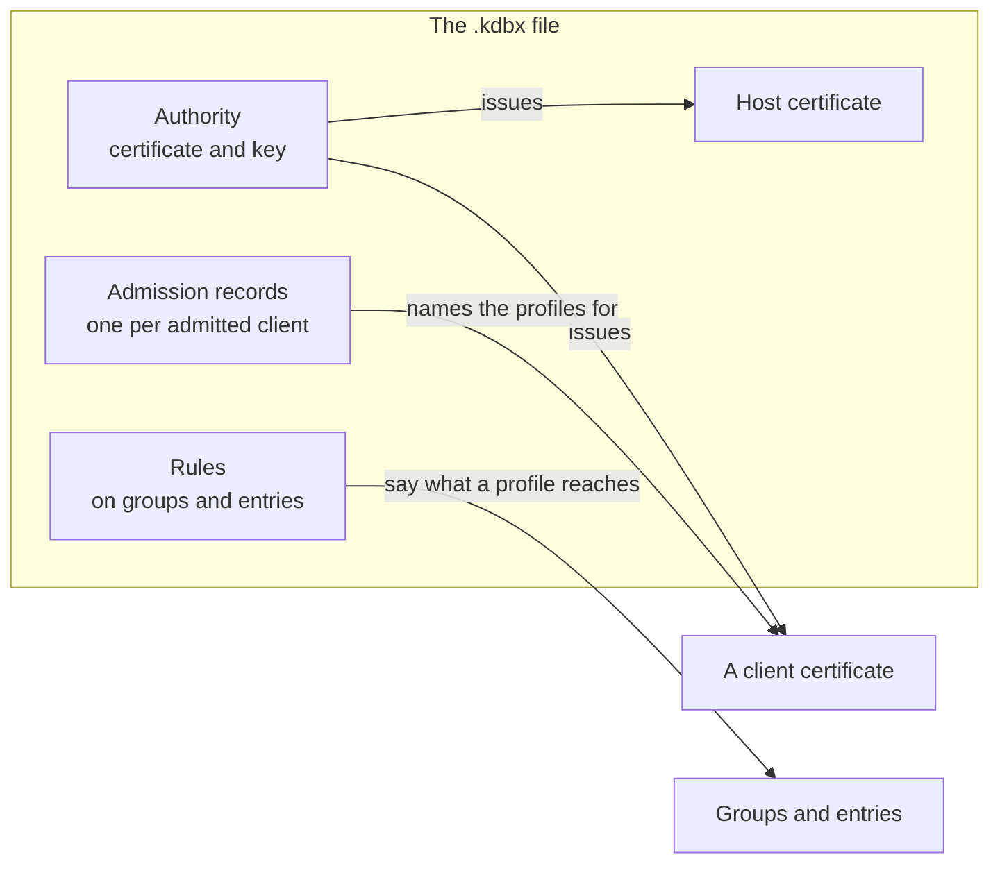
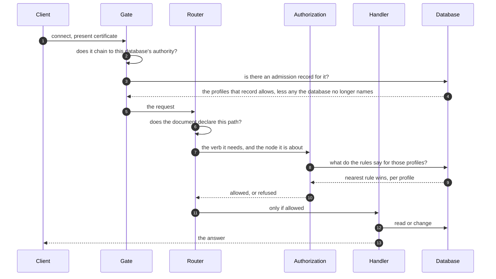

# The system on one page

What the pieces are and how a request gets through them. [`../DESIGN.md`](../DESIGN.md) is the
argument for all of it; this is the shape.

## The parts

**Everything is inside KeePass.** There is no service, no daemon and no second process. Close
KeePass and nothing is served.

**The listener is on loopback only.** Nothing off the machine can reach it. Which port it uses is
the plugin's one setting, on the window under **Tools**, **KeePassGate (KPG)**, and it is stored in
KeePass's configuration rather than in any database: one KeePass runs one gate for every database
open in it.

## What the database holds

Every database is its own certificate authority, stored inside itself. A malicious `.kdbx` therefore
vouches for nothing but itself.

The authority, the host certificate, the records, the revocations and the list of profile names live
in the database's own custom data. The rules live on the
group or entry they are about. All of it is inside the database, covered by the database's own
encryption, and none of it is anywhere else on the machine.

## How one request is decided

**Both halves have to allow it.** The record says which profiles a certificate may use, and only
the ones the database still names count; the rules say what those profiles reach. Neither is
enough on its own, and the record is read from the open database every time, which is what makes
revoking one immediate.

**Every decision is written to the audit file**, allowed or refused, outside the database so that a
program with access to the database cannot edit the record of what it did.
[`audit.md`](audit.md) says where that file is and what a line in it holds.

**A change is saved as it is made, and the whole database is saved with it.** Every route that
changes something ends in KeePass's own save of the database it changed, the same save as pressing
Save, so anything else in that database that had not been saved yet reaches the disk with it: an
edit made in KeePass and left unsaved is saved by the next program that writes. While the save
runs KeePass does not respond, which on a small database is a moment and on a large one with a
long history is seconds, and changes take their turn, so a program writing often keeps the window
busy for as long as it writes. A trigger set on saving a database runs for these saves as for any
other, message boxes included. And each save counts as activity, so a program that writes
regularly keeps KeePass from locking itself after a period of KeePass inactivity.

**The lock after global user inactivity is the one writes cannot postpone.** KeePass has two
timeouts, both under **Tools**, **Options**, **Security**. **Lock workspace after KeePass
inactivity** counts from the last thing KeePass did on its own screen, and a save made for a
program is one. **Lock workspace after global user inactivity** counts from the last time Windows
saw the keyboard or the mouse, which KeePass asks Windows for every second, and nothing that comes
through the gate moves it. A lock that falls due while a change is being saved is applied once the
save is over, and one that falls due while KeePass has a question on the screen waits for the
answer, as below. Reading moves neither timeout.
[`getting-started.md`](getting-started.md#locking-while-a-program-writes) says which to set.

## The states of a database

| State | What is served |
| --- | --- |
| Open | everything the record and the rules allow |
| Locked | every route answers that the database is locked, and nothing else |
| Undecided | the database holds more than one authority and the operator has not kept one: every route answers that, and nothing else |
| Open twice | two copies of one database holding the same authority, a backup opened beside the original for instance, answer to the same name and cannot be told apart, so neither is served: a connection is dropped before TLS until one of them is closed |
| Closed | the gate is listening, but nothing resolves, so a connection is dropped before TLS |
| KeePass not running | nothing is listening |

A locked KeePass still answers, using a second host certificate held only in memory, made when the
database is opened and made again as it is locked, and good for ninety days from then, so a client
gets a refusal it can read rather than a connection failure it cannot interpret. At lock the plugin
lets go of the key of the host certificate the gate serves the open database with, and
[`../CA.md`](../CA.md) §208 says how much of that is erasure. The key that reads the database is
KeePass's own, and the plugin never holds it.

**KeePass does not lock while it has a question of its own on the screen**, and that is worth
knowing because an agent can put one there. When a save fails, KeePass warns that writing to the
file may have failed and waits for somebody to answer. Until they do, the inactivity countdown
restarts every second, and a Windows lock, a user switch or a suspend is dropped rather than
remembered: the database stays Open, the gate goes on serving it, and after the box is answered the
lock that was asked for is not applied. This is how KeePass behaves for any failed save, including
one the operator caused; what is new is that a write arriving over the gate can cause it while
nobody is at the desk. If a database is kept somewhere its saves can fail, that is worth knowing
before leaving the machine on a lock timeout.

## What this deliberately does not defend against

**A program running as the same account.** It can read the database file, the plugin's memory and
anything else that account can reach. Conceded throughout the design.

**A caller deliberately let in asking for too much.** That is what the record and the rules are for, and it
is the threat this is actually built against: an automated client, including one driven by a model,
can be talked into asking for more than it should, so what it may reach is decided here rather than
there.
