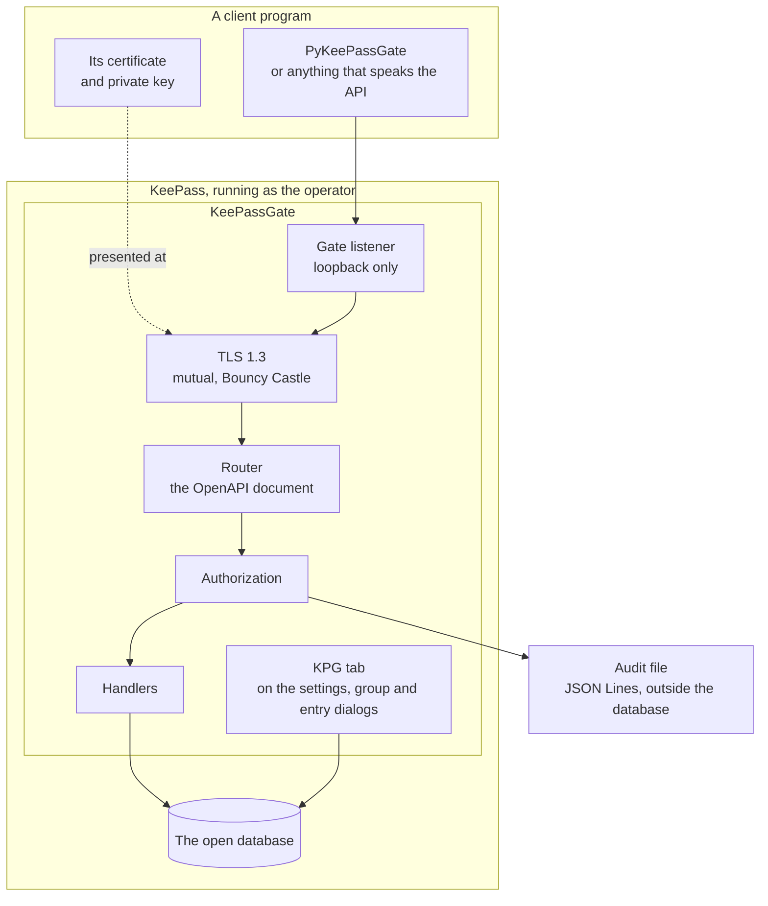
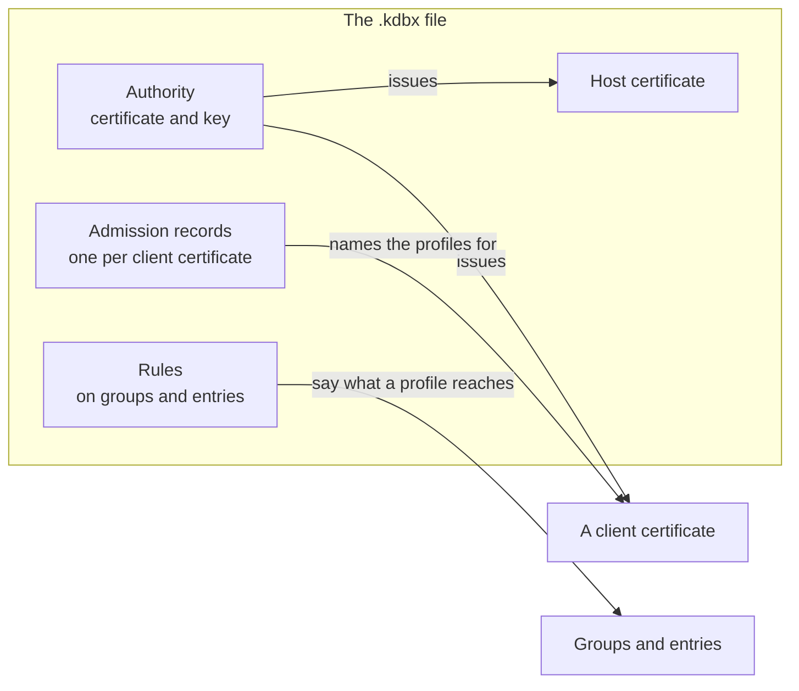
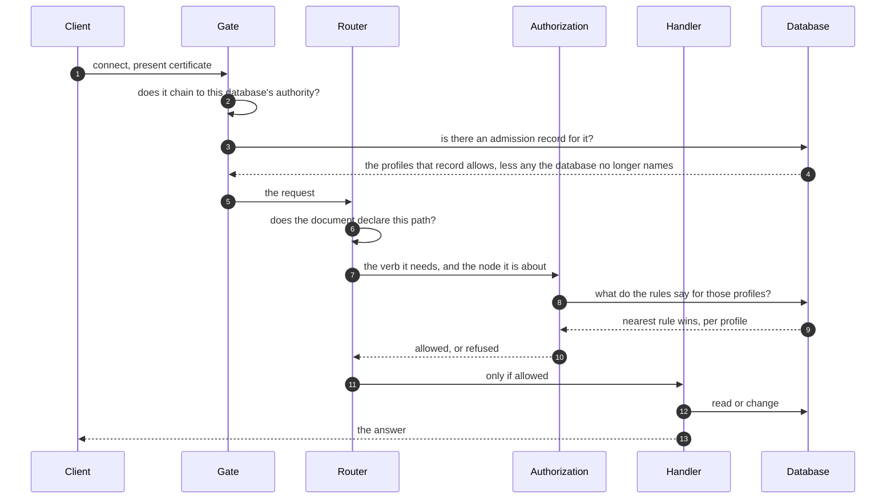

# The system on one page

<!-- A policy option of KeePass's own, named the way KeePass names it. -->
<!-- cspell:ignore Unhide -->

What the pieces are and how a request gets through them. [`../DESIGN.md`](../DESIGN.md) is the
argument for all of it; this is the shape.

## The parts

**Everything is inside KeePass.** There is no service, no daemon and no second process. Close
KeePass and nothing is served.

**The listener is on loopback only.** Nothing off the machine can reach it. Which port it uses is
the plugin's one setting, on the window under **Tools**, **KeePassGate (KPG)**, and it is stored in
KeePass's configuration rather than in any database: one KeePass runs one gate for every database
open in it.

## What the database holds

Every database is its own certificate authority, stored inside itself. A malicious `.kdbx` therefore
vouches for nothing but itself.

The authority, the host certificate, the records, the revocations and the list of profile names live
in the database's own custom data. The rules live on the
group or entry they are about. All of it is inside the database, covered by the database's own
encryption, and none of it is anywhere else on the machine.

## How one request is decided

**Both halves have to allow it.** The record states which profiles a certificate may use, and only
the ones the database still names count; the rules state what those profiles reach. Neither is
enough on its own, and the record is read from the open database every time, which is what makes
revoking one immediate.

**KeePass's own policies do not narrow what a program gets.** The options under **Tools**,
**Options**, **Policy**, whether set there or enforced by an administrator, govern the person at
KeePass's window. With **Unhide Passwords**, **Export** or **Clipboard** turned off, the gate still
serves a program whatever its rules allow, protected values and whole listings included, and the
button beside an invitation on the KPG tab still copies it. **Save Database** is the exception:
with it turned off, KeePass answers a save with a warning box and saves nothing, so the gate
answers "busy" to every request that would save the database rather than put that box on the
screen.

**Every decision is written to the audit file**, allowed or refused, and so is every pairing and
renewal the operator answers and every client revoked, outside the database so that a program with
access to the database cannot edit the record of what it did.
[`audit.md`](audit.md) states where that file is and what a line in it holds.

**A change is saved as it is made, and the whole database is saved with it.** Every route that
changes something ends in KeePass's own save of the database it changed, the same save as pressing
Save, so anything else in that database that had not been saved yet reaches the disk with it: an
edit made in KeePass and left unsaved is saved by the next program that writes. While the save
runs KeePass does not respond, which on a small database is a moment and on a large one with a
long history is seconds, and changes take their turn, so a program writing often keeps the window
busy for as long as it writes. A trigger set on saving a database runs for these saves as for any
other, message boxes included. And each save counts as activity, so a program that writes
regularly keeps KeePass from locking itself after a period of KeePass inactivity.

**A read holds KeePass still for as long as it takes**, so that nothing KeePass does can change the
database under it: well under a millisecond to look one entry up, and about seventeen to list ten
thousand. A read waits for KeePass to have nothing else to do first, so what is typed or clicked in
the window goes ahead of it, and so do KeePass's own timers, among them the one that locks it after
a period of inactivity. A read that KeePass cannot make room for within ten seconds, because it is
busy with something it does not pause in, answers "busy". **And no read starts inside a merge**:
while KeePass imports, synchronizes or runs XML Replace, what it holds is part of one database and
part of another, so a read asked for then waits for the merge to end and is answered from what it
leaves, or "busy" when the merge takes more than ten seconds.

**A program can ask not to write over what changed since it read.** Reading a group or an entry
hands back a tag of what it holds, and a program that hands the tag back with its write is
refused, with nothing changed, when that changed in between: for an entry anything in it, its
fields and attachments included, and for a group its own name, notes, place and times, but not the
groups and entries inside it. The change can be an edit made in KeePass, another program's write or
a synchronize. A program that does not hand one back writes over whatever is there, which is what
every write did before, and the entry's history keeps what it replaced, as for any change. Which
kind a program is, is its author's choice rather than something a rule can require.

A tag goes only to a program whose rule may read everything it covers: `read` on a group, and on an
entry `read` reaching its attachments, and its protected values too when it holds any. Every entry
KeePass makes holds a protected value from the start, its password, protected by default however
empty, so there the rule needs `P` as well. Any other program is handed none and cannot write under
one, because a tag compared by a program that may not read what it covers would let it test guesses
at that. A tag is made with a secret derived from the database's own host key, so it tells anyone
else nothing about what is in the entry, and it stays the same when KeePass starts again; recreating
the database's authority changes every tag.

**The lock after global user inactivity is the one writes cannot postpone.** KeePass has two
timeouts, both under **Tools**, **Options**, **Security**. **Lock workspace after KeePass
inactivity** counts from the last thing KeePass did on its own screen, and a save made for a
program is one. **Lock workspace after global user inactivity** counts from the last time Windows
saw the keyboard or the mouse, which KeePass asks Windows for every second, and nothing that comes
through the gate moves it. A lock that falls due while a change is being saved is applied once the
save is over, and one that falls due while KeePass has a question of its own on the screen waits for
the answer, as below. The plugin's pairing and renewal dialogs are not such a question: a lock goes
through under one and closes it as unanswered, and the program is told the database is locked.
Reading moves neither timeout.
[`getting-started.md`](getting-started.md#locking-while-a-program-writes) states which to set.

## The states of a database

| State | What is served |
| --- | --- |
| Open | everything the record and the rules allow |
| Locked | every route answers that the database is locked, and nothing else |
| Undecided | the database holds more than one authority and the operator has not yet kept any of them: every route answers that, and nothing else |
| Open twice | two copies of one database holding the same authority, a backup opened beside the original for instance, answer to the same name and cannot be told apart, so neither is served: a connection is dropped before TLS until one of them is closed |
| Closed | the gate is listening, but nothing resolves, so a connection is dropped before TLS |
| KeePass not running | nothing is listening |

A locked KeePass still answers, using a second host certificate held only in memory, made when the
database is opened and made again as it is locked, and good for ninety days from then, so a client
gets a refusal it can read rather than a connection failure it cannot interpret. At lock the plugin
lets go of the key of the host certificate the gate serves the open database with, and
[`../CA.md`](../CA.md) §208 states how much of that is erasure. The key that reads the database is
KeePass's own, and the plugin never holds it. A database locked while Undecided answers nothing,
since a responder would have to be made under one of its authorities, and neither does a database
locked with no current responder to answer with: until it is unlocked, a connection to it is
dropped before TLS, as a connection to a closed database is.

**KeePass does not lock while it has a question of its own on the screen**, and that is worth
knowing because an agent can put one there. When a save fails, KeePass warns that writing to the
file may have failed and waits for somebody to answer. Until they do, the inactivity countdown
restarts every second and nothing can lock: the database stays Open and the gate goes on serving it.
This is how KeePass behaves for any failed save, including a save the operator caused; what is new
is that a write arriving over the gate can cause it while nobody is at the desk. If a database is
kept somewhere its saves can fail, that is worth knowing before leaving the machine on a lock
timeout.

**A Windows lock during a save that a program's write makes is applied once that write has been
answered.** KeePass itself drops a Windows lock, a user switch, a suspend or a change of remote
control that arrives while it is saving, so the plugin notes such a lock arriving during its own
save, where KeePass is set to lock for it, and has KeePass lock once the program that wrote has its
answer. The screen is locked by then, since Windows locks it whatever KeePass does, so this happens
behind it. After a failed save that is once the warning is answered.

## What this deliberately does not defend against

**A program running as the same account.** It can read the database file, the plugin's memory and
anything else that account can reach. Conceded throughout the design.

**A caller deliberately let in asking for too much.** That is what the record and the rules are for, and it
is the threat this is actually built against: an automated client, including one driven by a model,
can be talked into asking for more than it should, so what it may reach is decided here rather than
there.

**A URL a program wrote, opened by the operator.** The gate stores a URL as it is written, and
KeePass's Open URL resolves references in it, replaces environment variables, starts programs and
fills in override command lines. A link in an entry's notes or fields, clicked in KeePass's entry
view, has its environment variables replaced the same way. So a program allowed to change one entry
can reach further through the operator's click than its rules let it reach through the gate. This
is conceded until one check can judge a URL with what the gate and KeePass both know, and
[access-control.md](access-control.md) describes what to watch for.
