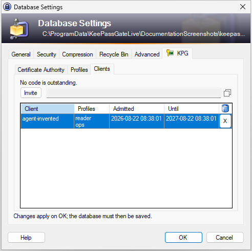
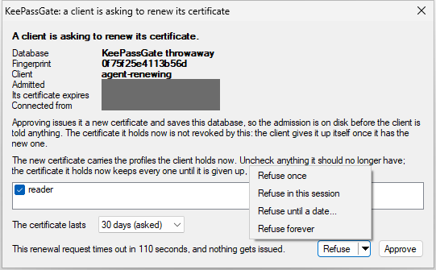
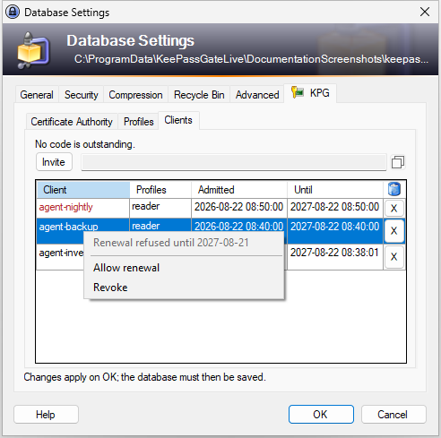

# Who is in, and taking one back out

The **Clients** page of the **KPG** tab lists every program this database has admitted, and takes
one away.

## The list

One row per admission record, newest first, because the one being looked for is usually the one
just approved.

| | |
| --- | --- |
| **Client** | the name the program asked to be called when it paired |
| **Profiles** | the profiles approved for it, which is what its rules are worked out from. One this database no longer names is dimmed and marked "(removed)": the client still holds it, and it grants nothing unless the name is added back |
| **Admitted** | when it was approved, in UTC and to the second |
| **Until** | when its certificate stops working, or why it does not work at all |
| **X** | takes this client's admission away |

**Resting the pointer on a row names its keys in full**: the **client key**, which is the
fingerprint of the certificate the client paired with and stays the same through every renewal, and
the **certificate**, the fingerprint of the one this row admits, which is what the
[audit file](audit.md) names it by. A name is the program's own choice and need not be unique, so
two rows under one name are either one client that [renewed](#expiry) and still holds its older
certificate, both rows with one client key, or two programs that chose the same name, such as one
program on two machines, with two. Every count of clients on these pages counts client keys, and a
sentence naming two clients that share a name adds the start of each client key, "agent
(3f2a9c1e)". The key is in the tooltip rather than in a column because the page has no room for one
beside the names, and it does not scroll.

**A name in red** is a client whose renewals stand refused, by one of the
[standing answers](#taking-a-standing-answer-back) the renewal dialog can give. Resting the pointer
on any of the row's text says which one, above the keys: refused forever, until a day, or in this
session. A screen
reader is told the same words as the row's description. A selected row keeps the list's own
colors, so the red shows only while the row is not selected.

**Each row has a menu**, opened with the right button on the row, or with Shift and F10 or the menu
key on the selected row. For a client with a standing answer, its first line states the answer,
grayed out, and under it are **Allow renewal**, which takes the answer back, and **Revoke**, which
does what the **X** does. For any other client, Allow renewal is grayed out.

A client whose certificate has expired is refused like any other, and **Until** says `expired`
instead of a date, by this computer's clock. The row goes with the next change the plugin itself
makes to the database: revoking a client, pairing or renewing one, a client revoking itself, or
keeping, recreating or deleting the authority. The plugin's log names each row that goes that way,
because a clock set wrong can cost one that setting it right does not bring back. Until then it says
`expired`, because a row that has expired and a row somebody removed look the same once the row is
gone, and only one of them needs doing anything about.

**Until** says `not this authority` for a record whose certificate this database's authority did not
issue. The gate checks that before anything else, so such a record grants nothing whatever its dates
say, and a date there would be the one thing about the row that is not true. Records reach that
state by outliving the authority that made sense of them: an authority recreated or deleted while a
program was pairing, the authorities not kept when a database held more than one, or a synchronize
or a partial restore carrying records across. Removing them is the same **X**, and there is nothing
else to do with them.

Two more phrases take the date's place, for the two things the gate asks next, in the order it asks
them. `not for client use` is a certificate this authority issued for something other than a
program to present, such as its own host certificate: only a file written by hand or merged from
another copy holds such a record, since pairing records only the client certificates it issues, and
it grants nothing. `not yet valid` is a certificate whose first moment has not come, which a clock
that is wrong on the machine that issued it, or on the one reading the file, produces: it grants
nothing until then. The expiry warnings on the Certificate Authority page leave all three out,
since the gate refuses them before their end matters.

**A record that cannot be read at all** is listed too, after the clients: damaged by a merge,
edited by hand, or written by a later version of the plugin. It admits nobody and has nothing to
show but the start of the key it is stored under, so the row holds that, `cannot be read` under
**Until**, and the **X**, which takes it away like any other, once OK is pressed. The Certificate
Authority page counts such a record and says how many cannot be read.

The list is read from the open database rather than remembered, so it never shows a client that
has gone or misses one that has arrived. A program that pairs while this dialog is open is added
to the list as it is approved, without the page having to be left and come back to, and bringing
the page to the front reads the database again anyway.

## Revoking

Press the **X** at the end of a client's row, or choose **Revoke** on the row's menu.

The row goes, and the page says so. **Nothing has happened to the database yet**: press **OK** on
the settings dialog to make it real, then **save the database** to write it to disk. Cancel discards
the revocation along with everything else done on this tab.

That is worth knowing rather than assuming, because it is the one place where waiting costs
something. A revocation that has not been accepted has not revoked anything, so if a
client's access is being taken away out of necessity, press OK and save before doing anything else.

**A renewal is the case it costs most.** Until OK the record is still in the database, so the
program can still [renew](#expiry), and approving that renewal admits it again under a new
certificate: OK then revokes only the old one, and the program stays admitted. Refuse a renewal
from a program whose revocation is waiting, or press OK and save first.

The mark is in the row it acts on, so there is never a question of which client a press would
remove. The same mark takes a rule away in the access editor.

**Once accepted it takes effect at once, and saving is what keeps it.** Records are read from the
open database on every request, so from the next request onwards that client is told it is not
admitted. Nothing has to be reloaded and nothing has to be told.

**A program can also revoke itself**, for a key it no longer trusts or a certificate it no longer
needs. That writes the same revocation this page writes, and its row leaves the list on its own,
without OK being pressed: nobody is asked, the database is saved before the program is told, and
this dialog being open at the time changes nothing, since its OK touches only what was changed on
it. It is refused while KeePass's Database Maintenance dialog is open, for the reason that dialog is
left alone below, and the program can ask again once it is closed.

The client keeps holding a certificate. It has simply stopped meaning anything to this database,
which is the point of the record existing separately: a certificate proves who a program is, and a
record is what grants it anything.

A revocation survives a synchronize and an import, including one from a copy of the file taken while
the client was still admitted. Revoking adds a mark of its own to the database, beside the client's
record, and the mark is never changed afterwards. KeePass merges by adding what the other copy has
and never takes a mark away, so the client stays refused whatever the other copy holds, whatever
the clocks of the computers involved say, and whether or not the file kept the time of each change.

The other copy can still bring the client's record back. It admits nobody, and it is not listed as
a client: a line under the list says how many revoked clients reappeared in a merge, and that they
stay refused. The next change the plugin itself makes to the database takes those records away and
the line with them: revoking another client, pairing or renewing one, a client revoking itself, or
keeping, recreating or deleting the authority.

The mark stays until the client's certificate expires. After that the certificate is refused on its
dates anyway, and the next revocation takes the mark away, and the emptied record with it.

**All of that holds in KeePass 2.48 or later with the plugin in it, and only there.** Other programs
can open the database, KeePassXC and KeePass before 2.48 among them, but saving or merging in one of
them can quietly bring back a revoked client, a replaced authority or a removed profile, because
their merges replace or drop what the plugin keeps. So save and merge a paired database only in
KeePass 2.48 or later with the plugin, and after any change made anywhere else, look at this list
and at the Certificate Authority page.

**Nor is anything here managed from KeePass's own Database Maintenance dialog.** Its **Plugin Data**
tab lists what the plugin keeps, each revocation's mark among it, and deletes a row on request.
Deleting a mark there takes away the one thing a merge cannot undo, so a copy of the file from
before the revocation can admit the client again. Revoke on this page, and leave that tab alone.

## Getting a client back

There is no undo. Pair it again: hand out a new invitation, let it ask, approve it. It gets a new
certificate and a new record, and the profiles are chosen again.

## Revoking everything at once

**Recreate authority** on the Certificate Authority page replaces the authority, which invalidates
every certificate it ever issued and removes every record and every revocation with it. The old
authority is retired rather than only removed, so a copy of the file from before cannot put it back
into service. Every program has to pair again.

That is the recovery from an authority no longer trusted. For one program, use the list.

**An exported database needs the same recovery if it goes astray.** KeePass's **File**,
**Export**, **KeePass XML (2.x)** writes everything the database holds in the clear, the
authority's signing key and every client's record included, and the plugin is not told. Keep such a
file as carefully as the database itself, and recreate the authority if it is lost.

## Expiry

The plugin warns before a client stops working, on the Certificate Authority page, in the last
third of its certificate's life and never more than thirty days ahead: thirty days for a
certificate of a year, ten for one of a month, a little over two for one of a week. So a short
certificate is not reported as about to expire from the day it was issued.

**A program that is about to expire asks to renew**, and KeePass raises a dialog like the pairing
one, in front and without taking the keyboard, with no invitation to hand out first: it says which
program is asking, when it was admitted, when the certificate it holds now ends, where the request
came from, and the profiles it holds, all checked. Uncheck anything the new certificate should not
carry; nothing can be added. The certificate it holds now keeps every profile until it is given up,
so to take one away at once, revoke the older row once the renewal is approved. A profile this
database no longer names is not offered, and a line under the list says it is not carried over. Pick
how long the new certificate lasts, as on the pairing dialog. A program that asks again while its
dialog is still up is told to wait, so the dialog never comes up twice for one certificate.

**Refusing can mean more than once.** Pressing **Refuse** refuses once, and so do Enter, Escape and
the close box: nothing is kept, and the program may ask again. The arrow beside **Refuse**, or Alt
and Down while the button has the focus, opens a menu of what else refusing can mean. Escape or a
click anywhere else puts it away, and a click on **Approve** that puts it away approves nothing:

- **Refuse once** is what pressing the button does.
- **Refuse in this session** answers every renewal of that certificate without asking until KeePass
  exits. It is kept in the plugin's memory and not in the database, so it goes when KeePass closes,
  and the next renewal after that raises the dialog again.
- **Refuse until a date...** asks for a day, from tomorrow to the day the certificate ends, with a
  week from today already chosen, and answers every renewal of that certificate without asking
  until that day begins. **Cancel** there goes back to the renewal dialog with nothing decided. On
  the certificate's last day there is no day left to name, so the choice is grayed out and says
  the certificate ends today.
- **Refuse forever** answers every renewal of it without asking at all, so the program has to pair
  again for a new certificate before this one runs out, unless the answer is taken back.

The last two are kept in the database. If KeePass is busy when one is given, saving or with
Database Maintenance open, it holds at once all the same, from KeePass's memory, and is written to
the database with the next change the plugin itself makes there. One still unwritten when KeePass
exits is lost, and KeePass says so as it closes, so that nobody is surprised when the dialog comes
back for that program.

The plugin's log says what was answered and when. One until a date or forever goes with the
revocation of the certificate it was about, and once that certificate has expired, with the next
change the plugin itself makes to the database, as an expired row does.

### Taking a standing answer back

A client whose renewals stand refused has its name in red on the list. Open its row's menu and
choose **Allow renewal**: it takes back whichever answer stands, forever, until a day or in this
session, and the menu's first line says which one that is before anything is chosen.

**It waits for OK, as a revocation does.** The name stops being red at once, and nothing has
changed yet: until **OK** is pressed on the settings dialog the program's renewals are still
refused without asking, and **Cancel** leaves the answer standing. After OK the next renewal raises
the dialog again, to be answered afresh. An answer forever or until a day is kept in the database,
so taking it back is a change to save; one in this session is kept only in KeePass's memory, so
there is nothing to save. A copy of the database from before the answer was taken back brings it
back when merged in, and its client's name is red again.

This is also the way out of an answer given by mistake, **Refuse forever** chosen in place of
**Refuse until a date...**, or too late a day: there is no need to revoke the program and pair it
again.

Approving writes a new record beside the old one rather than replacing it, so the program is listed
twice under one name, told apart by **Admitted** and **Until**, until it gives the old certificate
up, which the reference client does as soon as it has stored the new one. A program that does not
leaves the old row on the list until its own date; revoke it once the new one is approved.

**If KeePass is still busy a moment after Approve is pressed**, saving or with a dialog open that
would take the new record back, nothing is issued yet and the approval is kept, in KeePass's memory
only, until the end of the six minutes the request was given. The program is told until when, and
when it asks again for the same thing before then, the certificate is issued without the dialog
coming back; the reference client does so by itself. Locking KeePass, closing the database or
exiting KeePass lets go of the approval, and so does the program asking for something different,
such as another lifetime: then the dialog comes back, and approving it again is what issues the
certificate.

**If KeePass locks while the dialog is open**, from its own inactivity timer, Ctrl and L, a Windows
lock or anything else that locks it, the dialog closes as unanswered and the program is told the
database is locked. Nothing is written, and the certificate it holds still works: it can ask again
once KeePass is unlocked, which a program given time to wait does by itself, and the dialog comes
back then.

**The authority and the certificate KeePass answers with are good for a hundred years**, and
nothing counts down to that. They are made together and end together, so neither runs out under the
other, and nothing on the tab warns about them or turns a pairing away ahead of them. A leaked key is
answered by recreating the authority, as above, however long it has left.
