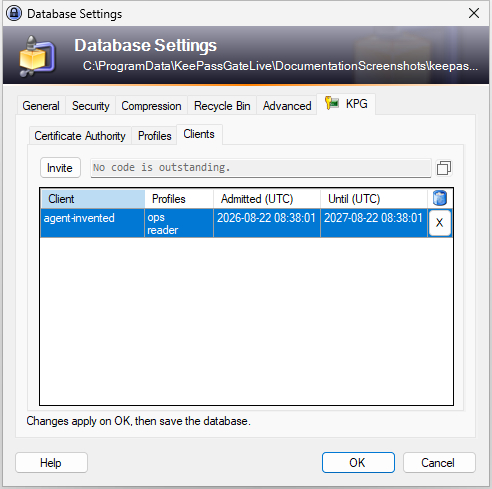
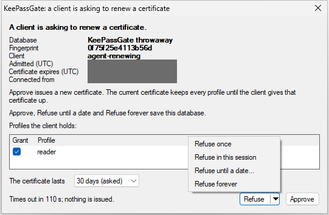
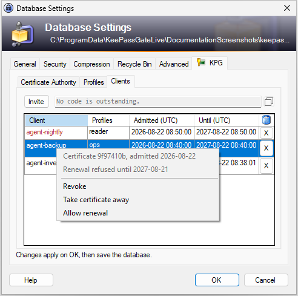

# Who is in, renewing a client, and taking a client back out

The **Clients** page of the **KPG** tab lists every program this database has admitted, with the
certificates each holds, and revokes a program or takes a single certificate away. A program
about to expire asks to renew on a dialog of its own, which approves the renewal or refuses it,
once or as a standing answer this page can take back: [Expiry](#expiry) covers both.

## The list

A row for each certificate, grouped by client. The client approved most recently is first, because
the client being looked for is usually the client just approved. A client that holds a single
certificate is a single row. Within a client the certificate admitted last is the first row: it
carries the client's name and the **X**. Each earlier certificate the client still holds is a row
indented under it, which reads `earlier certificate` where the first row reads the name and has
no **X**.

| | |
| --- | --- |
| **Client** | the name the program asked to be called when it paired, or `earlier certificate` on a row under it. A name too long for the column is cut, and the row's tooltip holds it whole; the column is always wide enough for the text of a row under a client, at every display scaling |
| **Profiles** | the profiles approved for that certificate, which is what its rules are worked out from. A profile this database no longer names is dimmed and marked "(removed)": the certificate still holds it, and it grants nothing unless the name is added back. A name too long for the column ends in "...", and the row's tooltip holds it whole |
| **Admitted (UTC)** | when that certificate was approved, to the second |
| **Until (UTC)** | when that certificate stops working, or why it does not work at all |
| **X** | on a client's first row: revokes the client, with every certificate it holds |

**Resting the pointer on a row names its profiles and its keys in full**: each profile as the row
marks it, the **client key**, which is the fingerprint of the certificate the client paired with
and stays the same through every renewal, and the **certificate**, the fingerprint of the
certificate this row admits. The [audit file](audit.md) names both on every line, as `clientKey` and
`admissionKey`. A name is the program's own choice and need not be unique, so two clients under
one name are two programs that chose the same name, such as one program on two machines, each
with a client key of its own. Every count of clients on these pages counts client keys, and a
sentence naming two clients that share a name adds the start of each client key, "agent
(3f2a9c1e)". The key is in the tooltip rather than in a column because the page has no room for one
beside the names, and it does not scroll.

**A row whose first cell is red** is a certificate whose renewals stand refused, by one of the
[standing answers](#taking-a-standing-answer-back) the renewal dialog can give. Resting the pointer
on any of the row's text states which one, above the keys: refused forever, until a day, or in this
session. A screen
reader is told the same words as the row's description. A selected row keeps the list's own
colors, so the red shows only while the row is not selected.

**Each row has a menu**, opened with the right button on the row, or with Shift and F10 or the menu
key on the selected row. Its first line names the certificate the menu is about, grayed out: the
start of the certificate's fingerprint and the day it was admitted. For a certificate with a
standing answer, a second grayed line states the answer. Under them are **Revoke**, on a client's
first row only, which does what the **X** does, **Take certificate away**, which
[takes that row's certificate away](#taking-a-single-certificate-away) and leaves the client
every other certificate it holds, and **Allow renewal**, which takes a standing answer back and
is grayed out where none stands. Where the Certificate Authority page states that nothing is
written into the store of this database in this session, no row carries the **X** and the menu
offers **Allow renewal** alone.

A certificate that has expired is refused like any other, and **Until (UTC)** states `expired`
instead of a date, by this computer's clock. The row stays: nothing takes a row away for its age,
so a certificate that ran out and a client somebody revoked never look the same. It goes when
the certificate is taken away, its client is revoked or the authority is recreated or deleted.

**Until (UTC)** states `not this authority` for a certificate that the authority this database
serves did not issue, for a record that names another authority than that as the issuer of its
certificate, and for every certificate while the database serves no authority at all, as while it
holds several authorities and none has been kept. The gate refuses each of those whatever its
dates state, so such a row grants nothing, and a date there would be the one thing about the row
that is not true. Revoking its client is the same **X**.

**Until (UTC)** states `listed twice` on each row of a certificate that more than one record
admits. None of them admits it, and resting the pointer on the row states so. The plugin writes no
such records; a file changed outside the plugin can hold them. Revoking one of the clients that
hold the certificate leaves it admitted for the other, and **Take certificate away** on any of
its rows takes the certificate from each of them.

**Until (UTC)** states `not counted` for a certificate that was renewed from a certificate taken
away, where whoever took that certificate away did not know of the renewal. That is a renewal
approved on a copy of the database that had not learned the older certificate was given up, seen
once the copies are synchronized, and the same holds for whatever was renewed onward from it.
The gate refuses such a certificate, and the program pairs again or renews from a certificate of
its own that is still admitted. Resting the pointer on the row states why: "Renewed, directly or
further back, from a certificate that was taken away without naming the renewal made from it, or
that no single admission admits, so it admits nobody." Such a row, a row marked `listed twice`
and a row marked `not this authority` count as no client anywhere on the tab: not in the count
of clients that recreating or deleting the authority is confirmed against, and not in the
warnings about certificates near their end.

Two more phrases take the date's place, for the two things the gate asks next, in the order it asks
them. `not for client use` is a certificate this authority issued for something other than a
program to present, such as its own host certificate: only a file written by hand or merged from
another copy holds such a record, since pairing records only the client certificates it issues, and
it grants nothing. `not yet valid` is a certificate whose first moment has not come, which a clock
that is wrong on the machine that issued it, or on the one reading the file, produces: it grants
nothing until then. The expiry warnings on the Certificate Authority page leave all three out,
since the gate refuses them before their end matters.

**A record that cannot be read as an admission** is listed too: under its client where it names a
client that is on the list, and after the clients otherwise, where several such records of a
client stand together under the first of them. The plugin writes no such record; a file changed
outside the plugin can hold such a record. It admits nobody and has little to show, so the row
holds `Certificate` and the start of the fingerprint it names, or `Entry` and the start of its
entry's identifier where it names no certificate, and `not counted` under **Until (UTC)**.
Resting the pointer on it states why and names in full what it holds. Where such a row is the
first row of a client it carries the **X**, which revokes that client as any other, once OK is
pressed; a row that names no client has no **X**. Where such a row names a certificate, its
menu takes that certificate away, which clears the row and admits nobody: a certificate that
was renewed from it stays `not counted`. The Certificate Authority page counts such records
and states how many cannot be read.

The list is read from the open database rather than remembered, so it never shows a client that
has gone or misses one that has arrived. A program that pairs while this dialog is open is added
to the list as it is approved, without the page having to be left and come back to, and bringing
the page to the front reads the database again anyway.

## Revoking

Press the **X** on a client's first row, or choose **Revoke** on that row's menu.

**It revokes the client, not a single certificate**, which a row's menu
[takes away alone](#taking-a-single-certificate-away). Every row of the client goes, and once
the last row on the list has gone, the empty list reads "No clients once OK is pressed."
**Nothing has happened to the database yet**: press **OK** on the settings dialog to make it real,
then **save the database** to write it to disk. Cancel discards the revocation along with everything
else done on this tab. A revocation that is waiting changes nothing about inviting: the invite
button above the list stays as it was, and a code handed out meanwhile pairs as any other.

That is worth knowing rather than assuming, because it is the one place where waiting costs
something. A revocation that has not been accepted has not revoked anything, so if a
client's access is being taken away out of necessity, press OK and save before doing anything else.

**A renewal approved meanwhile does not get round it.** Until OK the client is still admitted, so
the program can still [renew](#expiry), and a renewal approved before OK gives it a new
certificate. OK then revokes the client with that certificate as well, since what is revoked is
the client and every certificate it holds.

The mark is in the first row of the client it acts on, so there is never a question of which client
a press would remove. The same mark takes a rule away in the access editor.

**Once accepted it takes effect at once, and saving is what keeps it.** Records are read from the
open database as each request is served, so from then on that client is told it is not admitted, a
request of its own that was still waiting for KeePass included. Nothing has to be reloaded and
nothing has to be told. [The audit file](audit.md) records
the revocation at that moment, a line for each certificate the client held, by the certificate's
key and the client key, and records nothing for a revocation that Cancel took away.

**A program can also give its own certificate up**, for a key it no longer trusts or a certificate
it no longer needs. That takes away the certificate the program asks with and no other. Its row
leaves the list on its own, without OK being pressed, and the program's other certificates keep
working, which is how a program that renewed lets go of its older certificate. Nobody is asked,
the database is saved before the program is told, and this dialog being open at the time changes
nothing. It is refused while KeePass's Database Maintenance dialog is open, for the reason that
dialog is left alone below, and while KeePass's entry dialog is open on an entry of the plugin's
own group that the change would delete or put back; the program can ask again once the dialog is
closed. The audit file records it too, once it is in the database. A program that gives up the
only certificate it holds has to pair again.

The client keeps holding a certificate. It has simply stopped meaning anything to this database,
which is the point of the record existing separately: a certificate proves who a program is, and a
record is what grants it anything.

A revocation survives a synchronize and an import, including one from a copy of the file taken while
the client was still admitted. Revoking writes an entry of its own into the plugin's group,
`KeePassGate`, which is never changed afterwards, and every later change the plugin makes in that
group states the revocation again in a second entry. KeePass merges by adding what the other copy
has, so the client stays refused whatever the other copy holds and whatever the clocks of the
computers involved show. **It refuses every certificate of that client**, a certificate the client
renewed to on a copy of the database that had not learned of the revocation among them.

**A certificate taken away stays refused the same way**, whether its program gave it up or it was
taken away on this page, and so does a certificate renewed from it on a copy that had not
learned it was taken away. A certificate the program renewed to before the old certificate was
taken away, on the copy where that happened, keeps working.

**A copy learns of either by a synchronize, or by an import that matches entries.** An import
with **Create new IDs** changes nothing about which clients the database imported into admits,
so a copy that still admitted the client goes on admitting it until it is synchronized.

The other copy can still bring the client's certificates back. They admit nobody and are not
listed: a line under the list states how many removed clients came back in a merge, and that they
stay refused. The next change the plugin itself makes to the database takes them away and
the line with them: revoking another client, taking a certificate away, pairing or renewing a
client, a program giving a certificate up, or keeping, recreating or deleting the authority.

**A revocation has no end.** It stays in the database for good, so a revoked client comes back
only by [pairing again](#getting-a-client-back), as a new client. The entries of the plugin's group
are the plugin's own: deleting a revocation's entry there by hand does not admit the client again,
and nothing on this page is managed by editing that group.

**All of that was measured in KeePass with the plugin in it, which is 2.62 or later.** Other
programs can open the database, KeePassXC, KeePass before 2.48 and programs on Android among
them, and what follows is what was measured of them for what the plugin keeps outside its own
group: the standing answers to a renewal. **Merging an older copy into the
database in KeePassXC quietly brings back every standing answer** the older copy still had.
Saving in KeePassXC, from 2.4.1 to 2.8.0, or in KeePass 2.47 keeps
what the plugin wrote there but usually drops the times it was written at, and a later
synchronize in KeePass can then put an older standing answer back over a later answer about the
same certificate. Releases not named here were not measured. [`CA.md`](../CA.md) §204 has what
was measured.

So save and merge a paired database only in KeePass with the plugin in it, and after any change
made anywhere else, look at this list, the Profiles page and the Certificate Authority page, and
at the State column on the [**KPG** tab](access-control.md#reading-the-state-column) of the
groups and entries that hold rules: the **Rules** column on the Profiles page counts, for each
profile, the groups and entries with a rule for it.

**Nor is anything here managed from KeePass's own Database Maintenance dialog.** Its **Plugin Data**
tab lists the standing answers to a renewal, which the plugin keeps outside its own group, and
deletes a row on request. Deleting a standing answer there puts that certificate's next renewal to
the operator again. The dialog also writes its own copy of those rows back as it closes, over
whatever was written while it was open, which is why a pairing, a renewal and a program giving a
certificate up are refused until it is closed. Manage clients on this page, and leave that tab
alone.

## Getting a client back

There is no undo. Pair it again: hand out a new invitation, let it ask, approve it. It gets a new
certificate and a new record, and the profiles are chosen again. To the database it is a new
client, with a client key of its own.

## Taking a single certificate away

Open the menu of the certificate's row and choose **Take certificate away**.

**It takes that certificate away and no other.** The row goes, and the client keeps every other
certificate it holds, whichever of its certificates was taken away first: an earlier
certificate taken away after a later certificate leaves the same certificates working as the
other order does. Where the row was the client's first row, the next row of the client becomes
its first row, with the client's name and the **X**. Where it was the only certificate the
client held, the client leaves the list without being revoked, and the program pairs again. It
is the command for a certificate the program no longer uses and did not give up itself, such as
the earlier certificate a renewal left behind, or a certificate a renewal issued whose answer
never reached the program.

Like a revocation it waits: nothing has happened to the database until **OK** is pressed on the
settings dialog, Cancel discards it, and saving the database is what keeps it. It changes
nothing about inviting meanwhile. Until OK the certificate still works, and a renewal the
program makes from it meanwhile keeps working afterwards, as a renewal made before the press
does. Once accepted, the certificate is refused from the next request, and
[the audit file](audit.md) records it, by the certificate's key and the client key.

**It ends that certificate alone, and not what was already renewed from it.** A certificate
that was renewed from it before it was taken away, on this copy of the database, keeps working,
and so does whatever was renewed onward from that. So where a certificate may have been stolen
and renewed from, taking it away is not enough: **revoke the client**, which refuses every
certificate of the client, wherever and whenever it was issued. To end a program's access for
any other reason, revoke the client as well.

## Revoking everything at once

**Recreate authority** on the Certificate Authority page replaces the authority, which invalidates
every certificate it ever issued and takes every client off this list with it. The old
authority is retired rather than only removed, so a copy of the file from before, synchronized or
merged in later, cannot put it back into service. Every program has to pair again.

**A copy opened on its own is not retired.** The retirement is written into this database alone, so
a backup from before the recreation, opened in a KeePass with the plugin loaded, still serves its
own authority and every client it admitted. Recreate or delete the authority in such a copy as
well, or open it only in a KeePass without the plugin.

That is the recovery from an authority no longer trusted. For one program, use the list.

**An exported database needs the same recovery if it goes astray.** KeePass's **File**,
**Export**, **KeePass XML (2.x)** writes everything the database holds in the clear, the
authority's signing key and every client's record included, and the plugin is not told. Keep such a
file as carefully as the database itself, and recreate the authority if it is lost.

## Expiry

The plugin warns before a client stops working, on the Certificate Authority page, in the last
third of its certificate's life and never more than thirty days ahead: thirty days for a
certificate of a year, ten for one of a month, a little over two for one of a week. So a short
certificate is not reported as about to expire from the day it was issued.

**A program that is about to expire asks to renew**, and KeePass raises a dialog like the pairing
one, in front and without taking the keyboard, with no invitation to hand out first: it names which
program is asking, when it was admitted and when the certificate it holds now ends, both in UTC as
the dialog marks them, where the request came from, and the profiles it holds, all checked. Uncheck
anything the new certificate should not carry; nothing can be added. The certificate it holds now
keeps every profile until the program gives it up, which the reference client does as soon as it
has stored the new certificate. A profile this database no longer names has a red X in place of a
box and its name in gray: the new certificate goes without it, as the pointer on either says;
where no profile the program holds is still named, a notice above the table reads "The new
certificate reaches no profile.". With more profiles than the table shows, the row at its bottom
is cut in half while the table is at the top of its rows, as on the pairing dialog. Pick how
long the new certificate lasts, as
on the pairing dialog. A program that asks again while its dialog is still up is told to wait,
so the dialog never comes up twice for one certificate.

**Refusing can mean more than once.** Pressing **Refuse** refuses once, and so do Enter, Escape and
the close box: nothing is kept, and the program may ask again. The arrow beside **Refuse**, or Alt
and Down while the button has the focus, opens a menu of what else refusing can mean. Escape or a
click anywhere else puts it away, and a click on **Approve** that puts it away approves nothing:

- **Refuse once** is what pressing the button does.
- **Refuse in this session** answers every renewal of that certificate without asking until KeePass
  exits. It is kept in the plugin's memory and not in the database, so it goes when KeePass closes,
  and the next renewal after that raises the dialog again.
- **Refuse until a date...** asks for a day, from tomorrow to the day the certificate ends, both
  where the operator is rather than in UTC, with a week from today already chosen, and answers every
  renewal of that certificate without asking until that day begins there. **Cancel** there goes
  back to the renewal dialog with nothing decided. On the certificate's last day there is no day
  left to name, so the choice is grayed out and states that the certificate ends today.
- **Refuse forever** answers every renewal of it without asking at all, so the program has to pair
  again for a new certificate before this one runs out, unless the answer is taken back.

The last two are kept in the database, and **choosing either saves the database**, as **Approve**
does, which the dialog states in its second line: the answer is in the file before the program
is told it was refused, and nothing is left for a later save. If the answer cannot be written
then, because KeePass is part way through work of its own, Database Maintenance or the TAN wizard
is open on that database, or another copy has replaced the file, it holds until KeePass exits
instead, as **Refuse in this session** does, and a message under the plugin's name comes up once
the renewal dialog has gone: "The answer to the renewal was not written:" and the reason, then
"Renewal stays refused until KeePass exits." The next renewal after KeePass starts again raises
the dialog, where the answer can be given again. If the save ran and the file then does not hold
what KeePass wrote, the answer stays in force, KeePass shows the database as changed, and the
message states that the save of the answer could not be confirmed; a save of the database that
goes through keeps the answer. **A later answer about the same certificate is the answer that
counts**: an answer given on a later dialog, or an answer a synchronize brought in from another
copy, is kept.

The plugin's log states what was answered and when, and the audit file records every renewal the
operator answered or left unanswered, one refused without asking included. An approval is written
there when its record lands, which may be on the program's next try, below; one that issued
nothing, because the new record did not reach the disk, has no line there, and the log states why.
An answer until a date or forever goes once the certificate it was about is no longer on the list:
its client revoked, the certificate given up or taken away, or the authority recreated or
deleted. It stays past the certificate's end, as the expired row does.

Approving writes a new record beside the old record rather than replacing it, so the client has
two rows, the new certificate under the client's name and the old certificate indented under it
as `earlier certificate`, until the program gives the old certificate up, which the reference
client does as soon as it has stored the new certificate. A program that does not leaves the
earlier row on the list, where it reads `expired` once its date has passed, and where
[its menu takes it away](#taking-a-single-certificate-away).

**If KeePass is still busy a moment after Approve is pressed**, saving or with a dialog open that
would take the new record back, nothing is issued yet and the approval is kept, in KeePass's memory
only, until the end of the six minutes the request was given. The program is told until when, and
when it asks again for the same thing before then, the certificate is issued without the dialog
coming back; the reference client does so by itself. Locking KeePass, closing the database or
exiting KeePass lets go of the approval, and so does the program asking for something different,
such as another lifetime: then the dialog comes back, and approving it again is what issues the
certificate.

**If KeePass locks while the dialog is open**, from its own inactivity timer, Ctrl and L, a Windows
lock or anything else that locks it, the dialog closes as unanswered and the program is told the
database is locked. Nothing is written, and the certificate it holds still works: it can ask again
once KeePass is unlocked, which a program given time to wait does by itself, and the dialog comes
back then. **Closing the database the dialog is about closes the dialog the same way**, as
unanswered, and the program is told the database is locked; closing another database leaves the
dialog where it is. **Exiting KeePass closes it as unanswered too**, and the program is told
nothing: its connection ends with no answer, since the plugin stops with KeePass.

**The authority and the certificate KeePass answers with are good for a hundred years**, and
nothing counts down to that. They are made together and end together, so neither runs out under the
other, and nothing on the tab warns about them or turns a pairing away ahead of them. A leaked key is
answered by recreating the authority, as above, however long it has left.

### Taking a standing answer back

A certificate whose renewals stand refused has the first cell of its row in red on the list. Open
that row's menu and choose **Allow renewal**: it takes back whichever answer stands, forever, until
a day or in this session, and the menu states which answer that is, on the grayed line under the
certificate's, before anything is chosen.

**It waits for OK, as a revocation does.** The name stops being red at once, and nothing has
changed yet: until **OK** is pressed on the settings dialog the program's renewals are still
refused without asking, and **Cancel** leaves the answer standing. After OK the next renewal raises
the dialog again, to be answered afresh. An answer given on a renewal dialog before OK, which a
day that has passed makes possible, is newer than the choice: its client's name is red again, and
OK leaves that answer standing. An answer forever or until a day is kept in the database,
so taking it back is a change to save; one in this session is kept only in KeePass's memory, so
there is nothing to save. A copy of the database from before the answer was taken back brings it
back when merged in, and its client's name is red again.

This is also the way out of an answer given by mistake, **Refuse forever** chosen in place of
**Refuse until a date...**, or too late a day: there is no need to revoke the program and pair it
again.
