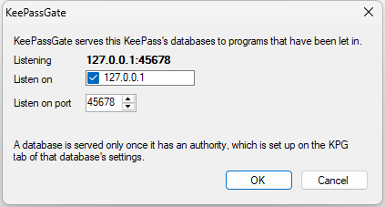
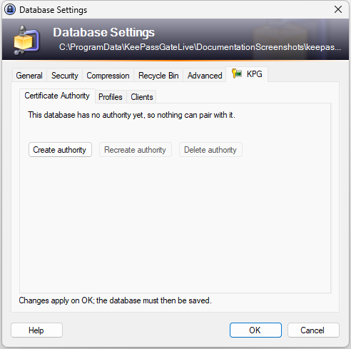
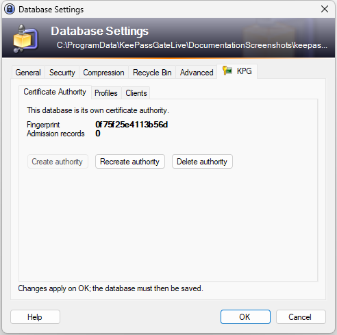
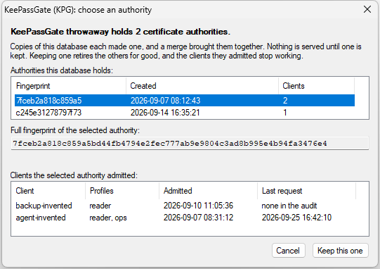

# Getting started

Install the plugin, open a database, and give it a certificate authority. After that it can let
programs in; until then it can do nothing at all.

## Install the plugin

KeePassGate is a plain DLL, built against KeePass 2.61.1, and it needs that release or a later one:
an older KeePass cannot load it. Make a directory named `KeePassGate` inside the `plugins` directory
of the KeePass installation, copy `KeePassGate.dll` **and every DLL beside it** into that, then
restart KeePass. KeePass looks for plugins in the directories under `plugins` as well.

Copying only `KeePassGate.dll` is the mistake worth naming. KeePass loads a plugin with
`Assembly.LoadFrom`, which looks for what that plugin needs in the plugin's own directory rather
than beside `KeePass.exe`. Without one of the DLLs `KeePassGate.dll` refers to directly, KeePass
refuses the plugin, in a box saying that the plugin cannot be loaded and naming the DLL it did not
find, at every start until the DLL is there. Without `SharpYaml.dll`, which only one of those needs,
the plugin gets far enough to refuse to start, and the same box names it. And KeePass checks what a
plugin needs once for each build of `KeePassGate.dll`, and remembers that the check passed, so a
DLL beside it that is removed or replaced later is left to the plugin to find: it loads every one
of them as it starts, and without one, or with one of another version than it was built against,
it refuses to start, the same box names the DLL, and so does [its log](#the-plugins-log).
Whichever it is, copying the whole set again mends it.

**A directory of its own is what keeps those DLLs this plugin's.** Other plugins ship some of
the same ones, `Newtonsoft.Json.dll` most of all, and in `plugins` itself there is room for one
copy of each. A plugin built against a different version from the copy that is there stops
working, and which plugin that is depends on nothing but the order they were installed in.
Installed in its own directory, each plugin finds its own.

**From a release**, which is the way most installs go: each one on
[the releases page](https://github.com/mfrnd/KeePassGate/releases) carries
`KeePassGate-<version>.zip` and a `SHA256SUMS`, and the zip holds the whole set, the license and
`THIRD-PARTY-NOTICES.md`, under `KeePassGate`. The sums name each file under `KeePassGate/` and the
zip by its own name, so they are checked where the zip lies: put both in one directory, extract the
zip there, run `sha256sum -c SHA256SUMS` in that directory, and only then copy the folder into
`plugins`.

When building from source, `.\build.ps1 -Task Deploy` copies the whole set into
`plugins\KeePassGate`, with `THIRD-PARTY-NOTICES.md` beside it, which holds the licenses of the DLLs
this project did not write. `.\run-debug.ps1` deploys and starts the KeePass this repository pins.
From a clone of the repository with no change left uncommitted, `.\build.ps1 -Task Package` puts
the same set and the license into one zip under `dist`, with a `SHA256SUMS` beside it to check every
file against; extracted into `plugins`, the zip makes `plugins\KeePassGate`. A source download has
no `.git`, and the package refuses it, because the build maps every source path to `/_/` from the
repository's own record and without one the plugin would name the directory it was built in. Its
sums are checked as a release's are.

To check that it loaded, open **Tools**, **KeePassGate (KPG)**.



That window is about the plugin rather than about any one database, which is why it is reachable
with no database open at all:

| | |
| --- | --- |
| **Listening** | the address a client connects to, or that nothing is listening. |
| **Incidents** | only appears if something went wrong in a way nobody predicted, directly under the address. [The plugin's log](#the-plugins-log) says what. |
| **Listen on** | the addresses the gate binds. There is one, `127.0.0.1`, and it cannot be turned off: nothing off this machine can reach the gate, and the rest of the plugin's security is written on that basis. |
| **Listen on port** | the port the next start of KeePass binds: the one chosen here, or while none has been, the one it is listening on. It is the only thing on this window that can be changed. What OK does with it is below. |

**The port is set here too**, and it is the only setting the plugin has. Type a port between 1024
and 65535 and press **OK**. **It takes effect the next time KeePass starts**, not straight away:
the gate binds its port once, while KeePass is loading, and never moves it afterwards, so a client
that is connected cannot have the socket taken out from under it by somebody looking at a settings
window. Cancel leaves the port where it was.

Until then the window says, under the table, which port the gate moves to, and the box holds it.
**Typing back the port the gate is listening on takes the change back**: OK then says the gate
stays where it is, and no client has anything to change.

OK writes the port into KeePass's configuration file there and then, the way KeePass's own Options
dialog does, so it is kept however KeePass is ended. A KeePass set not to save its configuration
cannot keep a port for the next start at all, and the window says so rather than pretending to.

One thing follows from changing it. **Every client already paired is configured with the old
port.** Nothing the database holds names a port, so the certificate and the record are unaffected,
but PyKeePassGate stores the port with the identity it keeps from pairing and offers no way to
change it afterwards. So each of its clients pairs again against the new port, and the record it
held before can then be revoked on the [clients page](clients.md).

**If something else on the machine is already holding the port**, nothing listens for the whole of
that run of KeePass. The plugin says so when it starts and this window repeats it, with the reason.
Everything else still works: settings, authorities and profiles can all be changed, and they are
waiting for the next start along with the port. But no client can connect until KeePass is started
again.

**A port can come from the environment instead**, as `KEEPASSGATE_PORT`, which is read when KeePass
starts and only when no port has been chosen on this window. It has to name a port from 1024 to
65535. Set to anything else, nothing listens for that run either: KeePass says so in a box when it
starts, naming the variable and what it held, and this window says why nothing is listening. Fix the
variable or remove it, then start KeePass again.

**With neither, the gate listens on 51776.** The picture above was taken with it on 45678, which is
the port every example on these pages uses as well: read it as whatever **Listening** shows.

The port belongs to this KeePass rather than to a database. One KeePass runs one gate and serves
every database open in it, which is why this is here rather than on a database's own settings.

**Two copies of one database open at once are the exception**, a backup opened beside the original
for instance. They hold the same authority and answer to the same name, so the gate cannot tell
which one a client means and serves neither of them until one is closed. Nothing on screen says
so: a client is told that its handshake failed, and [the plugin's log](#the-plugins-log) names the
reason.

If the item is not in the menu at all, the plugin did not load, for one of four reasons: the DLL is
in the wrong place, KeePass is older than 2.61.1, a DLL it needs is missing, or the plugin refused
to start. Where KeePass put up a box saying that the plugin cannot be loaded, the box names what it
could not find or why the plugin refused to start, and [the plugin's own log](#the-plugins-log)
has more. A refusal with no box is in that log alone. **Tools**, **Plugins** is KeePass's own list
and will not show it either.

## The plugin's log

The plugin says more in its log than a window has room for: why the gate is not listening, what an
incident was, why the plugin refused to start, which audit file it settled on, and why a change a
program asked for was refused. It is a file, by default under the Windows account KeePass runs as,
beside [the audit file](audit.md):

```text
%LOCALAPPDATA%\KeePassGate\plugin.log
```

The directory is made the first time a line is written. **To put it somewhere else**, set
`KEEPASSGATE_LOG_FILE` to the full path of the file, for the account KeePass runs as, before KeePass
starts. At eight megabytes the file is set aside as `plugin.log.1` and a new one is started, and the
one before that is deleted, as the audit's are. Every line goes to Windows's debug output as well,
which a debugger or a viewer such as Sysinternals DebugView shows while KeePass is running, and on
an account with no local application data directory for the plugin to find, that is the only place
it goes.

## Find the tab

Open the database to be served, then **File**, **Database Settings**. The plugin adds a tab
called **KPG**, with the plugin's icon on it, after the tabs KeePass brings. The tabs are short
because that strip is shared: KeePass puts five of its own on some of these dialogs and other
plugins may add more. The item under **Tools** says the name in full.



The tab has three pages, because it covers three subjects. **Certificate Authority** is what this
database can issue. **Profiles** is the names it can issue for. **Clients** is who holds what it
already issued.

Everything here is about this one database. What the plugin is and whether it is listening are on
the window above, because those answers are the same whichever database is open.

## Create the authority

Press **Create authority**.



The table is the whole state of it:

| | |
| --- | --- |
| **Fingerprint** | which authority this is. Written down somewhere, it is how a replaced authority is noticed: the one in the database is not the one that was made. |
| **Admission records** | how many records of programs let in the database holds and has not taken back out: one for each program, and two for one that has [renewed](clients.md#expiry) until it gives the old certificate up or the operator revokes it. One whose certificate has expired is counted until the plugin's next change to the database takes it away, and one whose record cannot be read until it is removed: the [clients page](clients.md) lists every one and says which admit nobody. |

No date is in it. The authority and the certificate KeePass answers with are made together and good
for a hundred years, so there is nothing to count down to: see [`clients.md`](clients.md#expiry).

Anything wrong or about to be wrong appears as a sentence under the table: a client in the last
third of its certificate's life, which is thirty days at most, and anything unreadable.

**Once it is saved, the file is KDBX 4.1.** What the plugin keeps in the database carries the time
each value was written, and that is a 4.1 field. KeePass 2.48 or later keeps those times. KeePassXC,
and KeePass before 2.48, open the file all the same, but saving or merging in them can undo what the
plugin keeps: [Revoking](clients.md#revoking) says what it costs and what to check afterwards.

## OK, then save

**Nothing on this tab is changed until OK is pressed, and OK does not save.**

That is what the notice on the page says, and it is worth reading once carefully. There are two
steps, and skipping either one loses the work:

1. **OK** on the settings dialog puts the changes into the database KeePass is holding. Cancel
   discards it, on every page of this tab, with one exception: an invitation already handed out
   lives in KeePass's memory rather than in the database, and [`pairing.md`](pairing.md) says how
   to take one back.
2. **Saving** writes that database to disk. Until it is saved, the file does not have it, and closing
   KeePass without saving throws it away.

Both steps apply to everything here: creating an authority, naming a profile, taking a client's
admission away.

**The authority cannot be created and a client paired in the same visit to this dialog.** A program
pairing talks to the gate, and the gate answers out of the database KeePass is holding, which has
not been told about anything still waiting for OK. So press OK, open the dialog again, and then
invite. The clients page says so itself while there is an authority change waiting.

Two things save the database without anybody pressing Save, and neither is on this dialog. Pairing
saves it before handing a certificate over, and [`pairing.md`](pairing.md) says why. And every change
a program makes through the gate is saved as it is made, along with anything else in that database
that had not been saved yet, an edit made in KeePass included:
[`architecture.md`](architecture.md#how-one-request-is-decided) says what else follows from that.

## Recreating and deleting

**Recreate authority** replaces the authority and revokes every client with it, once OK is pressed.
Every program let in has to pair again. It is the recovery from an authority no longer trusted, not a way
to remove one program: for that, see [`clients.md`](clients.md).

**Delete authority** stops this database being served at all.

Both ask first, and both say how many clients are about to be cut off, because that is the
number nobody can work out unaided. Both retire the old authority rather than only removing it, so
a copy of the file from before, synchronized in later, cannot put it back into service.

An authority made by a development build older than this layout is not read at all: the page says
the database has no authority yet. Create one, and pair every program again.

## When a database holds more than one authority

Two copies of one database that each created or recreated an authority, and were then synchronized,
hold both. The plugin will not guess which one is trusted, so it serves neither: every program that
connects is told the database is undecided, and nothing can pair.

KeePass then asks, in a window titled **KeePassGate (KPG): choose an authority** over its main
window, as soon as the plugin sees the database that way: when it is opened or unlocked, or when it
is saved, which is how a synchronize ends. The window lists every authority with its fingerprint,
when it was created and how many clients it admitted, and for the one selected, its whole
fingerprint and every client it admitted, with the client's profiles, when it was admitted and when
it last made a request, if the audit file remembers one.



**Keep this one** keeps the selected authority and retires every other one for good: the programs
they admitted stop working and have to pair again, and their rows stay on the clients page as
**not this authority** until they are removed. The database is marked changed and not saved, so
save it to keep the choice.

**Cancel** serves nothing. The Certificate Authority page then says the database holds more than
one authority, and **Choose authority** there asks again; a choice made from there waits for OK
like everything else on that tab.

## Locking while a program writes

KeePass can lock itself when nobody has used it for a while, and it has two timeouts for that under
**Tools**, **Options**, **Security**. A program writing through the gate treats them differently.

**Lock workspace after KeePass inactivity** counts from the last thing KeePass did, and every change
a program makes is one: each ends in a save, and a save is activity to KeePass. A program that
writes more often than the timeout keeps the database open however long nobody is at the desk.
Reading does not count.

**Lock workspace after global user inactivity** counts from the last time Windows saw the keyboard
or the mouse, and nothing a program does through the gate moves that. It is the one lock writes
cannot postpone, so it is the one to set when the database has to lock once nobody is at the desk,
whatever the programs reaching it are doing. A lock that falls due during a save is applied when the
save is over, and one that falls due while KeePass is waiting for an answer to a question of its own
waits for the answer: [`architecture.md`](architecture.md) says when that happens. A program's
question is not one of those: a lock that falls due while a pairing or renewal dialog is up closes
the dialog as unanswered, and the program is told the database is locked. A locked database
answers every request that it is locked, until somebody unlocks it.

## Next

The database can now issue certificates and nobody holds one. [`pairing.md`](pairing.md) is how a
program gets one.
