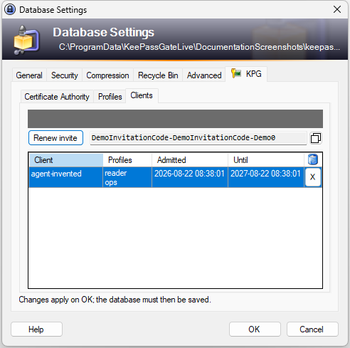
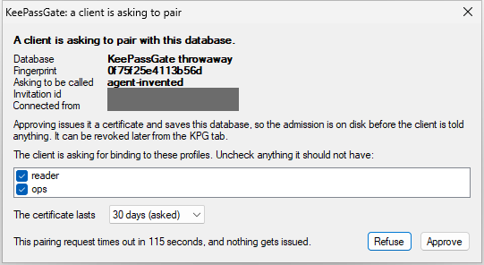

# Letting a program in

Pairing is how a program that holds nothing becomes a client that holds a certificate. It takes an
invitation from the operator, a request from the program, and an answer from the operator.

Nothing here is automatic. A program cannot pair itself in, and a program that has been refused
cannot try again with the same invitation.

## Hand out an invitation

**After creating or recreating the authority, press OK first and open this dialog again.**
Nothing on this tab is in the database until the dialog is accepted, and a program pairing is
answered by the database KeePass is holding rather than by the page on screen. The clients
page says so while there is anything waiting, and the button that hands out a code is dead until
there is not.

**It is dead while a profile change is waiting too**, for the same kind of reason and with the same
remedy: press **OK**, open the dialog again, and hand out the code then. See
[`access-control.md`](access-control.md).

Open **File**, **Database Settings**, the **KPG** tab, and the **Clients** page. Press
**Invite**.

The gray bar in this picture covers the line above the box. What it says is new every time an
invitation is handed out, so a picture of it would be a picture of one particular afternoon; on
screen it reads normally.

The code in the box is the invitation. Copy it with the button beside the box, or select it and copy
it by hand, and send it to whoever is setting the program up.

The button's copy is marked so that Windows keeps it out of clipboard history and out of the
clipboard shared between a person's machines, which is what KeePass does with everything it copies.
That stops the code being written down somewhere nobody looks; it is not protection from anything
running on this computer, which can read the clipboard whatever is on it. A copy made by hand
carries no such mark.

The line above the box says how long the code has left and gives the invitation an identifier. That
identifier, and not the code, is what the approval dialog shows when somebody redeems it, because a
single use credential is not worth putting on a second screen. It is there so that the dialog is
something checkable: if the identifier on it is not the one on this page, the code being
redeemed is not the code handed out.

Three things about that code surprise people, so the page says all three every time:

- **There is one code at a time.** Pressing the button again replaces it, and the code it replaced
  stops working at once. That is why, while a code is out, the button says **Renew invite**.
- **The first client to use it spends it.** A code given to two people admits whichever one gets
  there first, and the other one is not waiting, it is refused.
- **It is in this KeePass's memory and nowhere else.** It is never written to the database, so it
  does not travel with the file and does not survive KeePass closing. A code sent yesterday is
  gone.

That line also says how long the code has left. It runs out on its own in minutes.

**Close the dialog with OK to keep the code.** It works from the moment it is shown, so the program
can pair while the dialog is still open, but **Cancel**, or closing the dialog any other way, takes
back a code made on it that nobody has used yet. After **OK** it stays good until it runs out or
KeePass closes, and the page shows it counting down when the dialog is opened again. To take one
back sooner, open the dialog, press **Renew invite** and then **Cancel**: the old code stops working
when it is replaced, and Cancel takes back the new one. A code a program has already used stays
used, and the client it admitted is taken back by revoking it.

**Send it over a second channel.** Whoever holds the code may ask to pair, and the answer to the
dialog below is the only thing standing there.

## Answer the request

When the program asks, KeePass raises this:

The two gray bars cover the same kind of thing: the invitation's identifier and the address the
program connected from are both different on every run.

The table is what is being agreed to, and every row is worth checking against something
already known:

| | |
| --- | --- |
| **Database** | what KeePass calls this database. If it is not the database being approved for, refuse. |
| **Fingerprint** | the same database as the Certificate Authority page reports it. Two databases can share a name; none share this. |
| **Asking to be called** | the name the program chose for itself. It is what appears in the clients list afterwards. |
| **Invitation id** | which invitation this is against. The clients page shows the same identifier beside the code, so check the two against each other. If it is not the one handed out, refuse. |
| **Connected from** | always a loopback address, because the gate listens on nothing else, and a program that reaches it through a tunnel arrives from loopback as well. So this row cannot tell a program on this machine from one elsewhere: the invitation id above is what ties the request to the code handed out. |

Underneath, the profiles the program asked for, each with a check box. **Uncheck anything it should
not have.** What is left checked is what goes into the record, and what goes into the record is
the whole of what the program may ever use. Asking for a profile does not grant it: approving does.

A program can ask for up to 32 profiles, and the list shows ten at a time. Past ten it scrolls, and
a line under it says how many it holds, because **Approve grants every one still checked, seen or
not**. Scroll to the end before approving: a program that wanted something past the tenth row would
put it there.

**A profile marked "(new)" is one this database does not name now and no other client holds**, and
approving it adds it, so that approval does two things rather than one. It is marked because a name
never seen before and a name used every day would otherwise look identical, and the difference is
usually a spelling. It is usually a name never used before, which grants nothing until a rule says
so; but a name removed once, whose clients have all been revoked or have run out since, is marked
the same way, and any rule still naming it applies to the new program at once. The dialog says so,
and the Profiles page and the rules are where to look first.

**A profile marked "(removed)" is one this database used to name**, took off its list, and other
clients still hold. Approving it puts the name back on the list, and that brings more back than
this one program: every client still holding it regains it, and every rule still naming it applies
again. The dialog says so and names those clients, before anything is pressed. A client whose
certificate has expired is not among them: it regains nothing, and its record goes with the write.

A profile means nothing until a rule on a group or an entry names it, which is
[`access-control.md`](access-control.md). Approving a program for `reader` when nothing grants
`reader` anything admits a program that can reach nothing, which is a safe place to start.

**Under the profiles, how long the certificate lasts.** The list offers 1, 7, 30, 90 and 365 days.
A program may ask for anything from a day to a year, and what it asked for is chosen already and
marked "(asked)", offered beside the others when it is none of them. A program that asked for
nothing is offered a year. **Pick the shortest that will do**: a certificate that has run out is
refused without anybody having to remember to take it away, and a program that is still wanted
when it runs out pairs again.

The dialog closes itself after a couple of minutes and issues nothing when it does. An unanswered
request is not a refusal in one respect: the invitation is not spent, so the program can try again.
A refusal does spend it.

**Closing the dialog is refusing.** The close box, Alt with F4, the window menu and the taskbar all
mean no, and all spend the invitation, because dismissing a question about handing out a credential
is an answer rather than an absence. Leaving the dialog alone until it closes itself is the way to
say nothing.

## What approving does, in order

1. The certificate is issued by this database's authority.
2. The invitation is spent, so nothing else can use it.
3. Any profile marked "(new)" or "(removed)" is added to the ones this database names, unless it
   already names as many as it can hold, 32: then none is, and the dialog says so before anything
   is pressed.
4. The admission record is written into the database **and the database is saved**.
5. Only then is the certificate handed to the program.

The dialog says so before anything is pressed, because this is the one screen in the plugin whose
button writes the file.

The save comes before the certificate, and the order is why: a program holding a certificate for a
record that was never written would be a program that is refused forever and cannot say why.

**The Database Maintenance dialog refuses the whole thing before anybody is disturbed.** That
dialog takes a copy of the database's plugin data when it opens and writes the copy back when it
closes, which would silently destroy a record written while it was open. If a pairing is reported
refused for that reason, close the dialog and let the program ask again.

## What the program gets

A certificate, and the name it should use to reach this database. Nothing else. The profiles in the
record are the ones left checked, not the ones it asked for, and the program is told which it
got.

From here it connects, and every request it makes is checked against that record and against the
rules on the node it is asking about. [`clients.md`](clients.md) is how it is seen afterwards and
how the record is taken away.
