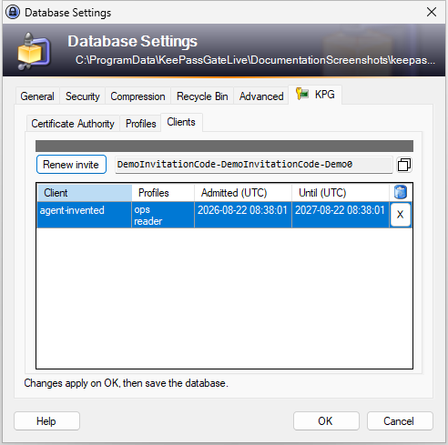
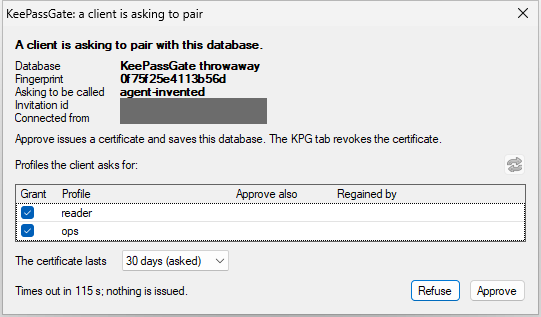

# Letting a program in

Pairing is how a program that holds nothing becomes a client that holds a certificate. It takes an
invitation from the operator, a request from the program, and an answer from the operator.

Nothing here is automatic. A program cannot pair itself in, and a program that has been refused
cannot try again with the same invitation.

## Hand out an invitation

**After creating or recreating the authority, press OK first and open this dialog again.**
Nothing on this tab is in the database until the dialog is accepted, and a program pairing is
answered by the database KeePass is holding rather than by the page on screen. The clients
page states so while there is anything waiting, and the button that hands out a code is dead until
there is not.

**It is dead while a profile change is waiting too**, for the same kind of reason and with the same
remedy: press **OK**, open the dialog again, and hand out the code then. See
[`access-control.md`](access-control.md).

Open **File**, **Database Settings**, the **KPG** tab, and the **Clients** page. While no code is
out, the box beside the button reads "No code is outstanding." in gray, which is not a code and
which the copy button does not copy. Press **Invite**.

The gray bar in this picture covers the line above the box. What it states is new every time an
invitation is handed out, so a picture of it would be a picture of one particular afternoon; on
screen it reads normally.

The code in the box is the invitation. Copy it with the button beside the box, or select it and copy
it by hand, and send it to whoever is setting the program up.

The button's copy is marked so that Windows keeps it out of clipboard history and out of the
clipboard shared between a person's machines, which is what KeePass does with everything it copies.
That stops the code being written down somewhere nobody looks; it is not protection from anything
running on this computer, which can read the clipboard whatever is on it. A copy made by hand
carries no such mark.

The line above the box states how long the code has left and gives the invitation an identifier.
That identifier, and not the code, is what the approval dialog shows when somebody redeems it,
because a single use credential is not worth putting on a second screen. It is there so that the
dialog is something checkable: if the identifier on it is not the one on this page, the code being
redeemed is not the code handed out.

Three things about that code surprise people, so the box's tooltip states all three:

- **There is one code at a time.** Pressing the button again replaces it, and the code it replaced
  stops working at once. That is why, while a code is out, the button states **Renew invite**.
- **The first client to use it spends it.** A code given to two people admits whichever one gets
  there first, and the other one is not waiting, it is refused.
- **It is in this KeePass's memory and nowhere else.** It is never written to the database, so it
  does not travel with the file and does not survive KeePass closing. A code sent yesterday is
  gone.

The code runs out on its own in minutes.

**Close the dialog with OK to keep the code.** It works from the moment it is shown, so the program
can pair while the dialog is still open, but **Cancel**, or closing the dialog any other way, takes
back a code made on it that nobody has used yet. After **OK** it stays good until it runs out or
KeePass closes, and the page shows it counting down when the dialog is opened again. To take one
back sooner, open the dialog, press **Renew invite** and then **Cancel**: the old code stops working
when it is replaced, and Cancel takes back the new code. Adding or removing a profile on the
**Profiles** page takes back a code made on the dialog too, since the list a program would be
approved against is about to change, and a new code waits for **OK** and the dialog opened again. A
code kept by an earlier **OK** is not the edit's to take back: it still pairs, and the page states
so over the invite button. A code a program has already used stays used, and the client it admitted
is taken back by revoking it.

**Send it over a second channel.** Whoever holds the code may ask to pair, and the answer to the
dialog below is the only thing standing there.

## Answer the request

When the program asks, KeePass raises this. It comes up in front without taking the keyboard from
whatever was being typed into, and KeePass flashes on the taskbar: click the dialog to answer it.
No key approves it. Enter and Escape refuse, and approving is a click on **Approve**, or Space once
Tab has reached it.

The two gray bars cover the same kind of thing: the invitation's identifier and the address the
program connected from are both different on every run.

The table is what is being agreed to, and every row is worth checking against something
already known:

| | |
| --- | --- |
| **Database** | what KeePass calls this database. If it is not the database being approved for, refuse. |
| **Fingerprint** | the same database as the Certificate Authority page reports it. Two databases can share a name; none share this. |
| **Asking to be called** | the name the program chose for itself. It is what appears in the clients list afterwards. |
| **Invitation id** | which invitation this is against. The clients page shows the same identifier beside the code, so check the two against each other. If it is not the one handed out, refuse. |
| **Connected from** | always a loopback address, because the gate listens on nothing else, and a program that reaches it through a tunnel arrives from loopback as well. So this row cannot tell a program on this machine from one elsewhere: the invitation id above is what ties the request to the code handed out. |

Underneath, a table of the profiles the program asked for, a row for each with a check box.
**Uncheck anything it should not have.** What is left checked is what goes into the record, and
what goes into the record is the whole of what the program may ever use. Asking for a profile does
not grant it: approving does. A check changes only by a click on its box, or by Space on the box
focused and in sight: Space on a box out of sight only brings it into view. A letter typed on a box
changes nothing, and a double click counts as one click.

| | |
| --- | --- |
| **Grant** | the check box, alone in its column. |
| **Profile** | the name the program asked for. |
| **Approve also** | empty for a name on this database's list, **adds the profile** for a name approving adds, and **restores the profile** for a name approving puts back. |
| **Regained by** | for a profile approving restores, the clients that still hold it and regain it, each on a line of its own. |

Every other cell of a row stays at the row's top, beside the first client. A line too long for its
column ends in "...", and the pointer resting on the cell shows the whole cell. The pointer
resting on a cell under **Approve also** shows what Approve does: "Approve adds the profile to this
database. Rules already naming the profile apply at once." for **adds the profile**, and "Approve
restores the profile for every rule and client still naming the profile." for **restores the
profile**. A screen reader reads a row's box as the name, then the same sentence, then the clients
regaining the name. No sentence names a profile or a client: the table shows which rows a sentence
is about. A program that asks for no profile is shown "The client asks for no profile." above the
table, and the pointer resting on it shows "Approved, the client reaches nothing."

A program can ask for up to 32 profiles, and the table shows ten lines at a time. Past ten it
scrolls, and at the top of the rows the line at its bottom is cut in half to show so, because
**Approve grants every profile checked, seen or not**. The wheel scrolls it; so do the
arrows, Page Up, Page Down, Home and End while a box or the table itself has the focus, and Tab
moves to the table and from box to box. A box keeps the focus when the keys scroll it out of
sight, and the table stays where the keys put it.
A thin line parts each row from the next, and a long row scrolls as the rest do: once its name has
left the table, the line under it is what tells where the next profile begins. Scroll to the end
before approving: a program that wanted something past the tenth line would put it there. Where
**Refresh** makes the rows taller, the table grows with them, up to ten lines, and the dialog grows
downward with it, **Refuse** and **Approve** lower by as much; Approve takes no press for a moment
after a Refresh, so a click aimed at where it stood approves nothing. Rows a Refresh makes shorter
leave the table as tall as it stood.

**Approve adds a profile that this database does not name now and knows no removal of**, so that
approval does two things: it admits the program, and it adds the name. It is shown because a
name never seen before and a name used every day would otherwise look identical, and the
difference is usually a spelling. A name
never used before grants nothing until a rule states so, and any rule already naming it applies to
the new program at once. The tooltip of **adds the profile** states so, and the Profiles page and
the rules are where to look first.

**The dialog does not change by itself while it stands.** It reads the database again every second,
and when the profiles it asks about stand otherwise than it shows, as a synchronize KeePass runs
under the dialog brings in another copy, or another program's pairing or renewal kept from earlier
is written meanwhile, it changes nothing on the screen: **Refresh**, the button with KeePass's
green pair of arrows at the right end of the line above the table, is enabled, **Approve** is
disabled, and beside **Refresh** the dialog reads "The database changed.", the tooltip of
**Refresh** "Refresh shows the change. (F5)"; while nothing waits, the pointer resting on the
disabled **Refresh** shows "Refresh (F5)". F5 presses **Refresh** wherever the focus is.
**Refresh** shows the profiles as they stand, unchecks a row whose
change makes approving do more and keeps every other check, highlights in light yellow each row
whose entry under **Approve also** or **Regained by** it changed, with a tooltip stating what
changed, and brings the first such row into view; **Approve** is
enabled again a second later, and in that second no key does anything but Enter and Escape, which
refuse as ever. A change that alters nothing the table shows enables nothing. While the database
cannot be read, both buttons are disabled and beside **Refresh** the dialog reads "The database
cannot be read for now.", and the next second reads again; where the plugin cannot read the
database at all, it reads "The database cannot be read." until the dialog ends, with **Refuse**
the only button
enabled. A database that no longer serves this program's authority, as a second authority
synchronized in or the authority recreated leaves it, closes the dialog, and
the program is told what it would have been told before any dialog; locking KeePass or closing the
database takes the dialog away as unanswered.

**Approve restores a profile that is off the list and that this database knows a removal of**, made
here or in another copy and brought in by a synchronize, or that other clients still hold. Approving
it puts the name back on the list, and every rule still naming it applies again. Where other
clients still hold it, that brings more back than this one program: each of them regains it. The
tooltip of **restores the profile** states so, and **Regained by** names those clients before
anything is pressed, the Profiles page naming them all. Each client is named once, however many of its
certificates hold the name, and two that chose the same name are named apart by the start of their
client keys, "agent (3f2a9c1e)", as [adding a profile back](access-control.md) names them. A client
whose certificate has expired is not among them: it regains nothing. A profile also reads
**restores the profile** when the dialog comes back after Approve because it was removed meanwhile,
below, whether or not any client holds it.

A profile means nothing until a rule on a group or an entry names it, which is
[`access-control.md`](access-control.md). Approving a program for `reader` when nothing grants
`reader` anything admits a program that can reach nothing, which is a safe place to start.

**Under the profiles, how long the certificate lasts.** The list offers 1, 7, 30, 90 and 365 days.
A program may ask for anything from a day to a year, and what it asked for is chosen already and
marked "(asked)", offered beside the others when it is none of them. A program that asked for
nothing is offered a year. **Pick the shortest that will do**: a certificate that has run out is
refused without anybody having to remember to take it away, and a program that is still wanted asks
to renew before then, which is a dialog like this one with no invitation to hand out first, as
[`clients.md`](clients.md#expiry) states.

The dialog closes itself when the countdown beside its buttons runs out, after two minutes, or
less when it came up behind another request and the program's time was running short, and issues
nothing when it does. An unanswered
request is not a refusal in one respect: the invitation is not spent, so the program can try again.
A refusal does spend it.

**Closing the dialog is refusing.** The close box, Alt with F4, the window menu and the taskbar all
mean no, and all spend the invitation, because dismissing a question about handing out a credential
is an answer rather than an absence. Leaving the dialog alone until it closes itself is the way to
state nothing.

## What approving does, in order

1. The certificate is issued by this database's authority.
2. The invitation is spent, so nothing else can use it.
3. Any profile shown as new or removed is added to the profiles this database names, in the same
   write as the next step.
4. The admission record is written into the database **and the database is saved**.
5. Only then is the certificate handed to the program.

The dialog states so before anything is pressed, because this and the renewal dialog,
[`clients.md`](clients.md#expiry), are the two screens in the plugin whose answers write the file:
**Approve** here, and on the renewal dialog **Approve**, **Refuse until a date...** and **Refuse
forever**, which that dialog states in a line of its own.

The save comes before the certificate, and the order is why: a program holding a certificate for a
record that was never written would be a program that is refused forever and cannot state why. A
save that fails takes the record back out of the database, with any profile the approval added.

**Every answer is written to [the audit file](audit.md)**, by the invitation the request arrived on:
approved, with the key of the certificate it admitted, once the record is saved; refused; or
unanswered, when the dialog closed by itself, or locking KeePass, closing the database or exiting
KeePass took it away. An approval whose record never landed admitted nobody and is not written
down, and neither are the profiles, whichever were asked for or kept.

**If KeePass is busy when Approve is pressed**, saving or with a dialog open that would take the
record back, as KeePass's entry dialog does while it is open on an entry of the plugin's own
group that the pairing replaces, the approval is not lost. The plugin keeps it in memory, nothing
is issued yet, and the program is told to ask again and until when: the end of the six minutes
it was given for the whole pairing. When the same program asks again for exactly the same thing
before then, it is written without the dialog coming back. A lock of KeePass, closing the
database or exiting KeePass lets go of every approval kept this way, and asking again after that
shows the dialog again.

**The dialog can come back after Approve.** It shows the profiles as the database held them when
it last read them, and the approval is written only while they still stand that way. If, by the
time it is written, a profile it showed off the list is on the list, a profile it showed on the
list is off it, a profile off the list has a removal the dialog did not show, or a client the
dialog did not name under **Regained by** regains an approved profile, nothing is issued, written
or spent. That is a change that landed between the dialog's last reading and the write, or while
an approval was kept. **The program is not answered then, and
the dialog comes straight back** for the same request, with no other program's dialog in
between, over the profiles as they stand then, wherever a row reads otherwise than before. It
states beside **Refresh** "Shown again: the table changed.", the same whatever Approve found: the
rows show what changed. Where every row reads as before, as a change that went
back meanwhile leaves it, or a further removal of a profile the dialog already showed as
**restores the profile**, the dialog does not come back, and the approval is written as given. It
opens with the lifetime picked on the dialog before, and with a profile checked only where it was
left checked there and it reads as it read there: **a profile whose state changed comes back
unchecked**, a profile that was on the list and now reads **restores the profile** for instance,
and so does **a profile a client regains that was not named there under Regained by**, so that
approving it again is a decision about the profile as it stands. A profile with a client fewer
keeps its check. **Such a row is highlighted in light yellow**, and so is a row with a client
fewer, checked or not, and the pointer resting on it shows what changed, which a screen reader
reads with the profile's name: where the state changed, what **Approve also** reads now, as in "The
row changed after the profile was first shown: Approve now also restores the profile.", and where
only the clients changed, whether clients were added, removed, or added and removed; under a high
contrast setting
the row keeps the theme's background and its text takes the theme's link color. A profile left
unchecked on the dialog before whose state did not change comes back unchecked with no highlight.
**Approve on it takes no press for a second**
after it comes up, since it comes up where the dialog before stood and a second click meant for
that dialog would otherwise answer the dialog that came back, unread; Refuse can be pressed at
once. Each profile Approve found removed that is still off the list reads
**restores the profile**, even where no client holds it, and approving it writes the profile
back. Refusing it is a refusal, and
leaving it alone until it closes itself leaves the invitation unspent, as on any dialog. The program
is answered once an approval is written, the dialog is refused or left alone, or the six minutes it
was given for the whole pairing run out: the dialog that comes back has what is left of them, and
with less than thirty seconds left it does not come back, the program is told to ask again, and
nothing is issued or spent. **Locking KeePass or closing the database before it comes back** keeps
it from coming back, and the program is told the database is locked; so does an invitation spent
or run out meanwhile, and the program is told its invitation is gone. The plugin's log names each
change Approve found, and no profile.

A program that asks again after an approval was kept, as above, and finds by then that the
profiles moved, gets the same dialog back in the same way, opening with the profiles and the
lifetime the kept approval carries. Every other request's first dialog carries no such line, opens
with every profile checked and takes a press on Approve at once.

**The Database Maintenance dialog refuses the whole thing before anybody is disturbed.** Its
buttons delete history items and deletion records, which the plugin's group counts by, and a
press of one while a pairing saves was never measured, so a pairing waits until it is closed. If
a pairing is reported refused for that reason, close the dialog and let the program ask
again. **So does KeePass's TAN wizard**, under Tools, open on the
same database: it adds its entries from inside its own OK, which can land part way through the
save a pairing ends in and stop it, so nothing is saved to that database until the wizard is
closed.

## What the program gets

What it needs to come back as itself, and nothing about any other client:

- **Its certificate, with the private key that goes with it**, both made by the plugin.
- **The authority's certificate**, which the program checks the gate against from then on.
- **The gate key**, from which it makes a new name for every connection it opens, the name the
  gate finds this database by.
- **Its subject, the database's fingerprint, when the certificate expires, and its profiles**, to
  show and to keep beside the rest.

The profiles in the record are the ones left checked, not the ones it asked for, and that list is
how the program is told which it got. Whoever holds the first three can act as this client until
the certificate expires or is revoked.

From here it connects, and every request it makes is checked against that record and against the
rules on the node it is asking about. [`clients.md`](clients.md) is how it is seen afterwards and
how the record is taken away.
